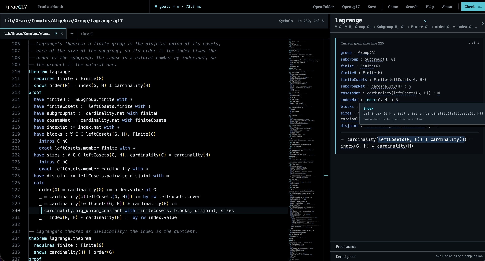
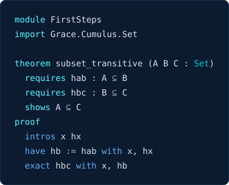
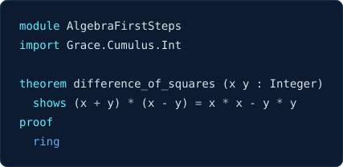

<p align="center">
  <picture>
    <source media="(prefers-color-scheme: dark)" srcset="workbench/assets/grace17-wordmark-dark.svg">
    
  </picture>
</p>

<p align="center"><strong>An open source proof assistant for mathematics based on set theory.</strong></p>

See the website [grace17.org](https://grace17.org) for documentation, the
mathematics library, and a live proof workbench in the browser, all generated
from this repository.

<p align="center">
  <a href="https://grace17.org/workbench/#file=lib%2FGrace%2FCumulus%2FAlgebra%2FGroup%2FLagrange.g17&line=210">
    
  </a>
</p>
<p align="center"><em>Lagrange's theorem in the Workbench. Click to open it live!</em></p>

Grace17 is a proof assistant in which every mathematical object is a set. A
group has a carrier set and operations, a function is a set of ordered pairs,
a quotient is a set of equivalence classes, and membership and equality are
propositions you use in proofs. My aim is for formally verified mathematics
to feel like ordinary mathematical practice: define a set, give it structure,
construct maps, form subsets, products, and quotients, and prove what follows
using the familiar rules of first-order logic and the ZF(C) axioms. There is
one universe and one equality, so everything you build now stays available
to everything you build next.

Set theory gives mathematics a singular ontology, organized by the iterative
conception: start from the empty set, form new sets from what is already
there, and continue through the transfinite. That combination of
unity and freedom is, to me, the gold standard foundation of classical
mathematics. Grace17 is my personal research project, and the question I am
investigating is: can set theory in first-order logic support a modern,
efficient, ergonomic proof assistant for people and AI systems alike, for the
everyday mathematics we write and teach and for mathematics increasingly
discovered with AI, where a proof may arrive from a machine and the human
work shifts to understanding it?

Grace17 is a research prototype, not a mature system like Lean, Isabelle or
ACL2, and it is evolving as I learn from building it and proving theorems in
it. Our mathematical library, **Cumulus**, is growing rapidly and includes
developments of set theory, ordinals and cardinals, order theory and
lattices, lists, number theory, combinatorics, finite probability, group
theory, commutative algebra, linear algebra, Euclidean geometry, graph
theory, topology, metric spaces, real and complex analysis, category theory,
fixed point theorems, and game theory, with forty-eight of the
[Top 100 theorems](docs/top-100.md) among them, from the Fundamental Theorem
of Calculus and the Fundamental Theorem of Algebra to the infinite Ramsey
theorem, Brouwer's fixed point theorem, and Nash equilibria for finite games.
It is early days but I believe the system has real promise. If this sounds
fun, I welcome your contributions!

Read the [introduction](docs/introduction.md), play the
[Set Theory Game](https://grace17.org/workbench/game.html), or open the
[Workbench](https://grace17.org/workbench/).

Created and maintained by Grant Olney Passmore. Released under the Apache
License 2.0.

## Try it

You need [Node.js](https://nodejs.org) 24 or later.

```sh
git clone https://github.com/grace17-prover/grace17.git
cd grace17
npm ci
npm run workbench
```

Open the local address the command prints. The Workbench is the full proof
assistant running in your browser: open a `.g17` file, move the cursor through
a proof, and watch the goals and hypotheses change. Nothing is sent to a
server. To check a file from the command line instead:

```sh
node bin/g17.ts check --foundation ZF --module-root lib examples/Introduction.g17
```

## A first proof

<p align="center"></p>

<details><summary>Plain text</summary>

```g17
module FirstSteps
import Grace.Cumulus.Set

theorem subset_transitive (A B C : Set)
  requires hab : A ⊆ B
  requires hbc : B ⊆ C
  shows A ⊆ C
proof
  intros x hx
  have hb := hab with x, hx
  exact hbc with x, hb
```
<!-- svg: first-proof -->

</details>

Read the statement as: let A, B, and C be sets; if A is a subset of B and B
is a subset of C, then A is a subset of C. `intros x hx` takes an arbitrary
member of A, each inclusion is applied to what it needs with `with`, and
the kernel checks every step.

Annotations such as `(f : A → B)` or `(x : Integer)` are soft types:
hypotheses that automation discharges from the evidence at hand. Automation
builds proofs the kernel then checks; here `ring` constructs a checked proof
of a polynomial identity over the integers:

<p align="center"></p>

<details><summary>Plain text</summary>

```g17
module AlgebraFirstSteps
import Grace.Cumulus.Int

theorem difference_of_squares (x y : Integer)
  shows (x + y) * (x - y) = x * x - y * y
proof
  ring
```
<!-- svg: ring -->

</details>

The [Introduction](docs/introduction.md) continues from here.

## What is here

| Directory | Contents |
| --- | --- |
| `src/` | The kernel, elaborator, tactics, proof machine, and Workbench backend, in TypeScript |
| `lib/Grace/Cumulus/` | Cumulus, the mathematics library |
| `lib/Grace/Core/`, `lib/Grace/Bootstrap/` | The computation bootstrap and the ZF foundation layer |
| `examples/` | Small checked files, one subject each, good for learning the language |
| `checkers/python/`, `checkers/ocaml/`, `checkers/rust/` | Independent proof checkers that share no code with the kernel |
| `conformance/` | The language-neutral corpus every checker must accept and reject identically |
| `workbench/` | The browser proof assistant and the Set Theory Game |
| `docs/` | Documentation, starting with [docs/README.md](docs/README.md) |
| `tests/` | The test suite |

## Trust

The trusted kernel is relatively small and well specified, with (at the
time of writing) three independent proof checkers. Tactics, proof search,
soft types, and the Workbench are untrusted: whatever they produce must pass
the kernel before a theorem is admitted.

Every admitted theorem has a certificate that can be exported as a compact
proof tape and replayed by independent proof checkers written in Python,
OCaml, and Rust. Each of them constructs the ZF, ZFC, or ZFG foundation
itself and replays all of Cumulus from it. If you want to contribute an
independent proof checker, please study
[docs/checker-semantics.md](https://github.com/grace17-prover/grace17/blob/main/docs/checker-semantics.md)
and use the conformance tests to help guide your work. I am especially
interested in working towards a verified proof checker; if you are
interested in helping on this, please get in touch!

The command line offers three foundations: **ZF**, **ZFC**, and **ZFG** (ZF
with a global choice selector, a conservative extension of ZFC). An axiom
audit reports which axioms and schema instances a proof depends on,
hereditarily, so you can see whether a theorem checked under ZFG used
Choice. Read [docs/soundness.md](docs/soundness.md) for the full account.

## Humans and AI on the same mathematics

Grace17 is designed so that AI agents and people can work on the same checked
mathematics. The command line produces JSON, proof states are structured
data, proofs can be exported and audited, and the library is searchable. A
proof suggested by an agent is admitted on the same terms as one written by
hand: it must check. People remain responsible for choosing the definitions
and statements that capture the intended mathematics.
[docs/agents.md](docs/agents.md) documents the interfaces an agent can use
and a working loop for proving with them. If you work with
[Claude Code](https://claude.com/claude-code), install the Grace17 skill
from inside it:

```sh
/plugin install grace17 --marketplace grace17-prover/grace17
```

## Contributing

Contributions are welcome. Please read
[CONTRIBUTING.md](CONTRIBUTING.md) first; it covers the development workflow,
Cumulus conventions, and the policy on AI-assisted work, and please remember
that Grace17 is my personal research project, and my goals may be different
from yours. If you work with a coding agent, point it at
[AGENTS.md](AGENTS.md). Concrete examples of proofs that are harder than they
should be are among the most useful things you can send.

## Citing Grace17

```bibtex
@misc{passmore2026grace17,
  author = {Passmore, Grant Olney},
  title  = {The {Grace17} proof assistant for mathematics based on set theory},
  year   = {2026},
  url    = {https://grace17.org},
  note   = {Source code at \url{https://github.com/grace17-prover/grace17}}
}
```

## License

Copyright (c) 2026 Grant Passmore. Licensed under the
[Apache License, Version 2.0](LICENSE).
