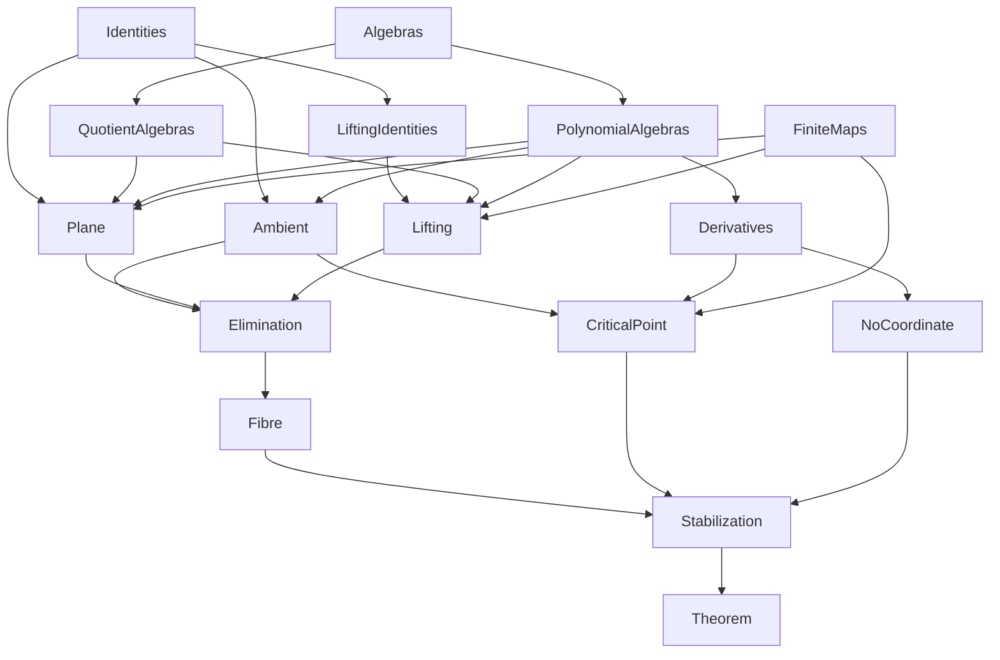

# An explicit noncoordinate polynomial with affine three-space zero fibre: blueprint

In ℂ[h, u, v, w] there is a polynomial F whose zero fibre is affine
three-space, ℂ[h, u, v, w] ⧸ (F) ≅ ℂ[3], and which is not a coordinate: no
automorphism of ℂ[h, u, v, w] sends a variable to F. The same F, read in
ℂ[4 + k], has the same two properties in every dimension at least four.
This blueprint plans its formalization in Cumulus as checked Grace17
modules: every definition here is final, every theorem is stated in full
and admitted with `sorry` unless already proved, and the import graph is
the dependency graph of the proof. The blueprint checks as it stands;
filling it in replaces admissions with proofs, one theorem at a time, and
`npm run blueprint:status` reports what remains.

```sh
npm run blueprint:check     # the whole blueprint elaborates
npm run blueprint:status    # theorems per module, proved and admitted
```

The module root is `blueprints/`; the modules are `AbhyankarSathaye.*`.
A module whose last admission goes is promoted into Cumulus under the home
named in its header, with its module line renamed and its imports made
relative, and is then held to the Cumulus rules: at most three imports for a
proof module, headers, and no admissions.

## The result

Abhyankar and Sathaye asked whether a polynomial whose zero set is an
affine space must be a coordinate. The source of this blueprint is a
September 2026 manuscript describing an explicit counterexample in four
variables, with a companion note and a formalization in another proof
assistant, which we consulted for the statements and the route but did not
port. With x = u³ + hv, y = −u² + hw, s = S(h, u, v, w) for the quartic
S = 2u³v + 3u⁴w + h(v² − 3u²w²) + h²w³, and p = P(x, y, s) for
P = −2s²x + 3sy² − 3s³y, the polynomial is F = h − p − 1. Three facts are
proved about it:

1. **The fibre is affine space.** ℂ[h, u, v, w] ⧸ (F) ≅ ℂ[3] as ℂ-algebras.
2. **F has a critical point.** At (h, u, v, w) = (2, 0, −1/2, 1/2) every
   partial derivative of F vanishes, and F = −1 there.
3. **F is not a coordinate.** A coordinate has no critical point, by the
   chain rule: if e(Xᵢ) = F for an automorphism e, differentiating
   e⁻¹(F) = Xᵢ and evaluating at the point gives 1 = 0.

And the whole stabilizes: in ℂ[4 + k] the same polynomial has fibre
ℂ[3 + k] and is not a coordinate.

## The proof

1. **Identities.** Three polynomial identities over every commutative ring:
   the cusp identity x² + y³ = hS with x, y, S as above; the shift identity
   (x + s³)² + (y − s²)³ = x² + y³ − sP(x, y, s); and a Bézout certificate
   αh + βy − 1 = (1 + 2s²x)(h − 1 − P) − 4s⁴(x² + y³ − sh) with explicit
   α, β. Composed, they give the ambient identity
   (x + s³)² + (y − s²)³ = s(1 + F) in ℂ[h, u, v, w]. All of these are
   closed by `ring`.
2. **Algebras.** The library content the statements need: algebras over a
   base ring as a structure (base, ring, structure map) with homomorphisms
   `f : A →ₐ B` and isomorphisms `f : A ≃ₐ B`; quotient algebras with the
   lift of a homomorphism that kills a finitely generated ideal; polynomial
   algebras with evaluation as the universal homomorphism, renaming of
   variables, transport along an isomorphism of base algebras, and the
   flattening K[m][n] ≅ K[m + n]; and partial derivatives with their rules
   and the chain rule.
3. **Lifting.** Over any commutative ring B with elements h, x, y, s
   satisfying x² + y³ = hs and αh + βy = 1, the presented algebra
   B[U, V, W] ⧸ (U³ + hV − x, −U² + hW − y, S(h, U, V, W) − s) is B[T], by
   T = αU + β(V + UW) and inverse formulas for U, V, W in T. The identities
   behind the two composites are proved with `linear_combination`.
4. **Plane.** Over any commutative ring K, the presented algebra
   K[h, x, y, s] ⧸ (h − 1 − P(x, y, s), x² + y³ − sh) is K[2], by
   s ↦ X₀² + X₁³, x ↦ X₀ − s³, y ↦ X₁ + s², h ↦ 1 + P.
5. **Elimination and the fibre.** ℂ[h, u, v, w] ⧸ (F) is the lifted algebra
   over the plane presentation B = ℂ[h, x, y, s] ⧸ (relH, relCusp), so by
   lifting, the plane presentation applied to coefficients, and flattening,
   it is ℂ[3].
6. **The critical point and the non-coordinate argument.** Evaluations at
   (2, 0, −1/2, 1/2); the derivative of the ambient identity gives the
   vanishing of every partial derivative of F; the chain rule for an
   algebra homomorphism between polynomial rings and the non-coordinate
   criterion.
7. **Stabilization.** F in ℂ[4 + k] by renaming, the point extended by
   zeros, and the fibre tensored with k more variables.

## Modules

| module | layer | home in Cumulus (relative to `Grace.Cumulus`) |
|---|---|---|
| Identities | 1 | AlgebraicGeometry/Coordinates/Identities |
| LiftingIdentities | 1 | AlgebraicGeometry/Coordinates/LiftingIdentities |
| Ambient | 1 | AlgebraicGeometry/Coordinates/Ambient |
| Algebras | 2 | Algebra/Algebra/Basic |
| QuotientAlgebras | 2 | Algebra/Algebra/Quotient |
| PolynomialAlgebras | 2 | Algebra/Polynomial/Algebra |
| Derivatives | 2 | Algebra/Polynomial/Derivative |
| FiniteMaps | 2 | Set/Function/Quadruples, Nat/Foundation |
| Lifting | 3 | AlgebraicGeometry/Coordinates/Lifting |
| Plane | 4 | AlgebraicGeometry/Coordinates/Plane |
| Elimination | 5 | AlgebraicGeometry/Coordinates/Elimination |
| Fibre | 5 | AlgebraicGeometry/Coordinates/Fibre |
| CriticalPoint | 6 | AlgebraicGeometry/Coordinates/CriticalPoint |
| NoCoordinate | 6 | AlgebraicGeometry/Coordinates/NoCoordinate |
| Stabilization | 7 | AlgebraicGeometry/Coordinates/Stabilization |
| Theorem | 7 | AlgebraicGeometry/Coordinates/Theorem |



## Conventions

- Rings are bundled objects under a `CommRing(R)` hypothesis, with `(x : R)`
  binders, `R[2]` for numerals, and `x ^ n` for powers; a polynomial ring
  is `polynomialRing(K, I)` with variables `X(K, I, j)` and constants
  `polynomialConstant(K, I)`, and numeral index sets `4`, `3`, `4 + k`
  stand for the variable lists.
- An algebra is `Algebra.mk(base, ring, map)`; `polynomialAlgebra(K, I)`,
  `quotientAlgebra(A, J)`, and `restrictScalars(A, K, ι)` build the ones
  the proof uses, and the isomorphisms are stated as `∃ e, e : A ≃ₐ B` or
  with the map named.
- Definitions made in a section take the section's ring as their first
  argument at use sites, `cuspS(R, h, u, v, w)`; the statements write
  elements with the ring's own notation, and the membership instances
  beside each definition let `typecheck`, `ring`, and the notation place
  them.
- Proofs follow the Cumulus style: readable steps, Unicode notation, lines
  within 80 columns where practical, and no proof much longer than its
  informal counterpart. Helper lemmas belong beside the statement they serve.
- Each agent works through the machine interface on one module at a time,
  never edits another module's statements, and reports ergonomic friction
  rather than working around it in the proof.

## Status

<!-- blueprint-status -->
| module | theorems | proved | admitted |
|---|---:|---:|---:|
| AbhyankarSathaye.Algebras | 21 | 21 | 0 |
| AbhyankarSathaye.Identities | 7 | 7 | 0 |
| AbhyankarSathaye.PolynomialAlgebras | 52 | 52 | 0 |
| AbhyankarSathaye.Ambient | 10 | 10 | 0 |
| AbhyankarSathaye.Derivatives | 61 | 61 | 0 |
| AbhyankarSathaye.FiniteMaps | 11 | 11 | 0 |
| AbhyankarSathaye.CriticalPoint | 10 | 0 | 10 |
| AbhyankarSathaye.QuotientAlgebras | 22 | 22 | 0 |
| AbhyankarSathaye.Plane | 27 | 0 | 27 |
| AbhyankarSathaye.LiftingIdentities | 21 | 18 | 3 |
| AbhyankarSathaye.Lifting | 16 | 0 | 16 |
| AbhyankarSathaye.Elimination | 17 | 0 | 17 |
| AbhyankarSathaye.Fibre | 5 | 0 | 5 |
| AbhyankarSathaye.NoCoordinate | 1 | 0 | 1 |
| AbhyankarSathaye.Stabilization | 7 | 0 | 7 |
| AbhyankarSathaye.Theorem | 3 | 0 | 3 |
| **total** | **291** | **202** | **89** |
<!-- /blueprint-status -->
