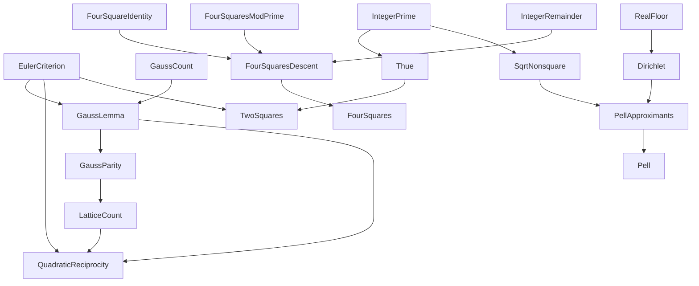

# Quadratic reciprocity, two squares, four squares, Pell: blueprint

Four theorems of elementary number theory, planned together because they
share one toolkit: congruences modulo a prime, the Wilson pairing, Thue's
pigeonhole, and Euler's product identities. The law of quadratic
reciprocity is proved by Gauss's lemma and Eisenstein's lattice count,
Fermat's theorem on sums of two squares by the first supplement and
Thue's lemma, Lagrange's four-square theorem by Euler's identity and
Fermat's descent, and the solvability of Pell's equation by Dirichlet's
approximation and a pigeonhole on codes. This blueprint plans the
formalization in Cumulus as checked Grace17 modules: every definition
final, every theorem stated in full and admitted with `sorry` until proved,
the import graph the dependency graph of the proof. The planned homes are
under `Grace.Cumulus.NumberTheory` except the floor, which goes to
`Grace.Cumulus.Real`.

```sh
npm run blueprint:check     # the four headline modules elaborate
npm run blueprint:status    # theorems per module, proved and admitted
```

The module root is `blueprints/`; the modules are `Arithmetic.*`, with
short names chosen to collide with no module of
`Grace.Cumulus.NumberTheory`. A module whose last admission goes is
promoted into Cumulus under the home named in its header, with its module
line renamed and its imports made relative, and is then held to the
Cumulus rules: at most three imports for a proof module, headers, and no
admissions. Once the final theorems are proved, rows 7, 19, 20, and 39 of
`docs/top-100.json` name them.

## The result

Odd primes are written `p = 2 * h + 1` throughout, so that `p − 1`, the
half range `1..h`, and the exponent of Euler's criterion never need
truncated subtraction. `QuadraticResidue(a, p)` says some natural x has
`x * x ≡ a (mod p)`; `SumOfFourSquares(n)` says n is a sum of four natural
squares. Four statements close the blueprint:

1. **`quadratic_reciprocity`.** For distinct odd primes `p = 2 * hp + 1`
   and `q = 2 * hq + 1`,
   `(QuadraticResidue(q, p) ↔ QuadraticResidue(p, q)) ↔ Even(hp * hq)`:
   the two residue statements agree unless both primes are 3 modulo 4,
   when exactly one holds. `quadratic_reciprocity.one_mod_four` and
   `quadratic_reciprocity.three_mod_four` state the two halves with the
   residues modulo 4.
2. **`fermat.two_squares`.** A prime p with `p % 4 = 1` is `a * a + b * b`
   for naturals a and b; `Prime.sum_of_two_squares_iff` says an odd prime
   is a sum of two squares exactly when it is 1 modulo 4.
3. **`lagrange.four_squares`.** Every natural n is
   `a * a + b * b + c * c + d * d` for naturals a, b, c, d.
4. **`pell.exists_nontrivial`.** For a natural d that is not a square,
   some naturals x and y with `0 < y` satisfy `x * x = d * (y * y) + 1`.

## The proof

The routes add the least theory: no Legendre symbol, no Gaussian
integers, no quotient ring of ℤ, no cyclicity of the units; every residue
statement is a congruence of naturals, and the counting is by the finite
cardinalities and weighted sums of `Cardinal`.

1. **Euler's criterion.** For p ∤ a, a square a has `a ^ h ≡ 1` by
   Fermat. A nonsquare a pairs each unit x with `a · x⁻¹ mod p`, never a
   fixed point; a list paired this way of length 2k has product `a ^ k`,
   so `1 · 2 ⋯ (p − 1) ≡ a ^ h`, and Wilson says the product is −1. The
   first supplement follows: `2 * h`, which is −1 modulo p, is a square
   exactly when h is even.
2. **Gauss's lemma.** The residues `a · k mod p` for k = 1..h, folded
   onto 1..h by `r ↦ p − r` when r > h, permute 1..h, so
   `a ^ h · h! ≡ (−1)^μ · h!` with μ the number of large residues, and
   `a ^ h ≡ 1` exactly when μ is even. The residue list is a list, μ is
   first a list count, and a bridge theorem identifies it with the
   cardinality of the Gauss set `{ k ∈ 1..h | h < (a k) mod p }`.
3. **Eisenstein's parity.** Writing `a k = p ⌊a k / p⌋ + r_k` and
   summing over 1..h, the folded residues sum to Σ k, and for odd a and
   odd p the parities give `μ ≡ Σ ⌊a k / p⌋ (mod 2)`.
4. **The lattice count.** `Σ_{k ≤ hp} ⌊q k / p⌋` counts the lattice
   points (k, j) of `1..hp × 1..hq` with `p j < q k`, and the other sum
   counts those with `q k < p j`; no point lies on the line, so the two
   sums add to `hp · hq`. The law is the parity bookkeeping of 2, 3, 4.
5. **Thue's lemma.** For `p < m²` and `m ≤ p`, the map
   `(x, y) ↦ a x − y mod p` on `m × m` collides; the difference of two
   colliding pairs is a nonzero pair of integers below m in absolute
   value with `a x ≡ y`. A natural form keeps x positive and leaves the
   sign of y as a disjunction of two congruences.
6. **Two squares.** For `p ≡ 1 (mod 4)` the first supplement gives
   `a² + 1 ≡ 0`; Thue with the least m with `p < m²` gives
   `x² + y² ≡ (1 + a²) x² ≡ 0` with `0 < x² + y² ≤ 2p`, and `2p` would
   make p a square, so `x² + y² = p`.
7. **Four squares, the prime case.** The h + 1 residues x² and the h + 1
   residues −1 − y² (x, y ≤ h) meet, so some `m p = a² + b² + 1` with
   `0 < m < p`. Descent: for `1 < m < p` with `m p` a sum of four squares,
   the least absolute residues of the four numbers modulo m have squares
   summing to `m r` with `0 < r < m` (the extreme cases force `m ∣ p`),
   and Euler's identity divided by m² writes `r p` as a sum of four
   squares; the least multiple is p itself.
8. **Four squares.** The product identity along a prime factorization.
9. **The floor.** `realFloor(X)` for a nonnegative real X is the least
   natural n with `X < n + 1`; the fractional part lies in [0, 1).
10. **Dirichlet.** The N + 1 values `⌊N · frac(y α)⌋` for y = 0..N lie in
    N boxes, so two fractional parts are within 1/N; their difference is
    `x − y α` for naturals x and `0 < y ≤ N`.
11. **Pell approximants.** `√d` is irrational for nonsquare d, so each
    pair (x, y) with y > 0 keeps a positive distance `|x − y √d|`, and
    Dirichlet's pair for a large N is new; the pairs with
    `|x² − d y²| < 3d` are unbounded in number, since
    `|x² − d y²| = |x − y √d| (x + y √d) < 2 √d + 1 ≤ 3d`.
12. **Pell.** Code each pair by `|x² − d y²|`, its sign, and the residues
    of x and y modulo it; among more than `2 (3d)⁴` pairs two share a code,
    and composing them, `(a c − d b e)/k` and `(a e − c b)/k`, solves
    `x² = d y² + 1` with y > 0.

## Modules

| module | layer | home in Cumulus (relative to `Grace.Cumulus`) |
|---|---|---|
| IntegerRemainder | 1 | NumberTheory/IntegerRemainder |
| IntegerPrime | 1 | NumberTheory/IntegerPrime |
| RealFloor | 1 | Real/Floor |
| EulerCriterion | 2 | NumberTheory/EulerCriterion |
| GaussCount | 2 | NumberTheory/GaussCount |
| Thue | 2 | NumberTheory/Thue |
| FourSquareIdentity | 2 | NumberTheory/FourSquareIdentity |
| FourSquaresModPrime | 2 | NumberTheory/FourSquaresModPrime |
| SqrtNonsquare | 2 | NumberTheory/SqrtNonsquare |
| Dirichlet | 2 | NumberTheory/Dirichlet |
| GaussLemma | 3 | NumberTheory/GaussLemma |
| TwoSquares | 3 | NumberTheory/TwoSquares |
| FourSquaresDescent | 3 | NumberTheory/FourSquaresDescent |
| PellApproximants | 3 | NumberTheory/PellApproximants |
| GaussParity | 4 | NumberTheory/GaussParity |
| FourSquares | 4 | NumberTheory/FourSquares |
| Pell | 4 | NumberTheory/Pell |
| LatticeCount | 5 | NumberTheory/LatticeCount |
| QuadraticReciprocity | 6 | NumberTheory/QuadraticReciprocity |



Library imports: `IntegerRemainder` takes
`NumberTheory.IntegerDivisibility`; `IntegerPrime` takes
`NumberTheory.IntegerDivisibility`, `NumberTheory.PerfectSquares`, and
`NumberTheory.CoprimeSquares`; `RealFloor` takes `Real.HarmonicSeries`
(for `Real.below_natural`), `Real.RootTwo` (for `realNat.lt_of_lt` and
`realNat.injective`), and `Nat.Least`; `EulerCriterion` takes
`NumberTheory.Wilson`, `NumberTheory.ModularMore`, and
`NumberTheory.CoprimeCancel`; `GaussCount` takes `NumberTheory.Wilson`,
`NumberTheory.ResidueLists`, and the root `Cardinal`; `GaussLemma` takes
`NumberTheory.CoprimeCancel`; `GaussParity` takes `Cardinal` and
`Nat.Division`; `LatticeCount` takes `Cardinal`; `Thue` takes
`Combinatorics.Pigeonhole` and `Nat.Least`; `TwoSquares` takes
`NumberTheory.PerfectSquares`; `FourSquareIdentity` takes the roots `Int`
and `Nat`; `FourSquaresModPrime` takes `Cardinal`,
`NumberTheory.ModularMore`, and `Combinatorics.Pigeonhole`; `FourSquares`
takes `NumberTheory.Factorization`; `SqrtNonsquare` takes `Real.Sqrt` and
`Real.RootTwo`; `Dirichlet` takes `Combinatorics.Pigeonhole` and
`Real.AbsoluteValue`; `PellApproximants` takes `Cardinal`; `Pell` takes
`Combinatorics.Pigeonhole` and `NumberTheory.IntegerDivisibility`. Every
proof module has at most three imports, a root counting as one.

## Conventions

- Odd primes are parametrized: every statement about an odd prime takes
  `(p h : Nat)` with `requires odd : p = 2 * h + 1`, and `p − 1` is
  written `2 * h`, the first supplement reads `QuadraticResidue(2 * h, p)`,
  and the half range is `halfRange(h) = { k ∈ succ(h) | 0 < k }`. The
  residue conditions modulo 4 appear only in the corollaries
  `quadratic_reciprocity.one_mod_four`, `three_mod_four`, and the
  two-squares statements, bridged by `oddPrime.one_mod_four_iff`.
- No `linarith` over ℤ. A probe registered an `OrderedRing(ℤ, integerAdd,
  integerZero, integerNeg, integerMul, integerOne, integerLeRelation)`
  instance with a relation set `integerLeRelation` built from `integerLe`.
  Under it `linarith` closes a goal `relates(integerLeRelation, a, b)`
  from the same hypothesis but not `relates(integerLeRelation, a,
  call2(integerAdd, b, integerOne))` from `relates(integerLeRelation, a, b)`
  ("no checked ordered-additive derivation"), and a goal written with the
  integer notation `a + 1 ≤ b` is the predicate `integerLe`, not a
  `relates` formula, so `linarith` falls back to `arith` and rejects it.
  So the blueprint states every integer bound in ℕ: `2 * integerNatAbs(y)
  ≤ m`, `integerNatAbs(x) < m`, `integerNatAbs(e * e + …) ≤ m * m`, and
  the descent, Thue, and Pell arguments transfer sizes through
  `integerNatAbs`, `integerLe.ofNat_iff`, and `arith`.
- Integer numerals are `0` and `1` only; `integerOfNat(m)`,
  `integerOfNat(m * m)` otherwise, and `-1` is the negation of `1`.
  Congruences in ℤ are `IntegerCongruent(integerOfNat(m), x, y)`;
  `integerMod(x, m)` is the natural remainder, defined by `defunique`,
  whose generated names `integerMod.exists`, `integerMod.unique`, and
  `integerMod.selected` are taken, so the uniqueness theorem is
  `integerMod.eq_of_below` (and `realFloor.eq_of_bounds` likewise). A
  `defunique` admitted in a blueprint needs both `proof` and `uniqueness`
  blocks, each `sorry`.
- Set-valued arithmetic is written in function form. A bound variable of
  `∀ k ∈ halfRange(h)`, a pair component `fst(q)`, a `cardinality(…)`, a
  `natSum(…)`, or a `defunique` value such as `modInverse(p, x)` has sort
  Set, and `*`, `+`, `-`, `%` beside it do not resolve ("cannot resolve
  notation * for operand types Nat, Set"); comprehensions, `defgraph`
  bodies, and sums of counts use `mul(a, k)`, `add(…)`, `sub(p, r)`,
  `mod(…, p)`: `gaussSet` is `{ k ∈ succ(h) | 0 < k ∧ h < mod(mul(a, k),
  p) }`, `gauss.parity` reads `Even(add(cardinality(…), natSum(…)))`, and
  the partner `a · x⁻¹ mod p` is the named function `pairPartner`. A
  typed binder `(k : Nat)` keeps the infix forms, so the `mem_iff` and
  `value` theorems restate each definition in infix notation.
- A `def` with a declared sort other than `Set` (`def sqrtNat (d : Nat) :
  Real`, `def squareBound (p : Nat) : Nat`, `def pairPartner … : Nat`)
  needs a proof block for its result type; the blueprint admits it with
  `sorry`. A `defgraph` admits its codomain proof the same way.
- Reals: `(realNat(n):R)` ascribes a natural into ℝ beside a real
  operand, `(0:R)` and `(1:R)` are the real numerals, `abs(…)` is the
  absolute value, `sqrtNat(d) := realSqrt(realNat(d))` is total, and the
  Dirichlet inequality is multiplied out, `abs(x − y α) * N < 1`, so no
  real division appears. `dirichletBox` carries α as a `Set` parameter
  with `requires real : Real(α)`.
- Lists versus sets. The residue machinery of `Euler` and `Wilson` is
  list-based (`factorialList`, `scaledList`, `multiplicity`, `∏`), while
  Eisenstein's count is a set cardinality and `natSum`. `GaussCount` is
  the bridge module: `largeCount` counts the large entries of a list,
  `largeCount.gaussSet` identifies that count on the residue list with
  `cardinality(gaussSet(a, p, h))`, and `foldedList.product_even/odd`
  turn the sign of the folding into congruences in ℕ. `PairedBy.product`
  takes the exact length `length{ℕ}(xs) = 2 * k` (a shorter paired list
  has product `a ^ j` for a smaller j).
- Beyond the audit, the modules add the helper statements a proof will
  want: `integerMod.ofNat/zero_iff`, `integerNatAbs.square_bound`,
  `Prime.square_mod_one/square_mod_zero/odd_half_positive`,
  `IsSquare.above_one_of_not`, `realFloor.of_natural/natural_le`,
  `realFrac.decomposition`, `QuadraticResidue.intro/mod_iff/of_congruent/
  mul`, `factorialList.length`, `pairPartner.*`,
  `factorialList.pairedBy`, `euler.nonresidue_iff`, `negOne.square`,
  `halfRange.*`, `gaussSet.*`, `gaussList.*`, `foldedList.permutes/
  product_factorial`, `factorial.coprime_prime`, `gauss.pow_even/pow_odd/
  residue_iff`, the weight graphs and sum identities of `GaussParity`,
  `lowerLattice`/`upperLattice` with `lattice.off_line/partition`,
  `floorWeights.le_half`, `Prime.not_divides_distinct`,
  `oddPrime.one_mod_four_iff/three_mod_four_iff`, `squareBound.*`,
  `thueMap.collision`, `thue.natural`, `Prime.one_mod_four_half`,
  `fermat.square_sum_multiple`, the `IntegerSumOfFourSquares` laws,
  `squareResidues.injective/image_count`, `residues.meet`,
  `fourSquares.cross_terms/quotient/residue_bound/extreme/no_extreme`,
  `SumOfFourSquares.all`, `sqrtNat.*`, `dirichletBox.collision/close/
  difference`, `pellPairs.mem_iff/subset/real_distance/gap/many_gap`,
  `pellCodes.*`, `pellDistance.*`, `pellCode.same/collision`.
- Changes from the audit: `Int/Remainder` is planned as
  `NumberTheory/IntegerRemainder`, since `IntegerCongruent` lives in
  `NumberTheory/Coprime`; `PairedBy.product` takes the exact length and
  `gcd(a, p) = 1`; `squareBound.le` takes `1 < p` (the least m with
  `1 < m²` is 2); the Gauss-lemma premises are `¬(p ∣ a)` throughout;
  `negOne.residue_iff` reads `QuadraticResidue(2 * h, p)`;
  `gauss.parity` takes `¬(p ∣ a)` as well as `Odd(a)`; the Pell code
  carries the sign of `x² − d y²`, so `pellCodes(M) = (M × 2) × (M × M)`
  and the collision needs more than `2 M⁴` pairs; `pell.compose` is
  stated in ℕ with the sign as a disjunction.
- Proofs follow the Cumulus style: readable steps, Unicode notation, lines
  within 80 columns, and no proof much longer than its informal
  counterpart. Each agent works through the machine interface on one
  module at a time, never edits another module's statements, and reports
  ergonomic friction rather than working around it in the proof.

## Status

<!-- blueprint-status -->
| module | theorems | proved | admitted |
|---|---:|---:|---:|
| Arithmetic.RealFloor | 16 | 1 | 15 |
| Arithmetic.Dirichlet | 8 | 3 | 5 |
| Arithmetic.EulerCriterion | 18 | 0 | 18 |
| Arithmetic.FourSquareIdentity | 10 | 0 | 10 |
| Arithmetic.FourSquaresModPrime | 13 | 6 | 7 |
| Arithmetic.IntegerRemainder | 12 | 1 | 11 |
| Arithmetic.FourSquaresDescent | 7 | 0 | 7 |
| Arithmetic.FourSquares | 3 | 0 | 3 |
| Arithmetic.GaussCount | 26 | 2 | 24 |
| Arithmetic.GaussLemma | 9 | 0 | 9 |
| Arithmetic.GaussParity | 25 | 15 | 10 |
| Arithmetic.IntegerPrime | 9 | 0 | 9 |
| Arithmetic.LatticeCount | 8 | 0 | 8 |
| Arithmetic.SqrtNonsquare | 8 | 0 | 8 |
| Arithmetic.PellApproximants | 7 | 0 | 7 |
| Arithmetic.Pell | 13 | 3 | 10 |
| Arithmetic.QuadraticReciprocity | 6 | 0 | 6 |
| Arithmetic.Thue | 12 | 3 | 9 |
| Arithmetic.TwoSquares | 5 | 0 | 5 |
| **total** | **215** | **34** | **181** |
<!-- /blueprint-status -->
