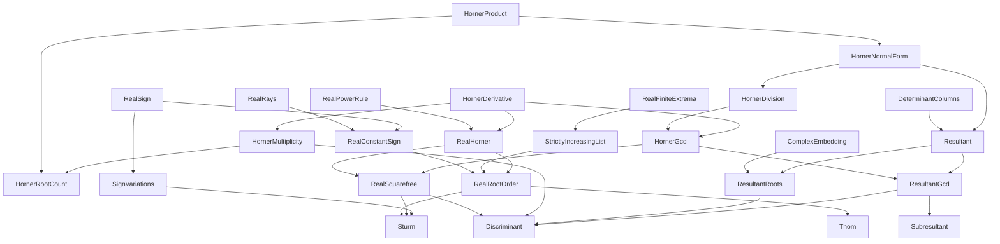

# Cylindrical algebraic decomposition: blueprint

The mathematics behind cylindrical algebraic decomposition and real
quantifier elimination, planned in five layers that share one
representation of a univariate polynomial: a Horner pair `(leading, cs)`
of a leading coefficient and the list of lower coefficients, over the
engine ring pieces `(A, add, zero, neg, mul, one)` and specialized to ℝ
by the bundled field `realRing`. Layer 1 is real univariate algebra:
derivatives, products, division with remainder, gcd and Bézout
coefficients, multiplicities, the polynomial function with its continuity
and derivative, signs, the roots in increasing order, the Cauchy bound,
and Rolle for polynomials. Layer 2 is root counting: sign variations,
the Sturm sequence and Sturm's theorem, and Thom's lemma. Layer 3 is
resultants and discriminants: the Sylvester matrix, the resultant with
its transport under ring homomorphisms and evaluation of polynomial
coefficients, its Bézout combination, its vanishing exactly at a common
factor over a field and at a common root over ℂ, the discriminant, and the
principal subresultant coefficients with the gcd-degree lemma. Layers 4
and 5 are to be written next and build on these definitions: layer 4
proves delineability over a connected set of parameters on which the
leading coefficient and all principal subresultant coefficients keep
their zero or nonzero status (Collins's projection), and layer 5 proves
the existence of a sign-invariant cylindrical algebraic decomposition for
every finite family in ℝ[x₁, …, xₙ] and that the projection of a
semialgebraic set is semialgebraic, the geometric Tarski–Seidenberg
theorem. This blueprint plans the formalization in Cumulus as checked
Grace17 modules: every definition final, every theorem stated in full and
admitted with `sorry` until proved, the import graph the dependency graph
of the proof.

```sh
npm run blueprint:check     # the headline modules elaborate
npm run blueprint:status    # theorems per module, proved and admitted
```

The module root is `blueprints/`; the modules are `CAD.*`, with short
names chosen to collide with no module of `Grace.Cumulus`. A module
whose last admission goes is promoted into Cumulus under the home named
in its header, with its module line renamed and its imports made
relative, and is then held to the Cumulus rules: at most three imports
for a proof module, headers, and no admissions.

## The result

A real polynomial is the pair `(leading, cs)` with `leading : Real` and
`cs : List(ℝ)`; its value at `X` is `horner(realRing, leading, X, cs)`,
its function is `hornerFunction(leading, cs) : ℝ → ℝ`, its roots are
`rootSet(realRing, leading, cs)`, and its declared degree is
`length{ℝ}(cs)`. The derivative pair is `(realDerivativeLeading(leading,
cs), realDerivativeList(cs))`. Four statements close the three layers:

1. **`sturm.theorem`.** For a squarefree pair with `leading ≠ 0` and
   `A < B` with `p(A) ≠ 0` and `p(B) ≠ 0`,
   `cardinality(rootSet(realRing, leading, cs) ∩ openInterval(A, B)) +
   sturmCount(leading, cs, B) = sturmCount(leading, cs, A)`: the number
   of roots in `(A, B)` is the drop of the Sturm count from `A` to `B`,
   where `sturmCount(leading, cs, X)` is the number of sign variations of
   the values at `X` of the Sturm sequence `p, p′, −rem(p, p′), …`.
2. **`thom.lemma`.** For two roots `X`, `Y` of a pair with `leading ≠ 0`,
   `SameDerivativeSigns(leading, cs, X, Y)`, which says that
   `realSign` of `p⁽ᵏ⁾` agrees at `X` and `Y` for every `k ≤ length{ℝ}(cs)`,
   forces `X = Y`; `thom.convex` says the points realizing one sign
   condition on all derivatives form a convex set.
3. **`resultant.zero_iff_common_root_complex`.** For pairs over ℂ with
   nonzero leading coefficients, `resultant(ℂ, a, cs, b, ds) = ℂ[0]`
   exactly when some `z ∈ ℂ` is a root of both; over a field,
   `resultant.zero_iff_common_factor` says the resultant vanishes exactly
   when the pairs have a common divisor of positive degree, and
   `realResultant.zero_iff_common_complex_root` reads a real resultant
   through the embedding `complexOfReal`.
4. **`principalSubresultant.zero_below_gcd_degree`** and
   **`principalSubresultant.nonzero_at_gcd_degree`.** Over a field with
   nonzero leading coefficients, `principalSubresultant(R, a, cs, b, ds, j)
   = R[0]` for every `j` below the degree of the gcd, and it is nonzero at
   that degree; `hornerGcd.length_eq_least_nonzero` states the degree as
   the least such index.

## The proof

1. **Lists.** The derivative pair of `(leading, c₀ :: cs)` is
   `(n·leading, [1·c₁, …, (n−1)·c_{n−1}])`, and its value satisfies
   `(c + X·p)′ = p + X·p′` (`hornerDerivative.value_cons`), which gives
   the analytic derivative by induction with the product rule, and the
   bridge `hornerPolynomial.derivative` to `partialDerivative` on the
   polynomial ring. The product `hornerMulList` is defined by
   `p·(d + X·q) = d·p + X·(p·q)` with a padded addition, so its value and
   its image in the polynomial ring follow by induction on the second
   list.
2. **Polynomials.** A pair is read as the element `hornerPoly` of the
   univariate polynomial ring `R[oneVariable]` in the variable `0`; two
   pairs are the same polynomial exactly when their coefficients
   `hornerCoefficient` agree, and over an infinite integral domain exactly
   when their values agree. A full coefficient list is brought to normal
   form by removing trailing zeros, so a nonzero pair has a nonzero
   leading coefficient.
3. **Division and gcd.** Long division from the low end: the dividend
   `c₀ + X·p₁` with `p₁ = q₁·d + r₁` gives the candidate `c₀ + X·r₁`, whose
   top coefficient divided by the leading coefficient of `d` is the next
   quotient coefficient, so quotient and remainder are a structural
   recursion on the list; the remainder keeps the length of the divisor's
   list. The Euclidean algorithm runs on normal forms with the length of
   the divisor as fuel; the gcd divides both pairs, is divided by every
   common divisor, and is a polynomial combination of the two. Coprime
   pairs are those with a Bézout identity equal to 1, squarefree pairs
   those coprime to their derivative, and the squarefree part is the
   quotient by the gcd with the derivative.
4. **Multiplicity and counting.** The multiplicity of a root `r` is the
   exponent `m` with `p(r + x) = x^m·h(x)`, `h(0) ≠ 0`, from
   `hornerTranslate` and `hornerAt.first_nonzero`; a root of multiplicity
   at least two is a root of the derivative, a simple root is not, and the
   roots number at most the degree, also counted with multiplicity.
5. **Analysis.** `hornerFunction` is continuous and differentiable with
   the derivative pair, through the power rule, the product rule, and the
   congruence of derivatives; the decreasing intermediate value theorem
   and the constancy of the sign of a continuous function without zeros
   on an interval or a ray give the sign of `p` between consecutive roots
   and beyond all roots, where it is the sign of the leading coefficient,
   times `(−1)^degree` on the left; the Cauchy bound confines the roots;
   Rolle gives a root of `p′` between two roots of `p`.
6. **Sturm.** The sequence is computed in normal form with the negated
   remainders; its last term divides every term and is a nonzero constant
   for a squarefree pair, so consecutive terms have no common root; at a
   root of a middle term its neighbors are negatives, so the count is
   locally constant away from the roots of `p`; across a root of `p` the
   count drops by one, since `p·p′` changes sign from negative to
   positive; the theorem follows by sweeping from `A` to `B`.
7. **Thom.** By induction on the degree: on a set where `p′` keeps a
   nonzero sign `p` is strictly monotone, so the realization of a sign
   condition on `p, p′, …` is convex, and two roots with the same
   condition would make `p` vanish on an interval.
8. **Resultants.** The Sylvester block matrix has rows of shifted
   coefficients in descending powers; the adjugate gives the Bézout
   combination `res = A·p + B·q`, so a common root kills the resultant;
   over a field, a nontrivial kernel of the Sylvester matrix is a pair
   `(A, B)` with `A·p = −B·q` of small degrees, which by Euclid's lemma is
   a common factor, and conversely a common factor gives a kernel vector,
   so the resultant vanishes exactly at a common factor; over ℂ the
   fundamental theorem of algebra splits `p` into linear factors and the
   resultant is `aⁿ` times the product of `q` over the roots of `p`. The
   discriminant is the resultant with the derivative pair, so it is
   nonzero exactly for squarefree pairs. The principal subresultant
   coefficients are the determinants of the Sylvester block matrices with
   `j` rows of each block and `2j` columns removed, and the gcd-degree
   lemma is the subresultant theorem: the `j`-th subresultant polynomial
   vanishes below the degree of the gcd and is a nonzero multiple of the
   gcd at that degree.

## Modules

| module | layer | home in Cumulus (relative to `Grace.Cumulus`) |
|---|---|---|
| HornerDerivative | 1 | Algebra/Polynomial/HornerDerivative |
| HornerProduct | 1 | Algebra/Polynomial/HornerProduct |
| HornerNormalForm | 1 | Algebra/Polynomial/HornerNormalForm |
| HornerDivision | 1 | Algebra/Polynomial/HornerDivision |
| HornerGcd | 1 | Algebra/Polynomial/HornerGcd |
| HornerMultiplicity | 1 | Algebra/Polynomial/HornerMultiplicity |
| HornerRootCount | 1 | Algebra/Polynomial/HornerRootCount |
| RealPowerRule | 1 | Real/Analysis/Polynomial |
| RealHorner | 1 | Real/Analysis/PolynomialFunction |
| RealSign | 1 | Real/Sign |
| RealFiniteExtrema | 1 | Real/FiniteExtrema |
| RealRays | 1 | Real/Analysis/OpenIntervals |
| RealConstantSign | 1 | Real/Analysis/IntermediateValue |
| StrictlyIncreasingList | 1 | List/RealSorted |
| RealSquarefree | 1 | Real/Analysis/PolynomialSquarefree |
| RealRootOrder | 1 | Real/Analysis/PolynomialRoots |
| SignVariations | 2 | Real/SignVariations |
| Sturm | 2 | Real/Analysis/Sturm |
| Thom | 2 | Real/Analysis/Thom |
| DeterminantColumns | 3 | Algebra/Ring/DeterminantColumns |
| Resultant | 3 | Algebra/Polynomial/Resultant |
| ResultantGcd | 3 | Algebra/Polynomial/ResultantGcd |
| ComplexEmbedding | 3 | Complex/Embedding |
| ResultantRoots | 3 | Complex/Resultant |
| Discriminant | 3 | Algebra/Polynomial/Discriminant |
| Subresultant | 3 | Algebra/Polynomial/Subresultant |



## Conventions

- Every operation is defined at engine level over the ring pieces,
  `def name {A : Set} (add zero neg mul one …) (cs : List(A))`, with
  closure and length theorems named `.data`, value theorems named
  `.value`, and transport under ring homomorphisms named `.map`, and is
  specialized to a bundled ring or to ℝ by a thin layer
  (`derivativeLeading(R, leading, cs)`, `mulList(R, a, b, cs, ds)`,
  `resultantOf(R, a, b, cs, ds)`, `realDerivativeLeading(leading, cs)`).
  The ring zero is the parameter `zero` in recursive definitions too,
  where it is a variable pattern; the zero of ℕ in the position of a
  decreasing natural is the pattern `0`.
- A definition over the variables of a section stands inside the
  section and is applied without them there: `hornerFunction(X)`,
  `rootMultiplicity(cs, r)`, `realGreatest`, `sturmCount(X)`,
  `derivativeSigns(X)(k)`, `mulList(a, b, cs, ds)`, and from outside
  with the section variables in front, `hornerFunction(leading, cs)(X)`,
  `rootMultiplicity(A, add, zero, neg, mul, one, leading, cs, r)`. A
  `defgraph` or `defunique` takes the section hypotheses as the
  premises of its laws, so the real modules keep `leading ≠ (0:R)` in a
  nested section `Nonzero` below the definitions, whose laws need only
  `Real(leading)` and `List(ℝ, cs)`. Instances stand in the same
  sections as the theorems; an instance takes the section's predicate
  hypotheses alone, so `sturmCount.natural` holds without `nonzero`.
- The univariate polynomial ring of a pair is `R[oneVariable]` with
  `oneVariable := 1`, named because a numeral index set inside a ring
  scope is read as the one of the ring. Equality of pairs as polynomials
  is equality of `hornerPoly`, divisibility `HornerDivides` is the
  existence of a cofactor there, coprimality `HornerCoprime` is a Bézout
  identity equal to 1, and `HornerSquarefree` is coprimality with the
  derivative pair.
- Quotients, remainders, and squarefree parts are full coefficient lists
  read with leading coefficient zero; a pair is brought to normal form by
  `normalLeading` and `normalLower`, which remove trailing zeros, so that
  the leading coefficient is nonzero unless the pair is zero. The gcd
  and the Sturm sequence are in normal form.
- Real statements take `(leading cs : Set)` with the hypotheses
  `Real(leading)`, `List(ℝ, cs)`, and `leading ≠ (0:R)` as section
  hypotheses; values are `hornerFunction(leading, cs)(X)`, and signs are
  `realSign`, with `(0:R)` for the real zero.
- Counts are naturals by declaration or by instance: `signVariations`
  has the result sort `Nat`, and `sturmCount.natural`,
  `rootMultiplicity.natural`, and `cardinality.nat` are instances, so
  `cardinality(S) + sturmCount(leading, cs, B)`, `sturmCount(Y) =
  sturmCount(Z) + 1`, `2 ≤ rootMultiplicity(cs, r)`, `length{A}(cs) *
  length{A}(ds)`, and `(length{A}(cs) + length{A}(ds)) - (2 * j)` are
  natural arithmetic as written, inside a ring section too; a numeral
  beside a ring element, `4 * (a * c)`, is the ring's. A trailing
  quantifier runs to the end of its formula, `… ∧ ∀ Y ∈ ℝ, ∀ Z ∈ ℝ, …`,
  and `(a, -b)` under the real and complex rings negates in ℝ by the
  sort of `b`.
- The Sylvester matrix of `(a, cs)` of declared degree `m` and `(b, ds)`
  of declared degree `n` has `n` rows of `p` then `m` rows of `q`, each
  row `i` of a block being `i` zeros followed by the coefficients from
  the top, so `resultant(R, one, [−r], b, ds) = q(r)` and
  `resultant(R, b, ds, a, cs) = (−1)^(mn)·resultant(R, a, cs, b, ds)`.
  The `j`-th subresultant matrix is the block matrix with `n − j` rows of
  `p`, `m − j` rows of `q`, and `m + n − 2j` columns. The discriminant is
  `resultant(p, p′)` with the derivative pair as it is, without the
  classical sign and division by the leading coefficient.

## Status

<!-- blueprint-status -->
| module | theorems | proved | admitted |
|---|---:|---:|---:|
| CAD.ComplexEmbedding | 23 | 6 | 17 |
| CAD.DeterminantColumns | 16 | 3 | 13 |
| CAD.HornerProduct | 30 | 30 | 0 |
| CAD.HornerNormalForm | 44 | 44 | 0 |
| CAD.Resultant | 25 | 3 | 22 |
| CAD.HornerDivision | 15 | 0 | 15 |
| CAD.HornerDerivative | 17 | 0 | 17 |
| CAD.HornerGcd | 21 | 0 | 21 |
| CAD.ResultantGcd | 4 | 0 | 4 |
| CAD.ResultantRoots | 8 | 0 | 8 |
| CAD.HornerMultiplicity | 13 | 1 | 12 |
| CAD.RealPowerRule | 23 | 23 | 0 |
| CAD.RealHorner | 31 | 31 | 0 |
| CAD.RealSquarefree | 9 | 0 | 9 |
| CAD.Discriminant | 10 | 0 | 10 |
| CAD.HornerRootCount | 8 | 3 | 5 |
| CAD.RealSign | 25 | 25 | 0 |
| CAD.RealRays | 10 | 10 | 0 |
| CAD.RealConstantSign | 13 | 13 | 0 |
| CAD.RealFiniteExtrema | 24 | 24 | 0 |
| CAD.StrictlyIncreasingList | 19 | 19 | 0 |
| CAD.RealRootOrder | 11 | 0 | 11 |
| CAD.SignVariations | 16 | 3 | 13 |
| CAD.Sturm | 30 | 3 | 27 |
| CAD.Subresultant | 11 | 0 | 11 |
| CAD.Thom | 9 | 3 | 6 |
| **total** | **465** | **244** | **221** |
<!-- /blueprint-status -->
