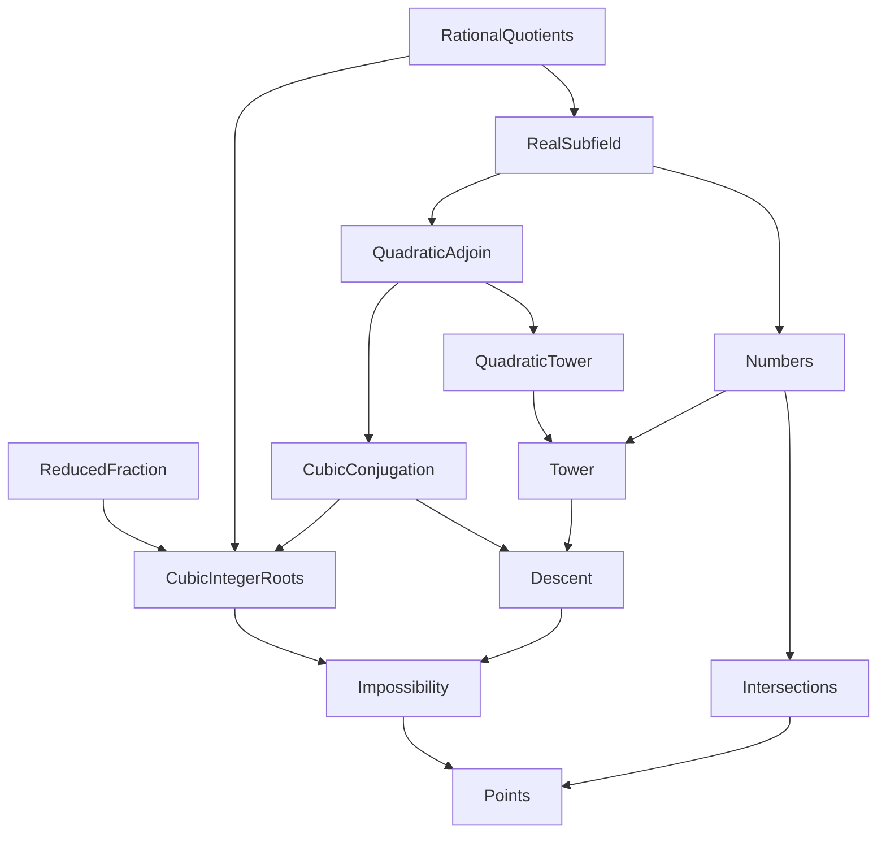

# Doubling the cube and trisecting the angle: blueprint

No number constructible with ruler and compass is a cube root of 2, and
none is the cosine of twenty degrees: the cube cannot be doubled and the
angle of sixty degrees cannot be trisected. This blueprint plans the
formalization in Cumulus as checked Grace17 modules: every definition
final, every theorem stated in full and admitted with `sorry` until proved,
the import graph the dependency graph of the proof. It is now proved in
full and promoted into Cumulus under the home named in each row below,
held to the Cumulus rules: at most three imports for a proof module,
headers, and no admissions. The constructions live under
`Grace.Cumulus.Geometry.Construction`, the field theory under
`Grace.Cumulus.Algebra.Field`, the number theory under
`Grace.Cumulus.NumberTheory`, and the rational quotients under
`Grace.Cumulus.Real`.

```sh
npm run blueprint:check     # the whole blueprint elaborates
npm run blueprint:status    # theorems per module, proved and admitted
```

The module root is `blueprints/`; the modules are `Constructible.*`. A
module whose last admission goes is promoted into Cumulus under the home
named in its header, with its module line renamed and its imports made
relative, and is then held to the Cumulus rules: at most three imports for
a proof module, headers, and no admissions. Once the final theorems are
proved, row 8 of `docs/top-100.json` names them.

## The result

A real number is constructible when it lies in every subset of ℝ that is
a subfield closed under square roots of its nonnegative elements; the
constructible numbers are the least such set. A point of the plane is
constructible when it lies in every set of points that holds (0, 0) and
(1, 0) and is closed under intersecting two lines, a line and a circle,
and two circles determined by its points. Four statements close the
blueprint:

1. **`doublingTheCube.impossible`.** No constructible x has x³ = 2.
2. **`trisection.impossible`.** No constructible x has 4x³ − 3x = 1/2.
   Since 4cos³θ − 3cosθ = cos 3θ and cos(π/3) = 1/2, a constructible
   cosine of twenty degrees would be such an x; the library has no cosine
   function yet, so the statement is the algebraic one.
3. **`doublingTheCube.no_point`.** No constructible point has abscissa
   x with x³ = 2.
4. **`trisection.no_point`.** No constructible point (x, y) of the unit
   circle has x³ − 3xy² = 1/2. On the unit circle x² + y² = 1 the real part
   x³ − 3xy² of the cube of the point is 4x³ − 3x, the cosine of three
   times its angle, and 1/2 is cos(π/3): the point would be at twenty
   degrees.

## The proof

The route is dimension-free: no vector spaces, no degrees of extensions,
only the conjugation of a single square root and descent through a tower.

1. **Lowest terms.** Every integer quotient p/q with q ≠ 0 is a coprime
   quotient, and a denominator coprime to p that divides p³ is ±1.
2. **Rationals as quotients.** A real x is rational exactly when
   x · q = p for integers p, q with q ≠ 0; the closure laws of
   `rationalReals` follow from this form and the laws of `realInt` alone,
   with no multiplicativity of the cut embedding needed.
3. **Subfields of ℝ.** `RealSubfield(F)` is a set of reals with 0 and 1
   closed under negation, sum, product, and inverses of nonzero elements;
   it contains every natural, every integer, and the rationals.
4. **Adjoining a square root.** `adjoinSqrt(F, d)` is the set of
   a + b√d with a, b ∈ F. For 0 ≤ d ∈ F it is a subfield: the inverse of
   a + b√d is (a − b√d)/(a² − b²d), and when √d ∉ F the coefficients of an
   element are unique, so a² − b²d ≠ 0.
5. **Conjugation.** For a monic cubic with coefficients in F and √d ∉ F,
   a root p + q√d has the conjugate root p − q√d; two distinct roots r, s
   give the third root −a − r − s by the identity
   (r − s)·f(−a − r − s) = (−a − 2s − r)·f(r) − (−a − 2r − s)·f(s); so a
   root in adjoinSqrt(F, d) yields a root in F, namely r itself when
   q = 0 or √d ∈ F, and −a − 2p otherwise.
6. **Towers.** A tower is a list of discriminants, the top first, each a
   nonnegative element of the field of the discriminants below it;
   `towerField` adjoins them in turn to the rationals. The field of a tower
   is a subfield, and two towers stack into one.
7. **Constructibles are tower numbers.** The union of all tower fields is
   constructibly closed (sums and products of elements of two towers live
   in the stacked tower; a square root extends the tower by one), so every
   constructible number lies in a tower field.
8. **Descent.** A rational cubic with a root in a tower field has a
   rational root, by induction on the tower with the conjugation lemma.
9. **Integer roots.** A rational root of a monic integer cubic is an
   integer; z³ ≠ 2 and z³ ≠ 3z + 1 for integers z, so x³ − 2 and
   x³ − 3x − 1 have no rational root.
10. **The theorem.** x³ = 2 is cubic(0, 0, −2, x) = 0, and
    4x³ − 3x = 1/2 is cubic(0, −3/4, −1/8, x) = 0, whose rational root s
    gives the rational root 2s of x³ − 3x − 1.
11. **Points.** The coordinates of an intersection lie in every
    constructibly closed set containing the coordinates of the defining
    points: two lines by a 2 × 2 linear system with determinant
    `directionCross`, a line and a circle by a quadratic in the line
    parameter, two circles by subtracting their equations. So the points
    with constructible coordinates form a construction-closed set, and the
    coordinates of every constructible point are constructible.

## Modules

| module | layer | home in Cumulus (relative to `Grace.Cumulus`) |
|---|---|---|
| ReducedFraction | 1 | promoted: NumberTheory/ReducedFraction |
| RationalQuotients | 1 | promoted: Real/RationalQuotients |
| RealSubfield | 2 | promoted: Algebra/Field/RealSubfield |
| QuadraticAdjoin | 3 | promoted: Algebra/Field/QuadraticAdjoin |
| Numbers | 3 | promoted: Geometry/Construction/Numbers |
| CubicConjugation | 4 | promoted: Algebra/Field/CubicConjugation |
| QuadraticTower | 4 | promoted: Algebra/Field/QuadraticTower |
| Intersections | 4 | promoted: Geometry/Construction/Intersections |
| CubicIntegerRoots | 5 | promoted: NumberTheory/CubicIntegerRoots |
| Tower | 5 | promoted: Geometry/Construction/Tower |
| Descent | 6 | promoted: Geometry/Construction/Descent |
| Impossibility | 7 | promoted: Geometry/Construction/Impossibility |
| Points | 8 | promoted: Geometry/Construction/Points |



Library imports: `ReducedFraction` takes
`Grace.Cumulus.NumberTheory.IntegerDivisibility`; `RationalQuotients`
takes `Grace.Cumulus.Real.Rationals` and `Grace.Cumulus.Real.Integer`;
`RealSubfield` takes `Grace.Cumulus.Real.Field` and
`Grace.Cumulus.Algebra.Ring.Subring`; `QuadraticTower` takes
`Grace.Cumulus.List.TakeDrop`; `Intersections` takes the root
`Grace.Cumulus.Geometry`, which reaches `Chords`, `Lines`, and
`LinearAlgebra.TwoByTwo` at once (on promotion into
`Geometry/Construction` these become relative imports, and the 2 × 2
solver may be inlined if the count matters).

## Conventions

- Fields are sets of reals and every statement is in real notation:
  `(x : Real)` binders, `(0:R)` numerals, `x * x * x` for a cube (the
  behavior of `realPow` under `ring` is unverified), `realInvValue(x)` for
  the inverse, `-(3:R) / (4:R)` for a rational constant. The bundled
  `realRing` appears only in the bridge `RealSubfield.subring`.
- `∀ x ∈ F` binds a set, so the field laws write `(x:R) + (y:R)`; a
  binder already typed `Integer` or `Nat` cannot be ascribed `R`, so
  integers and naturals enter ℝ as `realInt(q)` and `realNat(n)`
  (`RealSubfield.numeral_mem` and `Constructible.numeral` state
  `realNat(n)`), and integer constants beyond 0 and 1 are
  `integerOfNat(2)`, `integerOfNat(3)`.
- Square roots: definitions use the total `realSqrt(d)`, ascribed
  `(realSqrt(d):R)` where it is an operand, and statements write `√d`
  under a premise `(0:R) ≤ d` on a `(d : Real)` binder.
  `adjoinSqrt.contains` takes that premise too (x = x + 0 · realSqrt(d)
  needs the root real), as does `towerField.subset_append`, which takes
  both tower premises. `adjoinSqrt.intro` and `adjoinSqrt.cases` state
  membership in the `√d` form.
- Instances take predicate premises only: `x ∈ F` and `Constructible(x)`
  qualify, `x ≠ 0` and `(0:R) ≤ x` do not, so the inverse and quotient
  laws are theorems and `Constructible.sqrt` takes `NonnegativeReal(x)`,
  which also discharges the soft type of `√x`. An instance's variables
  must occur in its conclusion, so `RealSubfield.real` is a theorem.
- A quantifier after `∧` is parenthesized, `A ∧ (∀ x ∈ S, …)`; a negated
  existential is `¬(∃ …, … ∧ …)`; `adjoinSqrt.mem_iff` is named so because
  a comprehension generates its own `.membership`.
- Lists: `List(ℝ)` is a datatype predicate, not a set, so an existential
  reads `∃ ds, List(ℝ, ds) ∧ …`; `append(ds, es)` is es followed by ds
  (there is no `++`); `QuadraticTower` quantifies `∀ k < length(ds)` over
  the suffixes `listDrop(k, ds)` since a predicate cannot recurse.
- Geometry: `x` and `y` are the coordinate functions of
  `Grace.Cumulus.Geometry.Plane`, so the geometric modules name reals
  `t`, `u` and points `a`, `b`, `c`, `d`, `e`, `v`, `w`; coordinate
  premises are conjunctions `x(a) ∈ S ∧ y(a) ∈ S`; the nondegeneracy
  premises are `directionCross(a, b, c, d) ≠ 0`, `a ≠ b`, and `c ≠ e`
  for distinct centers.
- Beyond the audit, the modules add the helper statements a proof will
  want beside the result they serve: `rationalReals.real/sub_mem/div_mem/
  nat_mem`, `RealSubfield.subset/real/sub_mem/int_mem`,
  `realMulValue.eq_zero_or`, `cubic.split`, `QuadraticTower.head`,
  `towerField.nil/cons/subset_reals`, `constructibles.subset_reals`,
  `Constructible.sqrt_of_le/sub/div`, `towerReals.mem_iff`,
  `towerField.constructible`, `constructibles.eq_tower`,
  `cubic.no_rational_cube_root_two`, `cubic.no_rational_trisection_root`,
  `cubeRootTwo.not_constructible`, `ConstructiblyClosed.quadratic_root`,
  and `constructiblePoints.least/point/origin/unit`. The proofs added a
  few more: `realInt.nonzero`, `realNat.gap`,
  `rationalReals.of_scaled/of_quotient`, `realNumeral.subfield_mem`,
  `constructibles.intro`, `towerField.subset_append_right`,
  `QuadraticTower.append_subset`, `towerReals.subset_reals/of_tower/
  common_tower`, `cubic.tower_descent_all`,
  `ConstructiblyClosed.of_square_mem/circle_line_root`,
  `point.of_product/product_mem`, and the set `coordinatePoints` of points
  with constructible coordinates, with `mem_iff/unpack/intro/closed`.
- Proofs follow the Cumulus style: readable steps, Unicode notation, lines
  within 80 columns, and no proof much longer than its informal
  counterpart. Each agent works through the machine interface on one
  module at a time, never edits another module's statements, and reports
  ergonomic friction rather than working around it in the proof.

## Status

<!-- blueprint-status -->
| module | theorems | proved | admitted |
|---|---:|---:|---:|
| **total** | **0** | **0** | **0** |
<!-- /blueprint-status -->
