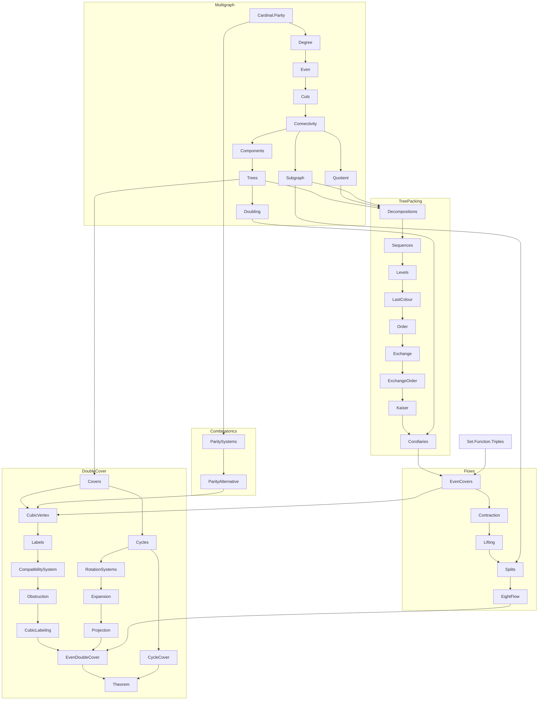

# The cycle double cover theorem: blueprint

Every bridgeless graph has a list of cycles such that every edge lies in
exactly two of them. This blueprint plans its formalization in Cumulus as
checked Grace17 modules: every definition here is final, every theorem is
stated in full and admitted with `sorry`, and the import graph is the
dependency graph of the proof. The blueprint checks as it stands; filling
it in replaces admissions with proofs, one theorem at a time, and
`npm run blueprint:status` reports what remains.

```sh
npm run blueprint:check     # the whole blueprint elaborates (complete: a note)
npm run blueprint:status    # theorems per module, proved and admitted
```

The module root is `blueprints/`; the modules are `CycleDoubleCover.*`.
A module whose last admission goes is promoted into Cumulus under the home
named in its header, with its module line renamed and its imports made
relative, and is then held to the Cumulus rules: at most three imports for a
proof module, headers, and no admissions.

Every module is promoted; the table below records where each went, and
[Complete](#complete) lists the library modules by layer.

## The proof

The source is Sang-il Oum's exposition of the July 2026 proof
(arXiv 2607.16356), with one change of route. The exposition reduces to
cubic 3-edge-connected graphs by a minimal counterexample, which rests on
Fleischner's splitting lemma; we instead expand every vertex of degree d
into a d-cycle, which makes the graph cubic without changing whether it is
bridgeless, and reduce the eight-flow theorem to the 3-edge-connected case
by contracting an edge of a cut of two edges. Both theorems the exposition
assumes are proved here: tree packing by Kaiser's elementary argument
(arXiv 0911.2809), and the eight-flow theorem from it.

1. **Graphs.** Edge sets of the existing multigraph model
   `Graph(V, E, leftEnd, rightEnd)` as a parity algebra: the degree of a
   vertex in an edge set counts edge ends, a loop contributing both; even
   edge sets are closed under symmetric difference; an even edge set crosses
   every cut an even number of times, so a bridge lies in no even edge set.
   Connectivity along an edge set, partitions of the vertex set and the
   quotient multigraph of a partition, forests and spanning trees with the
   fundamental even set and the one-edge exchange.
2. **Tree packing.** A k-decomposition is a colouring of the edges with k
   colours; the packing condition asks every partition of V to be joined by
   k(|P| − 1) edges. Kaiser's proof refines the trivial partition along the
   colours until every colour is internally connected, assigns each edge the
   level at which its ends part, and exchanges an edge of least level in a
   cycle of the last colour for one of lower level; the exchange improves the
   decomposition in the lexicographic order on the sequences of partitions
   and chosen colours, so a maximal decomposition into k trees and a rest
   has a connected rest, and a tree packing, k edge-disjoint spanning trees
   inside E, follows by induction on k.
   Corollaries: a 2k-edge-connected graph packs k trees; doubling every edge,
   a 3-edge-connected graph has three spanning trees with no common edge.
3. **Parity systems.** Linear algebra over the two-element field in the
   language of finite sets: a matrix is a relation between rows and columns,
   a vector a set of coordinates, and a row equation asks for the parity of a
   finite set. The alternative, that a system is solvable exactly when no
   left-kernel vector sees an odd right-hand side, is proved by eliminating
   one column at a time. This replaces the dimension argument of the
   exposition's consistency criterion and needs no vector-space theory.
4. **Flows.** A nowhere-zero flow in three copies of the two-element field is
   three even edge sets covering every edge; the value of an edge is the set
   of coordinates whose even set holds it. Three spanning trees with no
   common edge give one, by the even superset of each tree's complement;
   contracting an edge of a two-edge cut keeps a graph bridgeless and lifts a
   cover; so every finite bridgeless graph has one.
5. **Double covers.** Two-element labels on the edges with even local
   multiplicity give an even double cover; a cubic loopless graph with an
   even cover has such labels, by the compatibility system for the vertex
   vectors and the dual obstruction computation of the proof; a rotation
   system expands a bridgeless graph into a cubic bridgeless one; an even
   double cover of the expansion projects back; and every even edge set
   splits into cycles.

## Modules

| module | layer | home in Cumulus (relative to `Grace.Cumulus`) |
|---|---|---|
| Graphs.EdgeSets | 1 | promoted: Cardinal/Parity |
| Graphs.Degree | 1 | promoted: GraphTheory/Multigraph/Degree |
| Graphs.Even | 1 | promoted: GraphTheory/Multigraph/Even |
| Graphs.Cuts | 1 | promoted: GraphTheory/Multigraph/Cuts |
| Graphs.Connectivity | 1 | promoted: GraphTheory/Multigraph/Connectivity, GraphTheory/Multigraph/Quotient |
| Graphs.Trees | 1 | promoted: GraphTheory/Multigraph/Components, GraphTheory/Multigraph/Trees |
| TreePacking.Decompositions | 2 | promoted: GraphTheory/TreePacking/Decompositions, GraphTheory/Multigraph/Subgraph |
| TreePacking.Kaiser | 2 | promoted: GraphTheory/TreePacking/Sequences, GraphTheory/TreePacking/Levels, GraphTheory/TreePacking/LastColour, GraphTheory/TreePacking/Order, GraphTheory/TreePacking/Exchange, GraphTheory/TreePacking/ExchangeOrder, GraphTheory/TreePacking/Kaiser |
| TreePacking.Corollaries | 2 | promoted: GraphTheory/Multigraph/Doubling, GraphTheory/TreePacking/Corollaries |
| Parity.Systems | 3 | promoted: Combinatorics/ParitySystems, Combinatorics/ParityAlternative |
| Flows.EvenCovers | 4 | promoted: Set/Function/Triples, Nat/Foundation, GraphTheory/Flows/EvenCovers |
| Flows.Contraction | 4 | promoted: GraphTheory/Flows/Contraction, GraphTheory/Flows/Lifting |
| Flows.EightFlow | 4 | promoted: GraphTheory/Multigraph/Subgraph, GraphTheory/Flows/Splits, GraphTheory/Flows/EightFlow |
| DoubleCover.Covers | 5 | promoted: GraphTheory/DoubleCover/Covers, GraphTheory/DoubleCover/Cycles, GraphTheory/DoubleCover/CycleCover |
| DoubleCover.CubicLabeling | 5 | promoted: GraphTheory/DoubleCover/CubicVertex, GraphTheory/DoubleCover/Labels, GraphTheory/DoubleCover/CompatibilitySystem, GraphTheory/DoubleCover/Obstruction, GraphTheory/DoubleCover/CubicLabeling |
| DoubleCover.Expansion | 5 | promoted: GraphTheory/DoubleCover/RotationSystems, GraphTheory/DoubleCover/Expansion, GraphTheory/DoubleCover/Projection |
| DoubleCover.Theorem | 5 | promoted: GraphTheory/DoubleCover/EvenDoubleCover, GraphTheory/DoubleCover/Theorem |



## Complete

Every module of the blueprint is promoted. The graph layer became
`Grace.Cumulus.Cardinal.Parity` and `Grace.Cumulus.GraphTheory.Multigraph.*`
(`Degree`, `Even`, `Cuts`, `Connectivity`, `Quotient`, `Components`,
`Trees`), joined by `Subgraph` (the side of a vertex set with the end
functions restricted) and `Doubling` (every edge doubled). Tree packing is
`Grace.Cumulus.GraphTheory.TreePacking.*`: `Decompositions`, then Kaiser's
proof as the chain `Sequences`, `Levels`, `LastColour`, `Order`, `Exchange`,
`ExchangeOrder`, `Kaiser`, and `Corollaries`. Parity systems are
`Grace.Cumulus.Combinatorics.ParitySystems` and `.ParityAlternative`, with
the functions on three points in `Grace.Cumulus.Set.Function.Triples` and
`membership.three` beside `membership.two` in `Grace.Cumulus.Nat.Foundation`.
Flows are `Grace.Cumulus.GraphTheory.Flows.*`: `EvenCovers`, `Contraction`,
`Lifting`, `Splits`, `EightFlow`. Double covers are
`Grace.Cumulus.GraphTheory.DoubleCover.*`: `Covers`, `Cycles`, `CycleCover`;
`CubicVertex`, `Labels`, `CompatibilitySystem`, `Obstruction`,
`CubicLabeling`; `RotationSystems`, `Expansion`, `Projection`; and
`EvenDoubleCover` with `Theorem`, which states `cycleDoubleCover`. The
modules choosing base sums and cycle decompositions (`CubicLabeling`,
`CycleCover`, and what imports them) use `Set.Choice`, so the GraphTheory
entry point imports the rest and `Grace.Cumulus` imports `Theorem`.

## Conventions

- Statements name the graph by its four parts, as `Multigraph` does, and
  take finiteness and `Graph(V, E, leftEnd, rightEnd)` as hypotheses rather
  than building them into predicates, so each lemma says what it uses.
- Vectors over the two-element field are finite sets: the sum is `△`, the
  dot product the parity of the intersection, the span of p is `{∅, p}`.
  Flow values are subsets of `3`, label values subsets of `𝒫(3)`.
- Proofs follow the Cumulus style: readable steps, Unicode notation, lines
  within 80 columns where practical, and no proof much longer than its
  informal counterpart. Helper lemmas belong beside the statement they serve.
- Each agent works through the machine interface on one module at a time,
  never edits another module's statements, and reports ergonomic friction
  rather than working around it in the proof.

## Status

<!-- blueprint-status -->
| module | theorems | proved | admitted |
|---|---:|---:|---:|
| **total** | **0** | **0** | **0** |
<!-- /blueprint-status -->
