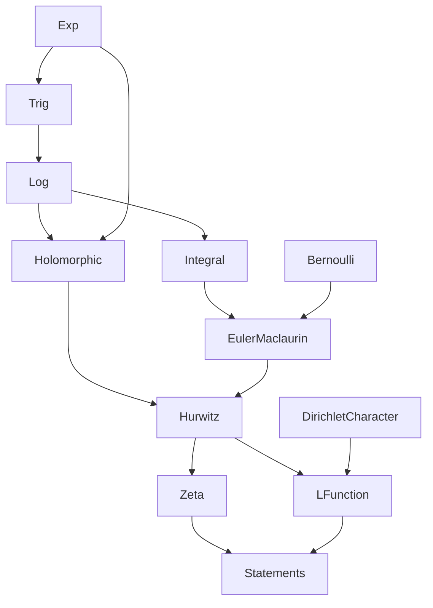

# The Generalized Riemann Hypothesis for Dirichlet L-functions: blueprint

Every zero of a Dirichlet L-function in the critical strip lies on the
line re s = 1/2; in particular the Riemann Hypothesis. This blueprint plans
a native formalization in Cumulus, checked by the Grace17 kernel from the
axioms of ZFC, with a certificate the independent checkers replay. It
follows a Lean 4 proof, ported rather than translated: the Lean text is a
guide to the mathematics and to the order of the work, and every
definition and proof is written in Grace17.

As with the other blueprints, each module states its definitions in final
form and its theorems in full, admitted with `sorry` until proved; the
import graph is the dependency graph of the proof; and a module whose last
admission goes is promoted into Cumulus under the home named in its
header. The module root is `blueprints/`; the modules are `GRH.*`.

```sh
npm run blueprint:status    # theorems per module, proved and admitted
```

## The source

The proof is Levent Alpöge's, written in Lean 4 with Claude, in the compact
edition of `lsernau/grh-lean` (directory `grh-compact`, commit `72fead1`,
Apache License 2.0), built on Mathlib at commit `56a00585`. That project
reports that its five theorems compile and replay in Lean's kernel using
only `propext`, `Classical.choice`, and `Quot.sound`, and that the proof
has been machine-checked only: no mathematician has read it through and
no paper accompanies it. A check by a second kernel from different
foundations is one reason to port it; the port is also where a reader
meets the argument one checked step at a time.

What the port faithfully states is the subject of [layer 1](#layer-1-the-statements);
what it proves follows `src/Lib` (background, about 51,000 lines of code)
and `src/New` (the argument, about 25,000), read in the order of
`GUIDE.md` in the source.

## Size

A static measurement of the source against Mathlib at the pinned commit
(identifiers resolved by name; spot checks put the matching at about 95%):

| quantity | size |
|---|---|
| the proof | 76,000 lines of code in 794 files, about 12,000 declarations |
| Mathlib declarations it uses directly | 13,000–15,000 |
| Mathlib it needs, declaration-level closure | about 250,000–400,000 lines |
| what the statements alone need | about 300 definitions; 10,000–60,000 lines with the facts they rest on |

The areas the closure falls in, largest first: commutative algebra, general
algebra, analysis, measure theory, topology, number theory, linear algebra,
category theory, algebraic geometry. Cumulus has real analysis through
Riemann integration and Taylor's theorem, algebra through polynomial rings
and quotients, metric and general topology, and cardinals; it has no
exponential, logarithm, or trigonometric function yet, no complex
differentiation, and no measure theory.

## Universes and large cardinals

All of `src/New` uses ordinary sets only. The Lean proof relies on universe
levels in one region: the functor-of-points étale and Hodge cohomology of
`src/Lib/Cohomology`, `src/Lib/PadicComparison`, and parts of
`src/Lib/General` (about 5,000 lines), where spaces are functors into
`Type 1` and Ext groups live a level higher. Schemes in `src/Lib/Shimura`
are used at the lowest level.

Where the port needs universes, it takes the hypothesis
`TarskiGrothendieck()` of `Grace.Cumulus.LargeCardinal.Axioms` as a section
hypothesis. The axiom audit reports every result that relies on it,
through its statement or its proof (`docs/axiom-audit.md`), so the reliance
stays visible all the way to the main theorems. The aim is a certificate
from ZFC alone: the source already works over small categories of test
rings in places, and the cohomology can be rebuilt over them. Until it is,
the main theorems read `TarskiGrothendieck() → …`, which is still a ZFC
certificate.

## Plan

The work proceeds in layers, each a set of blueprint modules that check as
they stand. A layer's statements are written before its proofs; a module
is proved and promoted before the modules that import it are proved.

1. **The statements.** The functions ζ and L(s, χ) on the whole complex
   plane, the five theorems stated, and the facts that pin the definitions
   down. Described in detail below; this layer is self-contained and
   useful on its own.
2. **Foundations the proof shares with the statements.** Measure and
   integration (Lebesgue measure on ℝ and ℝⁿ, the integral of
   complex-valued functions, Fubini), normed spaces, Fourier analysis on ℝ
   and on finite abelian groups, holomorphic functions with the identity
   theorem and the argument principle.
3. **Algebra and number theory.** Number fields and their rings of
   integers, places and completions, the different and discriminant,
   cyclotomic fields, class groups; p-adic numbers; matrix groups GLₙ and
   unitary groups over local and global fields; representations of finite
   and compact groups.
4. **`src/Lib`, area by area**, in the order its imports allow: class field
   theory (`ClassField`, `Cyclotomic`, `CM`), adelic analysis (`Adelic`,
   `LocalGL`, `GLn`, `DiscreteSeries`), the Weil representation and theta
   correspondence (`Weil`, `SiegelWeil`), Galois representations
   (`GaloisRep`, `PadicHodge`, `PadicComparison`), cohomology
   (`Cohomology`, under the large cardinal hypothesis as above), and
   Shimura varieties (`Shimura`).
5. **`src/New`, the argument**, in the order of the source's `GUIDE.md`:
   `Main` and `Endgame` stated first, then `Data`, then the parts serving
   its three main theorems A (short forms), B (enough forms), and C
   (integral forms are long), and the main inequality `star_inequality`
   that combines them.

Layer 1 is planned module by module below. Each later layer is planned the
same way, from the source and the declarations it uses, when the layer
before it is in place.

## Layer 1: the statements

The five theorems, as the source's `src/Statements.lean` and
`src/Main.lean` state them:

1. **`riemannHypothesis`.** Every zero s of ζ with s ≠ 1 and s not one of
   −2, −4, −6, … has re s = 1/2.
2. **`zeta.zeros_on_line`.** The same, stated with the trivial zeros as
   s = −2(n + 1).
3. **`LFunction.nonzero_right_of_half`.** For N ≥ 1, a Dirichlet
   character χ modulo N, and re s > 1/2: L(s, χ) ≠ 0, unless χ is the
   principal character and s = 1.
4. **`LFunction.zeros_on_line`.** For 0 < re s < 1, L(s, χ) = 0 implies
   re s = 1/2.
5. **`LFunction.zeros_on_line_primitive`.** The same for primitive χ.

All moduli and all characters are covered, primitive or not.

### The definitions

Mathlib defines ζ as the even Hurwitz zeta function at 0, through the
Mellin transform of a Jacobi theta function and a Bochner integral over
Lebesgue measure; that route needs measure theory before ζ can be written
down. The port defines the same functions by the Euler–Maclaurin
continuation, which needs only Riemann integrals over bounded intervals and
their limits, both in Cumulus already:

- For 0 < a ≤ 1 and s ≠ 1, the Hurwitz zeta function ζ(s, a) is the
  Euler–Maclaurin expression of order K for the series Σₙ (n + a)^(−s),
  with K taken large enough for re s (re s > 1 − 2K); a theorem shows the
  value does not depend on K. At s = 1 the Hurwitz function has a pole; its
  constant term at the pole is recorded separately as `hurwitzZeta.regular`.
- ζ(s) = ζ(s, 1).
- For a Dirichlet character χ modulo N, as Mathlib defines it,
  L(s, χ) = N^(−s) Σ_{j mod N} χ(j) ζ(s, j/N), the term j ≡ 0 read with
  a = 1. For χ other than the principal character the poles cancel, and
  L(1, χ) is the same sum with each ζ replaced by its regular part, which
  is the value of the continuous extension.

Faithfulness is then a matter of theorems, not of reading definitions:

- **`zeta.series`**, **`LFunction.series`**: for re s > 1, ζ(s) = Σ n^(−s)
  and L(s, χ) = Σ χ(n) n^(−s), absolutely convergent.
- **`zeta.holomorphic`**, **`LFunction.holomorphic`**: ζ is holomorphic on
  ℂ ∖ {1}; L(·, χ) is holomorphic on ℂ for χ not principal, and on ℂ ∖ {1}
  for χ principal.
- **`holomorphic.identity`**: two functions holomorphic on a connected
  open set that agree on a nonempty open subset agree everywhere.

Together these say that ζ and L(·, χ) are the analytic continuations of
their Dirichlet series, which determine them; a reader checks the
statements and these facts, not the Euler–Maclaurin formula. The value of
the principal L(·, χ) at s = 1, a pole, plays no part in the theorems.

### Modules

| module | contents | home in Cumulus (relative to `Grace.Cumulus`) |
|---|---|---|
| `GRH.Exp` | the exponential series on ℂ; exp(z + w) = exp z exp w; e^x on ℝ, increasing, onto (0, ∞) | Complex/Exp |
| `GRH.Trig` | sin, cos from exp; π as twice the least positive zero of cos; periodicity; e^(iθ) on the unit circle | Complex/Trig |
| `GRH.Log` | log on (0, ∞); the principal argument and logarithm on ℂ ∖ (−∞, 0]; x^s = exp(s log x) for x > 0, s ∈ ℂ, with its laws | Complex/Log, Complex/Power |
| `GRH.Holomorphic` | complex differentiability on open sets; sums, products, quotients, composition; power series are holomorphic; uniform limits on compact sets; the identity theorem | Complex/Holomorphic |
| `GRH.Integral` | improper Riemann integrals over [1, ∞) of complex-valued functions dominated by x^(−σ), σ > 1; differentiation under the integral sign for the parameter s | Real/Analysis/Integration/Improper |
| `GRH.Bernoulli` | Bernoulli numbers and polynomials, the periodic Bernoulli functions, and their bounds | NumberTheory/Bernoulli |
| `GRH.EulerMaclaurin` | the Euler–Maclaurin formula for Σ f(n + a) of order K, for f smooth on [a, ∞) | Real/Analysis/EulerMaclaurin |
| `GRH.Hurwitz` | ζ(s, a) by Euler–Maclaurin; independence of K; the series for re s > 1; holomorphy on ℂ ∖ {1}; the regular part at 1 | NumberTheory/Zeta/Hurwitz |
| `GRH.Zeta` | ζ(s) = ζ(s, 1); `zeta.series`, `zeta.holomorphic`; the trivial zeros | NumberTheory/Zeta/Riemann |
| `GRH.DirichletCharacter` | characters of (ℤ/Nℤ)ˣ extended by 0, the principal character, the conductor and primitivity, and orthogonality | NumberTheory/DirichletCharacter |
| `GRH.LFunction` | L(s, χ) through Hurwitz; `LFunction.series`, `LFunction.holomorphic`; the value at 1 | NumberTheory/Zeta/Dirichlet |
| `GRH.Statements` | the five theorems, admitted until layer 5 proves them | NumberTheory/GRH |



## Conventions

- Complex numbers are those of `Complex/Core`; a complex function on an
  open set is a set-theoretic function with its domain named, and
  holomorphy is a predicate on the function and the set, so each lemma
  says where it holds.
- A definition that needs a choice of parameter (the order K of the
  Euler–Maclaurin expansion) makes it explicitly and proves independence,
  rather than choosing it with a selector.
- Theorems that need universes take `TarskiGrothendieck()` as a section
  hypothesis, never as an axiom; the audit shows where it is relied on.
- Statements of layer 5 keep the source's names where they read well, so
  the Lean text can be followed beside the port, and say in a comment which
  source declaration they correspond to.
- Proofs follow the Cumulus style: readable steps, Unicode notation, lines
  within 80 columns where practical. Helper lemmas belong beside the
  statement they serve.
- Each agent works through the machine interface on one module at a time,
  keeps one `g17` process at a time, never edits another module's
  statements, and reports ergonomic friction rather than working around it
  in the proof.

## Status

<!-- blueprint-status -->
| module | theorems | proved | admitted |
|---|---:|---:|---:|
| GRH.Bernoulli | 176 | 176 | 0 |
| GRH.DirichletCharacter | 113 | 110 | 3 |
| GRH.Exp | 217 | 217 | 0 |
| GRH.Trig | 132 | 132 | 0 |
| GRH.Log | 108 | 108 | 0 |
| GRH.Holomorphic | 189 | 184 | 5 |
| GRH.Integral | 127 | 125 | 2 |
| GRH.EulerMaclaurin | 51 | 51 | 0 |
| GRH.Hurwitz | 198 | 198 | 0 |
| GRH.Zeta | 38 | 35 | 3 |
| GRH.LFunction | 68 | 63 | 5 |
| GRH.Statements | 7 | 4 | 3 |
| **total** | **1424** | **1403** | **21** |
<!-- /blueprint-status -->
