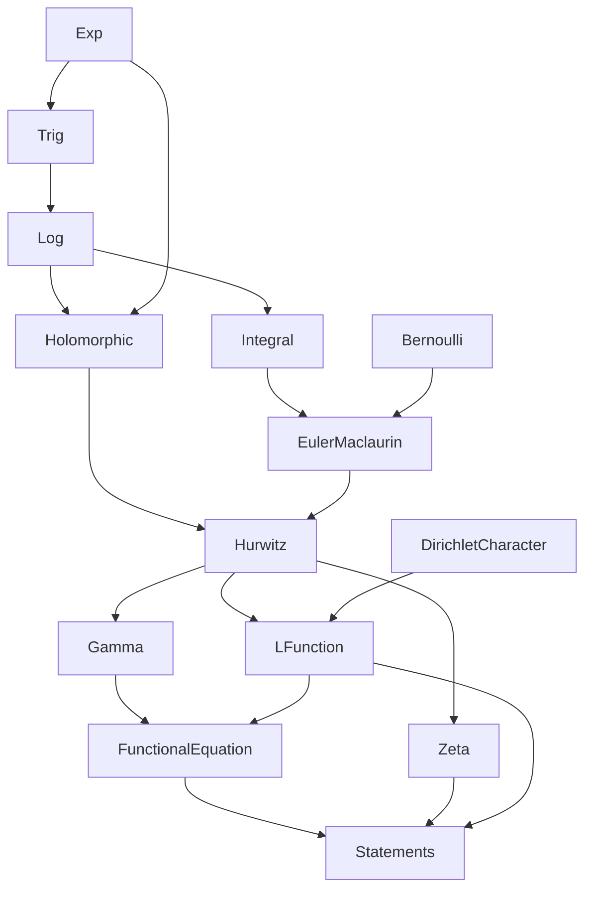

# The Generalized Riemann Hypothesis for Dirichlet L-functions: blueprint

Every zero of a Dirichlet L-function in the critical strip lies on the
line re s = 1/2; in particular the Riemann Hypothesis. This blueprint plans
a native formalization in Cumulus, checked by the Grace17 kernel from the
axioms of ZFC, with a certificate the independent checkers replay. It
follows a Lean 4 proof, ported rather than translated: the Lean text is a
guide to the mathematics and to the order of the work, and every
definition and proof is written in Grace17.

As with the other blueprints, each module states its definitions in final
form and its theorems in full, admitted with `sorry` until proved; the
import graph is the dependency graph of the proof; and a module whose last
admission goes is promoted into Cumulus under the home named in its
header. The module root is `blueprints/`; the modules are `GRH.*`.

```sh
npm run blueprint:status    # theorems per module, proved and admitted
```

## The source

The proof is Levent Alpöge's, written in Lean 4 with Claude, in the compact
edition of `lsernau/grh-lean` (directory `grh-compact`, commit `72fead1`,
Apache License 2.0), built on Mathlib at commit `56a00585`. That project
reports that its five theorems compile and replay in Lean's kernel using
only `propext`, `Classical.choice`, and `Quot.sound`, and that the proof
has been machine-checked only: no mathematician has read it through and
no paper accompanies it. A check by a second kernel from different
foundations is one reason to port it; the port is also where a reader
meets the argument one checked step at a time.

What the port faithfully states is the subject of [layer 1](#layer-1-the-statements);
what it proves follows `src/Lib` (background, about 51,000 lines of code)
and `src/New` (the argument, about 25,000), read in the order of
`GUIDE.md` in the source.

## Size

A static measurement of the source against Mathlib at the pinned commit
(identifiers resolved by name; spot checks put the matching at about 95%):

| quantity | size |
|---|---|
| the proof | 76,000 lines of code in 794 files, about 12,000 declarations |
| Mathlib declarations it uses directly | 13,000–15,000 |
| Mathlib it needs, declaration-level closure | about 250,000–400,000 lines |
| what the statements alone need | about 300 definitions; 10,000–60,000 lines with the facts they rest on |

The areas the closure falls in, largest first: commutative algebra, general
algebra, analysis, measure theory, topology, number theory, linear algebra,
category theory, algebraic geometry. Cumulus has real analysis through
Riemann integration and Taylor's theorem, algebra through polynomial rings
and quotients, metric and general topology, and cardinals; it has no
exponential, logarithm, or trigonometric function yet, no complex
differentiation, and no measure theory.

## Universes and large cardinals

All of `src/New` uses ordinary sets only. The Lean proof relies on universe
levels in one region, the functor-of-points étale and Hodge cohomology of
`src/Lib/Cohomology`, `src/Lib/PadicComparison`, and parts of
`src/Lib/General`, where spaces are functors on the category of all rings
and Ext groups live a level higher. Schemes in `src/Lib/Shimura` are used at
the lowest level.

The port needs no large cardinal: the region is written over a set of rings
that ZFC proves exists, as [Universes](#universes) below describes. The
certificate of GRH is meant to be a certificate from ZFC alone, and the
axiom audit (`docs/axiom-audit.md`) would show any reliance on a large
cardinal hypothesis all the way to the main theorems.

## Plan

The work proceeds in layers, each a set of blueprint modules that check as
they stand. A layer's statements are written, and reviewed for
faithfulness, before its proofs. Statements are then frozen: a module's
proofs may go ahead against the admitted statements of the modules it
imports, a change to another module's statement is an explicit request to
its owner, and promotion into Cumulus follows the import order.

1. **The statements** (complete; see [Layer 1](#layer-1-the-statements)).
2. **Analysis and general foundations**, in four independent tracks:
   A, linear algebra (modules, bases and dimension, duals, tensor products,
   exterior powers; matrices, determinants, GLₙ, SLₙ, unitary and
   symplectic groups, spectral facts); B, topology and analysis (filters and
   limits, compactness, topological groups, unconditional sums; normed,
   Banach and inner-product spaces; derivatives in several variables,
   analyticity, special functions); C, measure (σ-algebras, Lebesgue measure
   on ℝⁿ, the integral of nonnegative and of complex- and Banach-valued
   functions, dominated convergence, Fubini, change of variables; Haar
   measure; Fourier analysis on finite abelian groups, ℝⁿ and the torus);
   D, the L-series facts the proof uses about ζ and L(s, χ) (Euler
   products, nonvanishing on re s = 1, the von Mangoldt series, completed
   L-functions), proved for Layer 1's definitions.
3. **Algebra and number theory**, beside Layer 2: commutative algebra
   (ideals, local rings, finiteness, integral closure, DVRs, completions,
   flat and étale algebras), polynomials and power series, Galois theory and
   finite fields, cyclotomic fields and multiplicative characters, number
   fields (rings of integers, Dedekind domains, discriminants, places, CM
   fields, adeles), p-adic numbers, valuations, ℂ_p, Witt vectors and tilts,
   representations; and, for the cohomology region and Shimura varieties
   only, categories, abelian categories, Ext, and schemes.
4. **`src/Lib`.** Its folders import one another in cycles, so it is ported
   not by folder but in 83 module groups, each a set of source files whose
   imports form no cycle, built in stages S1 to S4 of the source's import
   order.
5. **`src/New`, the argument**, in 49 groups: `Main` and `Endgame` stated
   first, then the definitions (`Data`, `Seesaw.IndexTypes`,
   `Trace.GoodIdempotent`), then the groups serving the three main theorems
   A (short forms), B (enough forms), and C (integral forms are long), and
   the main inequality `star_inequality` that combines them. `Data` is a
   hypothesis bundle whose existence is proved once. The last step
   connects `New.grh` to `LFunction.nonzero_right_of_half`.

The module groups, their imports, the declarations each layer-2/3 theory is
used through, and the risks are recorded in the planning notes kept beside
the source measurement (`grh/plan/layers-2-5.md` in the campaign's scratch
directory). Estimated size: about 650,000 lines of Grace17 (450,000 to
1,100,000), from the measured 76,000 lines of Lean and the 182,000 lines of
Mathlib background Cumulus lacks.

### Universes

The cohomology region (`Lib/Cohomology`, `Lib/PadicComparison`, and the
parts of `Lib/General` they use, about 11,400 lines of Lean) works with
categories of rings and of algebras, which in Lean are categories of all
rings and so live one universe up. No construction in the region needs a
universe: there is no product, colimit, or sheafification over a proper
class, and every ring it builds has fewer than ℶ_ω elements. The rest of
the proof uses the region through theorems whose statements mention no
universe, chiefly `Model.exists_galois_rep`.

The port therefore needs no large cardinal. The region is written over the
set 𝒰 of rings whose carrier lies in V(ω·2), a stage of the cumulative
hierarchy that ZFC proves exists and in which Zermelo set theory holds.
Every category the region uses is cut from 𝒰: the test rings and their
over-categories, the Hodge, crystalline, and perfectoid test sites, and
the base rings (ℤ, ℚ̄, ℂ, ℂ_p, O_C, A_inf, A_max, B_cris). 𝒰 is closed under
the constructions the region performs, on the nose where they preserve
rank and up to isomorphism where they preserve only size: quotients,
localizations, residue fields, polynomial, Laurent, and monoid algebras,
finite and étale algebras, tensor products, products over sets built from
the inputs, subrings and unions of chains of subrings, algebraic closures,
valuation subrings and Galois hulls, p-adic completion and ultrapowers over
ℕ, Witt vectors, tilts, perfect closures and period thickenings,
square-zero extensions, rings of locally constant functions, and bounded
filtered colimits.

Writing the region over 𝒰 asks for a few changes to the Lean text: the
continuity condition ranges over diagrams of bounded size, as every use of
it already does; the ω-branching index type of the test envelopes is
encoded as a set of bounded rank; the `tangent` field of `Model` is
restated in terms of points rather than a functor category; one Zorn
argument over perfect algebras is bounded so that its chain lives in a set;
and Ext, defined by projective resolutions in functor categories on 𝒰,
comes with the comparison theorem, the horseshoe lemma, and enough
injectives. The read-only audit behind this paragraph, with file and line
references, is in the campaign's planning notes (`grh/plan/universe-audit.md`).

`Grace.Cumulus.LargeCardinal` remains available, and the audit would
report any reliance on its hypotheses, but the GRH certificate is meant to
use none.

## Layer 1: the statements

Layer 1 is proved except for the half-plane form of GRH,
`LFunction.nonzero_right_of_half`, which the later layers prove. Every
other theorem of its modules is proved, from the exponential series through
Cauchy's integral formula, Euler–Maclaurin summation, the Hurwitz and
Riemann zeta functions, Γ, Dirichlet characters and their L-functions,
Dirichlet's L(1, χ) ≠ 0, ζ(1 + it) ≠ 0, and the functional equations of ζ
and of L(s, χ). The five theorems below follow from the half-plane form,
and their audits list only the axioms of ZF and that one admission.
`GRH.Statements` and its whole import closure check under
`--foundation ZFC`.

The five theorems, as the source's `src/Statements.lean` and
`src/Main.lean` state them:

1. **`riemannHypothesis`.** Every zero s of ζ with s ≠ 1 and s not one of
   −2, −4, −6, … has re s = 1/2.
2. **`zeta.zeros_on_line`.** The same, stated with the trivial zeros as
   s = −2(n + 1).
3. **`LFunction.nonzero_right_of_half`.** For N ≥ 1, a Dirichlet
   character χ modulo N, and re s > 1/2: L(s, χ) ≠ 0, unless χ is the
   principal character and s = 1.
4. **`LFunction.zeros_on_line`.** For 0 < re s < 1, L(s, χ) = 0 implies
   re s = 1/2.
5. **`LFunction.zeros_on_line_primitive`.** The same for primitive χ.

All moduli and all characters are covered, primitive or not.

### The definitions

Mathlib defines ζ as the even Hurwitz zeta function at 0, through the
Mellin transform of a Jacobi theta function and a Bochner integral over
Lebesgue measure; that route needs measure theory before ζ can be written
down. The port defines the same functions by the Euler–Maclaurin
continuation, which needs only Riemann integrals over bounded intervals and
their limits, both in Cumulus already:

- For 0 < a ≤ 1 and s ≠ 1, the Hurwitz zeta function ζ(s, a) is the
  Euler–Maclaurin expression of order K for the series Σₙ (n + a)^(−s),
  with K taken large enough for re s (re s > 1 − 2K); a theorem shows the
  value does not depend on K. At s = 1 the Hurwitz function has a pole; its
  constant term at the pole is recorded separately as `hurwitzZeta.regular`.
- ζ(s) = ζ(s, 1).
- For a Dirichlet character χ modulo N, as Mathlib defines it,
  L(s, χ) = N^(−s) Σ_{j mod N} χ(j) ζ(s, j/N), the term j ≡ 0 read with
  a = 1. For χ other than the principal character the poles cancel, and
  L(1, χ) is the same sum with each ζ replaced by its regular part, which
  is the value of the continuous extension.

Faithfulness is then a matter of theorems, not of reading definitions:

- **`zeta.series`**, **`LFunction.series`**: for re s > 1, ζ(s) = Σ n^(−s)
  and L(s, χ) = Σ χ(n) n^(−s), absolutely convergent.
- **`zeta.holomorphic`**, **`LFunction.holomorphic`**: ζ is holomorphic on
  ℂ ∖ {1}; L(·, χ) is holomorphic on ℂ for χ not principal, and on ℂ ∖ {1}
  for χ principal.
- **`holomorphic.identity`**: two functions holomorphic on a connected
  open set that agree on a nonempty open subset agree everywhere.

Together these say that ζ and L(·, χ) are the analytic continuations of
their Dirichlet series, which determine them; a reader checks the
statements and these facts, not the Euler–Maclaurin formula. The value of
the principal L(·, χ) at s = 1, a pole, plays no part in the theorems.

### Modules

| module | contents | home in Cumulus (relative to `Grace.Cumulus`) |
|---|---|---|
| `GRH.Exp` | the exponential series on ℂ; exp(z + w) = exp z exp w; e^x on ℝ, increasing, onto (0, ∞) | Complex/Exp |
| `GRH.Trig` | sin, cos from exp; π as twice the least positive zero of cos; periodicity; e^(iθ) on the unit circle | Complex/Trig |
| `GRH.Log` | log on (0, ∞); the principal argument and logarithm on ℂ ∖ (−∞, 0]; x^s = exp(s log x) for x > 0, s ∈ ℂ, with its laws | Complex/Log, Complex/Power |
| `GRH.Holomorphic` | complex differentiability on open sets; sums, products, quotients, composition; power series are holomorphic; uniform limits on compact sets; the identity theorem | Complex/Holomorphic |
| `GRH.Integral` | improper Riemann integrals over [1, ∞) of complex-valued functions dominated by x^(−σ), σ > 1; differentiation under the integral sign for the parameter s | Real/Analysis/Integration/Improper |
| `GRH.Bernoulli` | Bernoulli numbers and polynomials, the periodic Bernoulli functions, and their bounds | NumberTheory/Bernoulli |
| `GRH.EulerMaclaurin` | the Euler–Maclaurin formula for Σ f(n + a) of order K, for f smooth on [a, ∞) | Real/Analysis/EulerMaclaurin |
| `GRH.Hurwitz` | ζ(s, a) by Euler–Maclaurin; independence of K; the series for re s > 1; holomorphy on ℂ ∖ {1}; the regular part at 1 | NumberTheory/Zeta/Hurwitz |
| `GRH.Zeta` | ζ(s) = ζ(s, 1); `zeta.series`, `zeta.holomorphic`; the trivial zeros | NumberTheory/Zeta/Riemann |
| `GRH.DirichletCharacter` | characters of (ℤ/Nℤ)ˣ extended by 0, the principal character, the conductor and primitivity, and orthogonality | NumberTheory/DirichletCharacter |
| `GRH.LFunction` | L(s, χ) through Hurwitz; `LFunction.series`, `LFunction.holomorphic`; the value at 1 | NumberTheory/Zeta/Dirichlet |
| `GRH.Gamma` | Γ on ℂ ∖ {0, −1, −2, …} through the entire 1/Γ of Gauss's limit; Γ(s + 1) = sΓ(s), Γ(n + 1) = n!, Γ(1/2) = √π; holomorphy, no zeros; reflection, duplication, Euler's integral | Complex/Gamma |
| `GRH.FunctionalEquation` | ξ(s) = ξ(1 − s) and the asymmetric form for ζ; Hurwitz's formula; Gauss sums, \|τ(χ)\|² = N; Λ(s, χ) = ε(χ) Λ(1 − s, χ̄) for χ primitive; the trivial zeros; zeros in the strip reflect to 1 − s | NumberTheory/Zeta/FunctionalEquation |
| `GRH.Statements` | the five theorems, admitted until layer 5 proves them | NumberTheory/GRH |



## Conventions

- Complex numbers are those of `Complex/Core`; a complex function on an
  open set is a set-theoretic function with its domain named, and
  holomorphy is a predicate on the function and the set, so each lemma
  says where it holds.
- A definition that needs a choice of parameter (the order K of the
  Euler–Maclaurin expansion) makes it explicitly and proves independence,
  rather than choosing it with a selector.
- Theorems that need universes take `TarskiGrothendieck()` as a section
  hypothesis, never as an axiom; the audit shows where it is relied on.
- Statements of layer 5 keep the source's names where they read well, so
  the Lean text can be followed beside the port, and say in a comment which
  source declaration they correspond to.
- Proofs follow the Cumulus style: readable steps, Unicode notation, lines
  within 80 columns where practical. Helper lemmas belong beside the
  statement they serve.
- Each agent works through the machine interface on one module at a time,
  keeps one `g17` process at a time, never edits another module's
  statements, and reports ergonomic friction rather than working around it
  in the proof.

## Status

<!-- blueprint-status -->
| module | theorems | proved | admitted |
|---|---:|---:|---:|
| GRH.Linear.Modules | 313 | 313 | 0 |
| GRH.Linear.Dimension | 130 | 125 | 5 |
| GRH.Matrix.Basic | 239 | 239 | 0 |
| GRH.Linear.Exterior | 51 | 10 | 41 |
| GRH.Matrix.Determinant | 164 | 163 | 1 |
| GRH.Algebra.Divisibility | 94 | 0 | 94 |
| GRH.Algebra.Ideals | 152 | 0 | 152 |
| GRH.Algebra.Localization | 58 | 1 | 57 |
| GRH.Algebra.LocalRings | 45 | 0 | 45 |
| GRH.Matrix.Spectral | 72 | 56 | 16 |
| GRH.Polynomial.Univariate | 96 | 6 | 90 |
| GRH.Linear.Dual | 81 | 81 | 0 |
| GRH.Linear.Tensor | 186 | 175 | 11 |
| GRH.Polynomial.Multivariate | 69 | 1 | 68 |
| GRH.Algebra.Finiteness | 76 | 1 | 75 |
| GRH.Algebra.Completion | 37 | 0 | 37 |
| GRH.Algebra.Integral | 37 | 0 | 37 |
| GRH.Algebra.DVR | 37 | 1 | 36 |
| GRH.Algebra.Flat | 31 | 0 | 31 |
| GRH.Bernoulli | 176 | 176 | 0 |
| GRH.Exp | 217 | 217 | 0 |
| GRH.Trig | 132 | 132 | 0 |
| GRH.Log | 108 | 108 | 0 |
| GRH.Holomorphic | 515 | 515 | 0 |
| GRH.Integral | 154 | 154 | 0 |
| GRH.Topology.Filters | 116 | 116 | 0 |
| GRH.Topology.Compactness | 67 | 31 | 36 |
| GRH.Topology.Groups | 58 | 25 | 33 |
| GRH.Topology.Sums | 138 | 137 | 1 |
| GRH.Normed.Groups | 118 | 110 | 8 |
| GRH.Calculus.Analytic | 40 | 5 | 35 |
| GRH.Normed.Spaces | 60 | 53 | 7 |
| GRH.Normed.InnerProduct | 86 | 62 | 24 |
| GRH.Calculus.Frechet | 51 | 32 | 19 |
| GRH.DirichletCharacter | 188 | 188 | 0 |
| GRH.EulerMaclaurin | 51 | 51 | 0 |
| GRH.Hurwitz | 198 | 198 | 0 |
| GRH.Gamma | 229 | 229 | 0 |
| GRH.Zeta | 98 | 98 | 0 |
| GRH.LFunction | 229 | 229 | 0 |
| GRH.FunctionalEquation | 494 | 494 | 0 |
| GRH.Fourier.FiniteAbelian | 29 | 0 | 29 |
| GRH.Measure.Spaces | 145 | 5 | 140 |
| GRH.Measure.Lebesgue | 96 | 0 | 96 |
| GRH.Measure.LIntegral | 60 | 0 | 60 |
| GRH.Measure.Bochner | 100 | 0 | 100 |
| GRH.Measure.Product | 42 | 0 | 42 |
| GRH.Measure.ChangeOfVariables | 30 | 0 | 30 |
| GRH.Measure.Haar | 56 | 0 | 56 |
| GRH.Fourier.Euclidean | 26 | 0 | 26 |
| GRH.Fourier.Torus | 21 | 0 | 21 |
| GRH.LSeries.Dirichlet | 98 | 28 | 70 |
| GRH.LSeries.Completed | 73 | 21 | 52 |
| GRH.LSeries.NonVanishing | 50 | 12 | 38 |
| GRH.LSeries.VonMangoldt | 53 | 15 | 38 |
| GRH.SpecialFunctions.More | 81 | 13 | 68 |
| GRH.LSeries.Values | 32 | 13 | 19 |
| GRH.Matrix.Groups | 92 | 82 | 10 |
| GRH.Polynomial.PowerSeries | 71 | 1 | 70 |
| GRH.Statements | 7 | 6 | 1 |
| **total** | **6653** | **4728** | **1925** |
<!-- /blueprint-status -->
