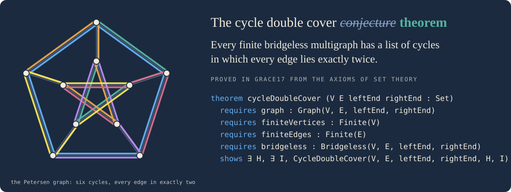
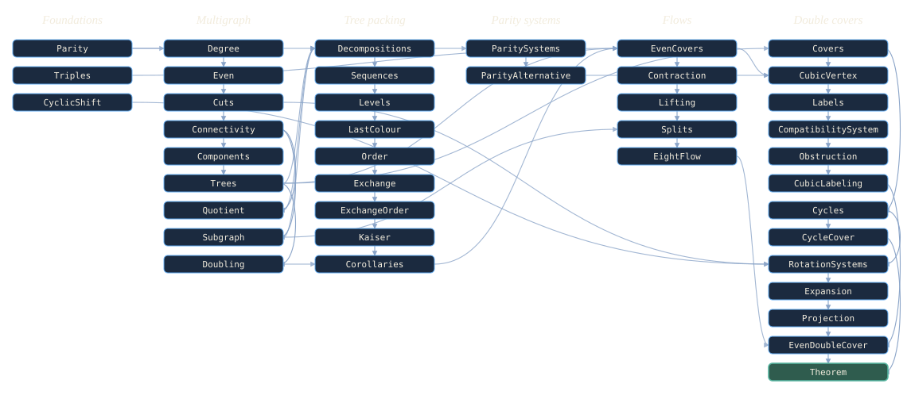

# An adventure in multifoundational Mathematics 2.0: the cycle double cover theorem in Grace17

<p class="byline"><span><a class="profile" href="http://www.cl.cam.ac.uk/~gp351/" data-name="Grant Olney Passmore" data-photo="images/profiles/grant-passmore.jpg" data-line="www.cl.cam.ac.uk/~gp351" data-contact="Z3JhbnRAZ3JhY2UxNy5vcmc=">Grant Passmore</a><br><time datetime="2026-10-30">30 October 2026</time></span></p>

<div class="preface">

If you have arrived here directly, welcome. Grace17 is a proof assistant for
mathematics based on set theory: a small trusted kernel for classical ZFC, a
modern elaborator and proof language above it, a library called
[Cumulus](cumulus.md) that runs from the axioms through analysis, algebra,
topology, and combinatorics, and a browser Workbench in which every proof opens
and can be stepped through interactively (including natural deduction proofs
from the axioms of set theory). I am building it because I want a mainstream
proof assistant that is ergonomic and efficient and whose foundation is ZFC in
first-order logic with equality. Please see the [Introduction](introduction.md)
for more background on the system and what I'm hoping to achieve. Now, onto the
cycle double cover theorem!

</div>

<div class="section-mark" aria-hidden="true"><span>§</span></div>



Every finite bridgeless multigraph has a list of cycles in which every edge
lies exactly twice. George Szekeres asked whether this is so in 1973, and Paul
Seymour asked it again in 1979, and for half a century it was an open problem.
Major progress was made by Jaeger, Alspach, Goddyn, Zhang, and Huck: Jaeger
showed that it is enough to settle the snarks, Alspach, Goddyn, and Zhang
settled every graph with no Petersen minor, and Huck showed that a smallest
counterexample would have girth at least twelve. Then, in July 2026, a model at
OpenAI found a proof, and the proof was written down, checked in Lean 4, and
further polished for human understanding by Sang-il Oum. Grace17 now proves it
too, from the axioms of set theory. The theorem is
[`Grace.Cumulus.GraphTheory.DoubleCover.Theorem.cycleDoubleCover`](../lib/Grace/Cumulus/GraphTheory/DoubleCover/Theorem.g17),
and the forty modules under it are our library [Cumulus](cumulus.md)'s
developments of graph theory, including edge sets, cuts, components, tree
packings, flows over the two-element field, and double covers.

This page is my account of how the proof was planned and carried out, and of
what I learned about doing a proof of this size in Grace17. The short version:
a blueprint written in an afternoon, based on Oum's exposition and the Lean
proof, five layers proved by agents using the [Grace17 agent
interface](agents.md) in about nine hours of agent time across a day and a
half, 521 theorems in forty-one modules, a certificate that an independent
Grace17 proof checker replays from axioms of set theory in under three seconds,
and a theorem whose statement is a formula of ZF. Needless to say, I believe
this is an encouraging result :-).

## How the problem was chosen

I wanted a challenge problem for Grace17: a recent substantial AI-assisted
result with a published proof, big enough that both our mathematical library
Cumulus and Grace17's core elaboration and proof automation would be stressed
and likely have to grow in the process. I asked Tim Chow for a suggestion, and
he proposed the cycle double cover conjecture (thank you, Tim!). It was a great
choice. It is a substantial recent result in graph theory which is deep but not
too large in terms of its dependencies, it was obtained in a "Mathematics 2.0"
fashion, it has both a Lean formalization and an exposition written to improve
human understanding of the proof, and almost none of its dependencies were in
[Cumulus](cumulus.md).

On 10 July 2026 OpenAI announced a proof found by its model GPT-5.6 Sol Ultra
and published the proof, the prompt, and a Lean 4 formalization,
[`openai/cdc-lean`](https://github.com/openai/cdc-lean), whose main theorem
`CDCLean.cycleDoubleCover_of_bridgeless` is checked from first principles for
finite loopless bridgeless multigraphs. A week later Sang-il Oum posted [an
exposition of the proof](https://arxiv.org/abs/2607.16356), with modifications
to make it easier to read, and Jim Geelen wrote notes clarifying it. Neither
found a gap. The proof has not been refereed yet, and this conjecture has seen
claimed proofs withdrawn before. A formalization, especially using a different
foundation of mathematics, is another kind of verification. Every step below is
verified by a ZFC-based kernel of about two thousand lines and replayed by
independent checkers written in Python, OCaml and Rust.

## What is proved

A multigraph is a vertex set `V`, an edge set `E`, and two functions `leftEnd`
and `rightEnd` from `E` to `V`. Loops and parallel edges are allowed. A cut of
`X ⊆ V` is the set of edges with one end in `X` and one outside, and a graph is
bridgeless when no cut has exactly one edge. A cycle is a nonempty connected
edge set in which every vertex has degree zero or two, a loop contributing both
of its ends.

<!-- cumulus-source: lib/Grace/Cumulus/GraphTheory/DoubleCover/Theorem.g17 -->
```g17
theorem cycleDoubleCover (V E leftEnd rightEnd : Set)
  requires graph : Graph(V, E, leftEnd, rightEnd)
  requires finiteVertices : Finite(V)
  requires finiteEdges : Finite(E)
  requires bridgeless : Bridgeless(V, E, leftEnd, rightEnd)
  shows ∃ H, ∃ I, CycleDoubleCover(V, E, leftEnd, rightEnd, H, I)
proof
  obtain ⟨H, I, cover⟩ := Bridgeless.even_double_cover
    with graph, finiteVertices, finiteEdges, bridgeless
  exact EvenDoubleCover.to_cycles with graph, finiteVertices, cover
```

The proof is the last two steps of the whole development: the even double cover
from the eight-flow theorem and the expansion, then its cycles.
`CycleDoubleCover(V, E, leftEnd, rightEnd, H, I)` says that `I` is finite, `H`
is a function from `I` into the subsets of `E`, every `H(i)` is a cycle, and
every edge lies in exactly two of the `H(i)`.

Our Grace17 proof follows Oum's exposition. The eight-flow theorem of Jaeger
and Kilpatrick gives three even edge sets that together cover every edge. A
rotation system expands each vertex into a ring, which makes the graph cubic
and loopless without changing whether it is bridgeless. A cubic graph with such
a cover has two-element labels on its edges with even local multiplicity; these
come from solving a system of parity equations, and the system is solvable
because the dual obstruction computation of the proof rules out any
obstruction. The labels give an even double cover, the cover projects back
through the expansion, and every even edge set splits into cycles.

Two results the exposition cites are proved here as background results in
Cumulus. The tree packing theorem of Nash-Williams and Tutte is proved by
[Kaiser's short argument](https://arxiv.org/abs/0911.2809): refine the trivial
partition along the colors until every color is internally connected, give each
edge the level at which its ends part, and exchange an edge of least level in a
cycle of the last color for one of lower level. It is a beautiful argument,
three pages on paper, and it is now a chain of eight modules that I think reads
quite naturally next to the paper. The eight-flow theorem then follows from
three spanning trees with no common edge in the doubled graph, with contraction
of a two-edge cut for the graphs that are not three-edge-connected.

Compared to Oum's proof, we deviate in one main way: Oum's exposition reasons
about dimensions of vector spaces over the two-element field, and our proof
states that linear algebra in the language of finite sets instead: a vector is
a set of coordinates, the sum is the symmetric difference, a matrix is a
relation between rows and columns, and a row equation asks for the parity of a
finite set. The alternative, that a system is solvable exactly when no
left-kernel vector sees an odd right-hand side, is proved by eliminating one
column at a time. No vector spaces, no dimensions, no bases. Symmetric
differences and the parity of an intersection are enough, and to my eye they
are lovelier.

In Grace17, we can always audit the proofs of any theorems to find out which
axioms were used. The axiom audit of `cycleDoubleCover` lists the axioms of ZF,
classical logic, and one use of the global choice function, in the last step,
which picks a cycle decomposition for each even set of the cover. A finite
choice would remove it, and I may do that. The modules that use choice are
`DoubleCover.CycleCover`, `DoubleCover.CubicLabeling`,
`DoubleCover.EvenDoubleCover`, and `DoubleCover.Theorem`. Everything else,
through the eight-flow theorem and the expansion, is in ZF.

## The blueprint

Following the standard approach in the Lean community, I started by creating a
Grace17 blueprint for the proof. A blueprint is a module root of its own,
`blueprints/`, holding modules whose definitions are final and whose theorems
are stated in full and admitted with `sorry`, which means their proofs still
have to be spelled out. The import graph is the dependency graph of the proof.
The key is that the whole blueprint should be explicit and correct enough to be
admitted into Grace17's logic, and should then constitute a sketch of a proof,
modulo the filling in of the details which eliminate the individual `sorry`s. A
status script counts proved and admitted theorems per module. Filling it in
means replacing admissions with proofs, one theorem at a time. A module whose
last `sorry` admission is eliminated by a proof is promoted into Cumulus under
the home named in its header.

The blueprint for this theorem had 17 modules in 5 layers and 108 theorems. I
wrote it with Claude's assistance in an afternoon by following the Oum
exposition: the parity algebra of edge sets, tree packing, parity systems,
flows, double covers. This is when key design decisions were made, especially
about representation. Edge sets are subsets of `E`. Degrees count edge ends, so
loops need no special case anywhere. Connectivity along an edge set is closure
of a vertex set under the edges. A partition of `V` has a quotient multigraph.
Vectors over the two-element field are finite sets with `△` as the sum; the dot
product is the parity of an intersection; the span of a vector is the pair `{∅,
p}`. Flow values are subsets of `3` and label values subsets of `𝒫(3)`.

Seven of the 108 statements in the blueprint turned out to be (slightly) wrong
as written, a fact the agents surfaced and helped me fix during the theorem
proving process. I come back to them below.

## The exposition and the Lean proof

The mathematics came from Oum's exposition. I read it closely while writing the
blueprint, and the blueprint is where it was turned into set theory. The
proving agents then worked systematically from the blueprint's statements. The
exposition's mathematics, as the blueprint states it, went through without a
change. What the exposition assumes, we either proved (tree packing) or went
around (Fleischner's splitting lemma).

The Lean proof was a major achievement and helped inform the writing of the
blueprint. Before writing it I read the main file of `openai/cdc-lean` and the
outline of its declarations, and the shape of its argument, the expansion of
each vertex by a rotation system in place of a reduction through Fleischner's
lemma, the projection of a cover back through the expansion, and the
decomposition of even edge sets into cycles at the end. We did not port the
Lean files, and in fact the proving agents were not given access to them,
though that would also be a very interesting route to take.

## The layers, with a theorem from each



The import graph above is the proof's dependency graph, and the five areas are
the blueprint's five layers. Below I'll share a theorem or two from each, as
they stand in Cumulus; each opens in the Workbench at its line.

**Multigraphs.** An even edge set crosses every cut an even number of
times, so a bridge lies in no even edge set, and a graph that is
2-edge-connected is bridgeless:

<!-- cumulus-source: lib/Grace/Cumulus/GraphTheory/Multigraph/Cuts.g17 -->
```g17
theorem EvenEdgeSet.crossing_even (V leftEnd rightEnd F X : Set)
  requires finiteVertices : Finite(V)
  requires even : EvenEdgeSet(V, leftEnd, rightEnd, F)
  requires subset : X ⊆ V
  shows Even(cardinality(crossing(leftEnd, rightEnd, F, X)))
proof
  have finiteF := even.left
  have finiteX := Finite.subset with finiteVertices, subset
  -- The degrees over X are even, so their sum is.
  have evens : ∀ v ∈ X, Even(degreeWeights(X, leftEnd, rightEnd, F)(v))
    intros v hv
    rw degreeWeights.value with finiteF, hv
    exact even.right with v, (subset with v, hv)
  rw crossing.parity with finiteX, finiteF
  exact natSum.even_of_even_weights
    with finiteX, (degreeWeights.natural with finiteF), evens
```

<!-- cumulus-source: lib/Grace/Cumulus/GraphTheory/Multigraph/Cuts.g17 -->
```g17
theorem EdgeConnected.bridgeless (V E leftEnd rightEnd : Set, k : Nat)
  requires two : 2 ≤ k
  requires ends : ∀ e ∈ E, leftEnd(e) ∈ V ∧ rightEnd(e) ∈ V
  requires connected : EdgeConnected(V, E, leftEnd, rightEnd, k)
  shows Bridgeless(V, E, leftEnd, rightEnd)
proof
  intros X bound
  by_cases trivial : X = ∅ ∨ X = V
  . rw [(crossing.trivial with ends, trivial), cardinality.empty]
    arith
  . have nonempty : X ≠ ∅ by tauto
    have proper : X ≠ V by tauto
    have many := connected with X, bound, nonempty, proper
    arith
```

**Tree packing.** Kaiser's proof of the theorem of Nash-Williams and Tutte,
and the corollary the flows need, three spanning trees of a 3-edge-connected
graph with no common edge:

<!-- cumulus-source: lib/Grace/Cumulus/GraphTheory/TreePacking/Kaiser.g17 -->
```g17
theorem treePacking (V E leftEnd rightEnd : Set, k : Nat)
  requires graph : Graph(V, E, leftEnd, rightEnd)
  requires finiteVertices : Finite(V)
  requires finiteEdges : Finite(E)
  requires nonempty : V ≠ ∅
  requires condition : PackingCondition(V, E, leftEnd, rightEnd, k)
  shows TreePacking(V, E, leftEnd, rightEnd, k)
```

<!-- cumulus-source: lib/Grace/Cumulus/GraphTheory/TreePacking/Corollaries.g17 -->
```g17
theorem EdgeConnected.three_trees (V E leftEnd rightEnd : Set)
  requires graph : Graph(V, E, leftEnd, rightEnd)
  requires finiteVertices : Finite(V)
  requires finiteEdges : Finite(E)
  requires nonempty : V ≠ ∅
  requires connected : EdgeConnected(V, E, leftEnd, rightEnd, 3)
  shows ∃ T, FunctionBetween(T, 3, 𝒫(E)) ∧
    (∀ i ∈ 3, SpanningTree(V, leftEnd, rightEnd, T(i))) ∧
    T(0) ∩ T(1) ∩ T(2) = ∅
```

**Parity systems.** Linear algebra over the two-element field in the
language of finite sets: a system is solvable exactly when no left-kernel
vector sees an odd right-hand side.

<!-- cumulus-source: lib/Grace/Cumulus/Combinatorics/ParityAlternative.g17 -->
```g17
theorem paritySystem.alternative (A R C b : Set)
  requires finiteRows : Finite(R)
  requires finiteColumns : Finite(C)
  requires matrix : A ⊆ R × C
  requires side : b ⊆ R
  shows (∃ t, Solves(A, R, C, b, t)) ↔ ¬(∃ y, Obstructs(A, R, C, b, y))
proof
  constructor
  . intros solvable obstructed
    obtain ⟨t, solution⟩ := solvable
    obtain ⟨y, obstruction⟩ := obstructed
    exact Solves.not_obstructed
      with finiteRows, finiteColumns, matrix, solution, obstruction
  . intro unobstructed
    have solvable := paritySystem.solvable with finiteRows, finiteColumns
    exact solvable with A, b, matrix, unobstructed
```

**Flows.** Three spanning trees with no common edge give an even cover, and
with contraction of two-edge cuts every finite bridgeless graph has one; the
induction is on the number of vertices.

<!-- cumulus-source: lib/Grace/Cumulus/GraphTheory/Flows/EvenCovers.g17 -->
```g17
theorem EvenCover.of_three_trees (V E leftEnd rightEnd T : Set)
  requires graph : Graph(V, E, leftEnd, rightEnd)
  requires finiteVertices : Finite(V)
  requires finiteEdges : Finite(E)
  requires trees : FunctionBetween(T, 3, 𝒫(E)) ∧
    (∀ i ∈ 3, SpanningTree(V, leftEnd, rightEnd, T(i)))
  requires sparse : T(0) ∩ T(1) ∩ T(2) = ∅
  shows ∃ F, EvenCover(V, E, leftEnd, rightEnd, F)
```

<!-- cumulus-source: lib/Grace/Cumulus/GraphTheory/Flows/EightFlow.g17 -->
```g17
theorem eightFlow (V E leftEnd rightEnd : Set)
  requires graph : Graph(V, E, leftEnd, rightEnd)
  requires finiteVertices : Finite(V)
  requires finiteEdges : Finite(E)
  requires bridgeless : Bridgeless(V, E, leftEnd, rightEnd)
  shows ∃ F, EvenCover(V, E, leftEnd, rightEnd, F)
proof
  have natV := cardinality.nat with finiteVertices
  have all := eightFlow.of_vertex_count at cardinality(V)
  exact all with V, E, leftEnd, rightEnd, graph, finiteVertices, finiteEdges,
    bridgeless, (LessEqual.reflexive at cardinality(V))
```

**Double covers.** The expansion by a rotation system is cubic, a cubic
graph with an even cover has an even double cover indexed by the subsets of
`3`, an even edge set splits into cycles, and the pieces assemble:

<!-- cumulus-source: lib/Grace/Cumulus/GraphTheory/DoubleCover/Expansion.g17 -->
```g17
theorem expansion.cubic (V E leftEnd rightEnd σ : Set)
  requires graph : Graph(V, E, leftEnd, rightEnd)
  requires finiteEdges : Finite(E)
  requires rotation : RotationSystem(V, E, leftEnd, rightEnd, σ)
  requires degrees : ∀ v ∈ V, 2 ≤ degreeIn(leftEnd, rightEnd, E, v)
  shows Cubic(halfEdges(E), expandedEdges(E),
    expandedLeft(E, σ), expandedRight(E, σ))
```

<!-- cumulus-source: lib/Grace/Cumulus/GraphTheory/DoubleCover/CubicLabeling.g17 -->
```g17
theorem Cubic.even_double_cover (V E leftEnd rightEnd F : Set)
  requires graph : Graph(V, E, leftEnd, rightEnd)
  requires finiteVertices : Finite(V)
  requires finiteEdges : Finite(E)
  requires cubic : Cubic(V, E, leftEnd, rightEnd)
  requires cover : EvenCover(V, E, leftEnd, rightEnd, F)
  shows ∃ H, EvenDoubleCover(V, E, leftEnd, rightEnd, H, 𝒫(3))
```

<!-- cumulus-source: lib/Grace/Cumulus/GraphTheory/DoubleCover/Cycles.g17 -->
```g17
theorem EvenEdgeSet.cycle_decomposition (V leftEnd rightEnd F : Set)
  requires finiteVertices : Finite(V)
  requires ends : ∀ e ∈ F, leftEnd(e) ∈ V ∧ rightEnd(e) ∈ V
  requires even : EvenEdgeSet(V, leftEnd, rightEnd, F)
  shows ∃ D, Finite(D) ∧ (∀ C ∈ D, Cycle(V, leftEnd, rightEnd, C)) ∧
    (∀ C ∈ D, ∀ B ∈ D, C ≠ B → Disjoint(C, B)) ∧ ⋃(D) = F
proof
  have finite := even.left
  have bound : cardinality(F) ≤ cardinality(F) by arith
  exact EvenEdgeSet.decomposition_of_size
    at V, leftEnd, rightEnd, F, cardinality(F)
    with finiteVertices, ends, F, Subset.reflexive, bound, even
```

<!-- cumulus-source: lib/Grace/Cumulus/GraphTheory/DoubleCover/EvenDoubleCover.g17 -->
```g17
theorem Bridgeless.even_double_cover (V E leftEnd rightEnd : Set)
  requires graph : Graph(V, E, leftEnd, rightEnd)
  requires finiteVertices : Finite(V)
  requires finiteEdges : Finite(E)
  requires bridgeless : Bridgeless(V, E, leftEnd, rightEnd)
  shows ∃ H, ∃ I, EvenDoubleCover(V, E, leftEnd, rightEnd, H, I)
proof
  have active := activeVertices.graph with graph
  have finiteActive : Finite(activeVertices(V, E, leftEnd, rightEnd)) :=
    Finite.subset with finiteVertices, activeVertices.subset
  have bridgelessActive := activeVertices.bridgeless with bridgeless
  have degrees := activeVertices.degrees with graph, finiteEdges, bridgeless
  obtain ⟨σ, rotation⟩ :=
    RotationSystem.exists with active, finiteActive, finiteEdges
  have expanded := expansion.graph with active, rotation
  have finiteEnds := halfEdges.finite with finiteEdges
  have finiteExpanded := expandedEdges.finite with finiteEdges
  have cubic := expansion.cubic with active, finiteEdges, rotation, degrees
  have expandedBridgeless := expansion.bridgeless
    with active, finiteActive, finiteEdges, rotation, bridgelessActive
  obtain ⟨F, cover⟩ :=
    eightFlow with expanded, finiteEnds, finiteExpanded, expandedBridgeless
  obtain ⟨H, double⟩ := Cubic.even_double_cover
    with expanded, finiteEnds, finiteExpanded, cubic, cover
  have projected :=
    projected.double_cover with active, finiteEdges, rotation, double
  exact ⟨projectedFamily(E, H, 𝒫(3)), 𝒫(3),
    (EvenDoubleCover.of_active with projected)⟩
```

The last proof above is the whole theorem in thirteen named facts and one
witness, and it reads like the informal proof. That, more than any count, is
what I hoped to see.

## The modules in numbers

The forty-one modules hold 111 definitions and 521 theorems in 13,881 lines, of
which 8,278 are lines of proof. The tables below give the count for each
module; a definition is a `def`, `predicate`, `notation`, or `structure`, and a
line of proof is a non-blank line under `proof`.

**Foundations**

| module | definitions | theorems | lines | lines of proof |
|---|---:|---:|---:|---:|
| `Cardinal.Parity` | 2 | 5 | 94 | 42 |
| `Set.Function.Triples` | 1 | 2 | 88 | 58 |
| `Nat.CyclicShift` | 0 | 6 | 185 | 138 |
| *Foundations, 3 modules* | *3* | *13* | *367* | *238* |

**Multigraph**

| module | definitions | theorems | lines | lines of proof |
|---|---:|---:|---:|---:|
| `GraphTheory.Multigraph.Degree` | 3 | 26 | 370 | 173 |
| `GraphTheory.Multigraph.Even` | 1 | 5 | 86 | 40 |
| `GraphTheory.Multigraph.Cuts` | 3 | 20 | 375 | 194 |
| `GraphTheory.Multigraph.Connectivity` | 9 | 15 | 292 | 136 |
| `GraphTheory.Multigraph.Quotient` | 5 | 12 | 215 | 101 |
| `GraphTheory.Multigraph.Components` | 0 | 35 | 626 | 348 |
| `GraphTheory.Multigraph.Trees` | 3 | 10 | 342 | 217 |
| `GraphTheory.Multigraph.Subgraph` | 0 | 9 | 159 | 77 |
| `GraphTheory.Multigraph.Doubling` | 3 | 6 | 152 | 79 |
| *Multigraph, 9 modules* | *27* | *138* | *2617* | *1365* |

**Tree packing**

| module | definitions | theorems | lines | lines of proof |
|---|---:|---:|---:|---:|
| `GraphTheory.TreePacking.Decompositions` | 7 | 20 | 530 | 304 |
| `GraphTheory.TreePacking.Sequences` | 6 | 26 | 541 | 284 |
| `GraphTheory.TreePacking.Levels` | 1 | 12 | 303 | 153 |
| `GraphTheory.TreePacking.LastColour` | 0 | 11 | 386 | 265 |
| `GraphTheory.TreePacking.Order` | 3 | 16 | 401 | 222 |
| `GraphTheory.TreePacking.Exchange` | 1 | 9 | 345 | 240 |
| `GraphTheory.TreePacking.ExchangeOrder` | 0 | 12 | 748 | 419 |
| `GraphTheory.TreePacking.Kaiser` | 3 | 11 | 530 | 369 |
| `GraphTheory.TreePacking.Corollaries` | 0 | 6 | 316 | 218 |
| *Tree packing, 9 modules* | *21* | *123* | *4100* | *2474* |

**Parity systems**

| module | definitions | theorems | lines | lines of proof |
|---|---:|---:|---:|---:|
| `Combinatorics.ParitySystems` | 2 | 9 | 222 | 122 |
| `Combinatorics.ParityAlternative` | 3 | 14 | 368 | 219 |
| *Parity systems, 2 modules* | *5* | *23* | *590* | *341* |

**Flows**

| module | definitions | theorems | lines | lines of proof |
|---|---:|---:|---:|---:|
| `GraphTheory.Flows.EvenCovers` | 3 | 7 | 229 | 126 |
| `GraphTheory.Flows.Contraction` | 3 | 17 | 412 | 229 |
| `GraphTheory.Flows.Lifting` | 1 | 4 | 251 | 187 |
| `GraphTheory.Flows.Splits` | 0 | 3 | 173 | 132 |
| `GraphTheory.Flows.EightFlow` | 0 | 6 | 307 | 226 |
| *Flows, 5 modules* | *7* | *37* | *1372* | *900* |

**Double covers**

| module | definitions | theorems | lines | lines of proof |
|---|---:|---:|---:|---:|
| `GraphTheory.DoubleCover.Covers` | 6 | 5 | 113 | 47 |
| `GraphTheory.DoubleCover.Cycles` | 3 | 20 | 615 | 415 |
| `GraphTheory.DoubleCover.CycleCover` | 5 | 7 | 280 | 173 |
| `GraphTheory.DoubleCover.CubicVertex` | 1 | 15 | 407 | 250 |
| `GraphTheory.DoubleCover.Labels` | 4 | 10 | 392 | 260 |
| `GraphTheory.DoubleCover.CompatibilitySystem` | 5 | 10 | 282 | 181 |
| `GraphTheory.DoubleCover.Obstruction` | 7 | 35 | 1043 | 698 |
| `GraphTheory.DoubleCover.CubicLabeling` | 3 | 6 | 173 | 97 |
| `GraphTheory.DoubleCover.RotationSystems` | 5 | 30 | 491 | 246 |
| `GraphTheory.DoubleCover.Expansion` | 5 | 28 | 442 | 233 |
| `GraphTheory.DoubleCover.Projection` | 3 | 13 | 411 | 268 |
| `GraphTheory.DoubleCover.EvenDoubleCover` | 1 | 7 | 163 | 89 |
| `GraphTheory.DoubleCover.Theorem` | 0 | 1 | 23 | 3 |
| *Double covers, 13 modules* | *48* | *187* | *4835* | *2960* |

| | definitions | theorems | lines | lines of proof |
|---|---:|---:|---:|---:|
| all forty-one modules | 111 | 521 | 13,881 | 8,278 |

About seventy percent of this is general-purpose mathematics rather than the
proof of the theorem. The multigraph modules, the tree packing theorem, the
parity systems, the flows, and the cycle decomposition of even edge sets
(`Cycles`) are foundational library material for graph theory: 9,661 lines, 354
theorems, and 66 definitions. The proof proper, the twelve remaining modules
under `DoubleCover`, is 4,220 lines, 167 theorems, and 45 definitions. A
library that already had the graph theory, in the way Mathlib already has much
of what a new formalization needs, would have been left with only that part to
prove.

## Checking the proof

A Grace17 proof is checked first by the official kernel, and then optionally by
independent external checkers (as of time of writing, we have three with
completely separate codebases: in Python, OCaml and Rust). The strict
certificate of this theorem is the [compiled module](compiled-module-format.md)
of `DoubleCover.Theorem` and its import closure: 135 modules from the bare
axioms of ZFG up, 608 admission events, and 2,329 theorems with their proofs
embedded. Each checker builds the foundation itself, replays every admission,
checks every proof, and must arrive at the same environment digest the kernel
reports. The numbers below are from one laptop.

| | |
|---|---:|
| modules in the closure | 135 |
| theorems checked | 2,329 |
| certificate, canonical JSON | 67 MB |
| certificate, gzipped | 10 MB |
| elaboration of the closure from source | 16 s |
| compiling the certificate | 47 s |
| replay with the Rust checker | 2.9 s |
| replay with the Python checker | 9.9 s |
| replay with the OCaml checker | 8 s |

The same proofs as a [machine tape](kernel-format.md), the lower-level format
in which every proof is a sequence of natural-deduction instructions against an
authenticated environment, are 2,221 theorems in 1,139,382 instructions: a 39
MB tape with a 12 MB environment, compiled in 53 s. The Rust checker replays
the tape in 0.6 s, Python in 9.1 s, and OCaml in 2.5 s, and the kernel verifies
it against the elaborated modules in 18 s.

## Check it yourself

Everything needed to check the proof is in the repository, and the Python
checker needs nothing but Python 3. You need [Node.js](https://nodejs.org)
24 or later for Grace17 itself.

```sh
git clone https://github.com/grace17-prover/grace17.git
cd grace17
npm ci
```

Check the theorem's module and its whole import closure with the kernel,
and audit the axioms its proof rests on:

```sh
node bin/g17.ts check --module-root lib \
  lib/Grace/Cumulus/GraphTheory/DoubleCover/Theorem.g17
node bin/g17.ts axiom-audit --module-root lib \
  lib/Grace/Cumulus/GraphTheory/DoubleCover/Theorem.g17 \
  --theorem Grace.Cumulus.GraphTheory.DoubleCover.Theorem.cycleDoubleCover
```

Export the strict certificate, the module and its closure from the bare
axioms, and replay it with the Python checker, which builds the foundation
itself and must reach the environment digest the kernel printed:

```sh
npm run compile:module -- lib/Grace/Cumulus/GraphTheory/DoubleCover/Theorem.g17
python3 checkers/python/g17c_check.py build/compiled-Theorem/Module.g17c \
  --foundation ZFG --dependency build/compiled-Theorem/Bootstrap.g17c --json
```

The Rust and OCaml checkers need a Rust toolchain or OCaml 5 with Zarith;
`npm run build:rust` and `npm run build:ocaml` build them into `build/`,
and then:

```sh
build/rust/g17c_check build/compiled-Theorem/Module.g17c \
  --foundation ZFG --dependency build/compiled-Theorem/Bootstrap.g17c --json
build/ocaml/g17c_check build/compiled-Theorem/Module.g17c \
  --foundation ZFG --dependency build/compiled-Theorem/Bootstrap.g17c --json
```

Each prints one JSON object with `ok`, the number of theorems it checked,
and the final environment digest. The [machine tape](kernel-format.md) is
the other route: `g17 compile` writes the tape and its environment, and
`g17check` in each checker replays the tape against it. The
[checkers' README](../checkers/README.md) has the details, and every
theorem on this page opens in the [Workbench](workbench.md), where you can
step through its proof.

## Set theory and type theory

The [formalization published by OpenAI](https://github.com/openai/cdc-lean) is
in Lean's dependent type theory over Mathlib. Its sixteen files hold about
7,200 lines, 234 theorems and lemmas, and 125 definitions, on top of Mathlib's
graphs, finite sets, modules over the two-element field, and much else.
Cumulus's forty-one modules hold about 13,900 lines, some 520 theorems, and 110
definitions, on top of a library that already had set theory, finite
cardinalities, and multigraphs, but had no linear algebra over the two-element
field, no tree packings, and no flows. I do not read the counts as a measure of
either system. The two developments prove different statements (loops are
allowed here and excluded there), by routes that agree in outline and differ in
the middle (both expand vertices by rotation systems; the linear algebra is a
module and its dual there and parity systems over finite sets here), with
different amounts of library underneath, in proof languages with different
ideas of what a step is.

What the foundation changes is the shape of a statement. In type theory a graph
is a structure with typed fields, a function from `E` to `V` can only be
applied to an element of `E`, and a vector space over the two-element field is
an instance the elaborator finds. In Grace17 every object is a set. A graph is
four sets and a hypothesis `Graph(V, E, leftEnd, rightEnd)` that two of them
are functions between the others, and `leftEnd(e)` for `e` not an edge is some
set about which nothing is known. That is why three of the seven bad statements
in the blueprint were missing a hypothesis the exposition leaves implicit (the
other four were my transcription errors: a bound on the wrong set, a packing
predicate that asked the trees to exhaust the edges, an order compared on the
wrong objects, and two column sets that were not disjoint in set theory because
an edge may happen to be a pair), and why the proving agents learned to ask of
every quantifier what happens to junk. It is also what makes the constructions
of this proof cheap to state. A subgraph is a subset. The doubled graph is a
product with `2`. The quotient by a partition is a set of classes. The cubic
expansion is a set of ends. The same `degreeIn` serves all of them without any
transport. The bookkeeping that type theory does with types, Grace17 does with
predicates and the membership laws generated for their definitions; each has
its own way of making that bookkeeping light, and this proof definitely
exercised ours.

A proof in Grace17 is a natural deduction derivation over first-order ZF,
potentially extended with Choice (ZFC) or Global Choice (ZFG). The elaborator
that produces it is outside the trusted base, the kernel that checks it is
about two thousand lines, and the certificate is compiled to a machine format
that the Python, OCaml and Rust checkers replay. So the elaboration and proof
automation can be as sophisticated as we want, provided that they are outside
of the trusted proof checking base. Lean is built on the same principle, a
small trusted kernel with an untrusted elaborator above it; the difference is
only in what the kernel checks, reasoning over a dependent type theory in Lean
and the axioms of set theory for Grace17 (cf. the [foundation
contract](foundations.md) for details).

## How Claude was used

All of this was done with the help of Claude Code running Claude Fable 5.1,
working through the [Grace17 agent interface](agents.md): the checking API,
goal states, and library search that the agents call to prove theorems. There
was one orchestrating session, which planned, integrated, and committed, and
the agents it launched, each with a brief, a private copy of the blueprint, and
a time budget. The session relied on the test runner for every change, kept the
library and the blueprint checking at every commit, and pushed to continuous
integration, which replays the whole library with the independent checkers.

The agents did four kinds of work on the proof. Proving agents took one module
whose statements had been finalized in the blueprint, with every other module
admitted in their copy, and replaced its admissions with proofs; they were told
to report friction, and to report a statement they believed false rather than
work around it. Polishing agents took a proved module and rewrote it for a
reader, with an audit of what still read as bookkeeping. Library agents added
the lemmas the proofs kept re-proving inline. Two promotion agents moved the
finished layers into Cumulus, splitting them at the section markers the
polishers had left. Agents on one source file never ran at the same time.

Along the way, I also improved Grace17 based upon feedback from the agents:
their friction reports drove several rounds of elaborator work on things like
inferring a theorem's parameters from the goal, induction over finite sets, and
`simp`. That work is a one-off, since Grace17 is close to a stable state, and
it is kept apart from the cost of the proof below.

## What it cost

I estimate the marginal cost of this proof at about $130. That is my share of
the bill for the twelve modules specific to the theorem, after setting aside
the general-purpose library material they rest on and the work of improving
Grace17 itself. The whole proof, library material included, came to about $500.
Here is how I get those numbers.

All of this ran on a Claude Max subscription. Twice in the day and a half I hit
its limits and bought extra usage, which is billed at list rates: $1,250 in
all, of which about $500 was left when the proof was done. So the proof and the
improvement work interleaved with it cost $750 beyond the subscription, and the
subscription itself, prorated to a day and a half, adds about $10. The proof
was about two thirds of the usage over those days, by tokens, so the whole
proof came to about $500. About seventy percent of its lines, and the same
share of its usage when each phase is charged to its modules by lines of proof,
went into foundational library material for graph theory; the twelve
theorem-specific modules are the remaining quarter or so, about $130. A library
that already had the graph theory would have faced only that part, and that is
the number I expect to carry over as Cumulus matures.

For anyone paying by the token, here is the proof's usage, counted from the
transcripts, with cache reads and writes kept apart from the tokens generated;
the orchestrating session's share is the part of its usage spent on the proof:

| phase | agents | tokens generated | cache reads | cache writes |
|---|---:|---:|---:|---:|
| layer one proved | 4 | 408k | 70M | 5.3M |
| layer one polished, four passes | 13 | 647k | 80M | 6.4M |
| layers two to five proved, three rounds | 11 | 1,184k | 218M | 8.2M |
| layers two to five polished | 5 | 438k | 87M | 5.2M |
| promotion into Cumulus | 2 | 122k | 24M | 1.3M |
| the orchestrating session | 1 | 797k | 441M | 32.2M |
| total | 36 | 3.6M | 920M | 58.6M |

The agents' time on the proof adds up to about nine hours. At the list prices
of Anthropic's largest models ($15 per million input tokens, $75 per million
generated, $1.50 per million cache reads, $18.75 per million cache writes)
those tokens would cost about $2,700, most of it cache reads, the price of
keeping a large library and many reports in view. That figure is the one anyone
can reproduce and compare, and it bounds the cost for someone paying by the
token; about $2,000 of it is the library material and about $750 the
theorem-specific modules. The point I want to make is the opposite of a large
number: a laptop, a subscription, and a day and a half were enough. You do not
need a big budget to do this.

## Why I think this is exciting

I did this to stress test Grace17 and many of my current design decisions (and
motivate directed improvements to Grace17 and Cumulus along the way), and to
show that a set-theoretic foundation can work well for a major recent result. A
recent theorem of some depth, proved by a machine, formalized in Lean and
written up by a domain expert, has now been formalized in classical ZFC,
largely by machine, from a plan written in a day. The two proofs agree in
outline and differ in some interesting ways. The set-theoretic proof is checked
by a relatively small kernel implementing a variant of ZFC and replayed by
three independent checkers, its statement is a formula in ZF and its proof is a
sequence of beautiful moves naturally expressed in first-order set theory.
Studying these proofs in Grace17, I think they are beautiful and natural,
though I still see quite a few places for ergonomic improvement.

As I say in the [Introduction](introduction.md), mathematics is better for
having many foundations, tools, and habits of thought; the same theorem seen
from set theory and from type theory is in some sense seen more fully than from
either alone. A result checked in two foundations, by two kernels, from two
libraries, is in some ways better established than a result checked in one, and
a substantial disagreement on the result between foundations would tell us a
lot. The agents here found the kind of mistakes in my blueprint that a referee
finds, in the statements rather than the proofs. How wonderful it would be if
new results, and especially the "Mathematics 2.0" results discovered with the
help of AI, were formalized in many foundations, as a matter of course, by
people and machines who delight in the mathematics and want it to stand on more
than one ground.

A word on scale, so that this positive result is not read as being more
significant than it really is. This proof is encouraging, and I think it shows
that multifoundational Mathematics 2.0 is possible with a ZFC-based kernel. It
is also small next to two formalizations completed in Lean this year: the proof
of OpenAI's counterexample to the Erdős unit distance conjecture, [Erdős
problem 90](https://github.com/plby/Erdos90), and Anthropic's proof of
[Fermat's Last Theorem](https://github.com/anthropics/fermats-last-theorem).
Counting lines of Lean or Grace17 source and the theorems declared in them:

| proof | system | files | lines | theorems |
|---|---|---:|---:|---:|
| the cycle double cover theorem, with its library | Grace17 | 41 | 13,881 | 521 |
| the cycle double cover theorem, the proof alone | Grace17 | 12 | 4,220 | 167 |
| the cycle double cover theorem | Lean | 16 | 7,156 | 234 |
| Erdős 90, the unit distance counterexample | Lean | 2,638 | 1,198,531 | 30,426 |
| Fermat's Last Theorem | Lean | 60,478 | 13,499,380 | 29,511 |

The two Grace17 rows are the split made above for the cost: the whole
development, and then the twelve modules specific to the theorem with the
background graph theory, tree packing, parity systems, and flows left out,
since those were built for this proof but belong to the library. The second row
is the nearer comparison with the Lean proof, which likewise builds some of
what Mathlib lacked, tree packing among it. The Lean rows count each project's
own files and not the Mathlib under them, which is several million lines more.

Fermat's Last Theorem is a thousand times the size of this proof, and its check
alone takes five and a half hours on ninety-six cores. Nothing here shows that
Grace17 scales to proofs of that size, and I expect that today it does not.
Getting there is a serious research challenge, in the elaborator, the library,
and the way agents and people work together on a development of that size, and
it is the work I am now actively engaged in. Encouraging, then, but a first
step, with much to do before the next.

Everything on this page is in the repository: the library, the blueprint, the
agent interface, and the checkers. Every theorem shown above opens in the
Workbench. If you try it, I would love to hear how it goes for you.

## Sources

- Sang-il Oum, [A proof of the cycle double cover conjecture by OpenAI: an exposition](https://arxiv.org/abs/2607.16356), arXiv 2607.16356, July 2026.
- Tomáš Kaiser, [A short proof of the tree-packing theorem](https://arxiv.org/abs/0911.2809), arXiv 0911.2809.
- OpenAI, [cdc-lean](https://github.com/openai/cdc-lean), the published Lean 4 formalization.
- [plby/Erdos90](https://github.com/plby/Erdos90), the Lean proof of OpenAI's counterexample to the Erdős unit distance conjecture.
- Anthropic, [fermats-last-theorem](https://github.com/anthropics/fermats-last-theorem), the Lean proof of Fermat's Last Theorem.
- The blueprint's [README](../blueprints/CycleDoubleCover/README.md), with the plan, the conventions, and the record of promotion.
