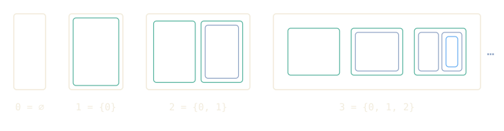
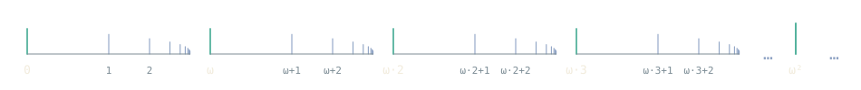

# Welcome to Grace17

Grace17 is a proof assistant for mathematics based on set theory. My aim is
for formally verified mathematics to feel like ordinary mathematical practice:
define a set, give it structure, construct maps, form subsets, products, and
quotients, and prove what follows using the familiar rules of first-order
logic and the <span class="note" tabindex="0" data-note="Actually, in Grace17 our default foundation with choice is ZFG, ZF with the Axiom of Global Choice, a convenient conservative extension of ZFC.">ZF(C)</span> axioms. There is one universe and one equality, so
everything you build now stays available to everything you build next.

; the stages are indexed by the ordinals.")

Set theory gives mathematics a singular ontology: every object lives in one
universe, and membership is the basic relation. The iterative conception
organizes this universe and gives us an intuitive picture of its structure.
Start from the empty set, form new sets from what is already there, and
continue through the transfinite. The result is the cumulative hierarchy, a
common setting for numbers, functions, spaces, structures and morphisms that leaves
mathematicians free to study each through its own properties. That
combination of unity and freedom is beautiful and powerful, and is to me the
gold standard foundation of classical mathematics.

<!-- cumulus-source: lib/Grace/Cumulus/Set/Hierarchy.g17 -->
```g17
noncomputable transfinite def V (α : Ordinal) : Set
  | 0 => ∅
  | succ β => 𝒫(V β)
  | limit λ => ⋃ { V β | β < λ }
```

Grace17 is <a class="profile" href="http://www.cl.cam.ac.uk/~gp351/" data-name="Grant Olney Passmore" data-photo="images/profiles/grant-passmore.jpg" data-line="www.cl.cam.ac.uk/~gp351" data-contact="Z3JhbnRAZ3JhY2UxNy5vcmc=">my</a> personal research project, and
it is evolving as I learn from
building it and proving theorems in it. The question I am investigating is
whether set theory in first-order logic, the foundation with which
mathematicians are most familiar, can support a modern, efficient, ergonomic
proof assistant for people and AI systems alike. That means "Mathematics 1.0,"
the everyday mathematics we write and teach, and also "Mathematics 2.0" in
Tao's sense: mathematics increasingly discovered with AI, where a proof may
arrive from a machine and the human work shifts to understanding it,
questioning it, and building the tools that make that understanding possible.

Formal proof is an essential component of trust in this new world, and it would
be a fine thing if new discoveries were formalized in both type theory and set
theory, each foundation illuminating the other. For that to happen, set theory
needs a modern, efficient, mainstream prover, and that is what Grace17 aims to
be: a system beautiful and powerful enough that set-theoretic formalization
becomes standard practice.

Please note: Grace17 is a research prototype, not a mature
industrial-strength system like Lean. Lean sets an extraordinary example: a
proof assistant that is also an industrial-strength programming language,
with the community and the library to match. Grace17 is not a
general-purpose programming language, though it does have a foundational
method for using efficient computation within set-theoretic proofs. Our
library, **Cumulus**, is tiny next to the largest libraries, but it is growing alongside the
language and the automation, so real proofs shape the system at a stage when
a single development can still change how it feels to use. If this sounds
like fun, I welcome your contributions.

## A place in a pluralistic mathematical world

Mathematics is better for having many foundations, tools, and habits
of thought. Grace17 welcomes mathematicians new to formal proof as well as
users of Lean, Mizar, ACL2, Isabelle, Rocq, PVS, Agda, Metamath, HOL Light,
HOL4, ProofPower, Naproche, and others to contribute and help us improve the
system.
Experience in any of those communities is useful here, and I hope ideas and
examples travel in both directions.

Grace17 draws on several traditions: readable formal proofs, small checkers
with explicit certificates, executable definitions, set-theoretic formalisms
with soft typing, and strong automation whose output can be checked
independently. What is particular here is bringing them together around set
theory, with human and AI participation designed in from the start.

Grace17 grows out of longstanding work in automated reasoning and formal
verification and a wish to bring set theory into the mainstream of formal
proof. I (<a class="profile" href="http://www.cl.cam.ac.uk/~gp351/" data-name="Grant Olney Passmore" data-photo="images/profiles/grant-passmore.jpg" data-line="www.cl.cam.ac.uk/~gp351" data-contact="Z3JhbnRAZ3JhY2UxNy5vcmc=">Grant Passmore</a>) have been inspired by many friends and collaborators,
including Bob Boyer, J Moore, Leo de Moura, Jeremy Avigad, Matt Kaufmann, Larry
Paulson, Natarajan Shankar, Sam Owre, Paul Jackson, Wenda Li, Marijn Heule,
Yves Bertot, Assia Mahboubi, Bas Spitters, André Platzer, Larry Wos, Michael
Beeson, Yuri Gurevich, Nikolaj Bjorner, Denis Ignatovich, András Salamon,
Christoph Wintersteiger, Simon Cruanes, Thomas Forster, Peter Koepke, Norm
Megill, John Harrison, Mike Gordon, Rob Arthan, Roger Bishop Jones, Robin
Milner, and many others. My design
decisions would not be the same without their work and ideas (though I must
take credit for all decisions they would disagree with! :-)).

## Mathematics in sets

Mathematical objects in Grace17 inhabit one universe of sets. A group has a
carrier set and operations, a function is a set of ordered pairs, a quotient
is a set of equivalence classes, and membership and equality are propositions
you use in proofs. `(A B x : Set)` introduces three arbitrary sets, and
`x ∈ A` says that one belongs to another. `Set` names the domain of discourse;
it does not assert that there is a set of all sets. Proper classes are
described by predicates.

Annotations such as `(x : Integer)` are **soft types**: the annotation is a
hypothesis that `Integer(x)` holds. Carrier conditions are inferred, proved,
and passed to theorems like any other mathematics, and automation discharges
them when the evidence at hand suffices.

Functions show the same idea at work. A function is a set of ordered pairs,
and `FunctionBetween(f, A, B)` says that `f` is one with domain `A` and
values in `B`. The binder `(f : A → B)` is soft-typing sugar for that
hypothesis, and `f : A → B` can also stand on its own wherever a formula
can. The automation makes the sugar seamless: `with *` finds the function
hypothesis when a library theorem needs it, `synthesize` builds facts such
as "the composite of `f : A → B` and `g : B → C` is a function `A → C`" from
the declared instances for composition, identity, and constant functions,
and `unfold FunctionBetween` exposes the set of pairs whenever a proof wants
to reason about it directly.

```g17
theorem value_in_codomain (A B x : Set) (f : A → B)
  requires hx : x ∈ A
  shows f(x) ∈ B
proof
  exact FunctionBetween.apply_closed with *
```

You write `x + y`, `A ⊆ B`, `f(x)`, and `∃ x ∈ A, P(x)` as usual. Scoped
notation lets the algebraic context fix which operations are meant.
Definitions and notation keep the underlying set constructions out of everyday
proofs while leaving them open to inspection.

A design question I care about is how to bring efficient computation into a
set-theoretic system in a fully foundational way, so that computing inside a
proof is natural and its correctness rests on the foundations. Matt Kaufmann's
ACL2(zf) has been a major influence on my approach.

## Try a first proof

The whole proof assistant runs in your browser, and nothing is sent to a
server. Each code block below has a Workbench button. Press it, move the
cursor through the proof, and watch the goals and hypotheses change. Hover
information, navigation, library search, and the Help panel are there for
exploring, and the Workbench opens any Cumulus module the same way. The
examples are collected in
[examples/Introduction.g17](../examples/Introduction.g17).

A complete small file with a basic set argument, the kind of reasoning
every mathematician does without thinking: if A is inside B and B is
inside C, then A is inside C.

```g17
module FirstSteps
import Grace.Cumulus.Set

theorem subset_transitive (A B C : Set)
  requires hab : A ⊆ B
  requires hbc : B ⊆ C
  shows A ⊆ C
proof
  intros x hx
  have hb := hab with x, hx
  exact hbc with x, hb
```

Read the statement as: let A, B, and C be sets; if A is a subset of B and B
is a subset of C, then A is a subset of C. `requires` names the hypotheses
and `shows` states the conclusion. The proof is the one you would give at a
blackboard. To show `A ⊆ C`, take an arbitrary element of A: `intros x hx`
names it `x` and names the fact `hx : x ∈ A`. A subset hypothesis says that
every element of the smaller set belongs to the larger one, so applying
`hab` to `x` and `hx` with `with` gives `x ∈ B`, recorded under the name
`hb`. Applying `hbc` the same way gives `x ∈ C`, which is the goal, and
`exact` closes it.

The module names the file. The namespace groups its declarations: inside it
the theorem is `subset_transitive`, and its qualified name is
`FirstSteps.subset_transitive`. Importing a module makes its definitions and
theorems available through their declared scopes.

## Building with existing mathematics

Cumulus already proves that inclusion is transitive. In the same context:

```g17
theorem subset_chain (A B C : Set)
  requires first : A ⊆ B
  requires second : B ⊆ C
  shows A ⊆ C
proof
  exact Subset.transitive with *
```

The goal and the local hypotheses determine the parameters and premises, and
`with *` asks for bounded automatic matching of the available evidence. You
can also write the application out:

```g17
  exact Subset.transitive at A, B, C with first, second
```

`at` supplies mathematical arguments and `with` supplies proofs of premises.
The explicit form is for when inference needs guidance; if several
interpretations fit, choosing the intended one is part of explaining the
mathematics to the system.

Proofs introduce local facts with `have`, take witnesses with `obtain`,
rewrite with `rw`, and present chains of equalities with `calc`. Sections share
variables and hypotheses across related theorems. See the
[theorem-section examples](../examples/TheoremSections.g17) and the
[algebraic hierarchy](algebra.md).

## Sets, naturally

Everyday set-theoretic reasoning is pleasant with familiar moves available
through basic tactics. An inclusion is proved by taking an arbitrary member, an
equation between sets by taking an arbitrary element of either side, and the
membership logic of `∅`, `∪`, `∩`, `∖`, `{x}`, and `𝒫` is settled by `simp`
from the hypotheses in play:

```g17 import=Grace.Cumulus.Set
theorem meet_commutes (A B : Set)
  shows A ∩ B = B ∩ A
proof
  ext y
  simp

theorem difference_mono (A B C : Set)
  requires h : A ⊆ B
  shows A ∖ C ⊆ B ∖ C
proof
  simp

theorem meet_below (A B : Set)
  shows A ∩ B ⊆ A
proof
  intros x hx
  obtain ⟨ha, hb⟩ := intersection.membership.forward with hx
  exact ha

theorem singleton_below (x A : Set)
  requires h : x ∈ A
  shows {x} ⊆ A
proof
  intros y hy
  have eq := singleton.membership.forward with hy
  rwa eq
```

`intros x hx` sees through the definition of `⊆`, a membership lemma applied
with `with` finds its parameters in the goal, `obtain` takes a conjunction or
an existential apart, and `rwa` rewrites and closes with a hypothesis. The
same forms carry over unchanged to functions, orders, numbers, and structures,
which the [Set Theory Game](../workbench/game.html) introduces one world at a
time.

## Natural reasoning with algebraic structures

A group in Cumulus is a set, a [structure](datatypes.md#structures) whose
fields are its carrier, its operation, its unit, and its inverse, with the
group laws as the `where` clauses:

<!-- cumulus-source: lib/Grace/Cumulus/Algebra/Group/Basic.g17 -->
```g17
structure Group
  | carrier : Set
  | mul : carrier × carrier → carrier
  | one : carrier
  | inv : carrier → carrier
  where
    mul_assoc : ∀ a b c ∈ carrier, mul(mul(a, b), c) = mul(a, mul(b, c))
    one_mul : ∀ a ∈ carrier, mul(one, a) = a
    mul_one : ∀ a ∈ carrier, mul(a, one) = a
    inv_mul : ∀ a ∈ carrier, mul(inv(a), a) = one
    mul_inv : ∀ a ∈ carrier, mul(a, inv(a)) = one
```

`Group(G)` then says that `G` is such a structure satisfying the laws, and
`G.carrier`, `G.mul`, `G.one`, and `G.inv` are projections giving you the
fields. The notation of group theory is declared once, to be supplied by that
hypothesis wherever it is in scope:

<!-- cumulus-source: lib/Grace/Cumulus/Algebra/Group/Basic.g17 -->
```g17
notation infixl 70 "*" => call2(G.mul, _, _) via hypothesis Group(G) for G.carrier
notation infixl 70 "*" => call2(G.mul, _, _) via hypothesis AbelianGroup(G) for G.carrier
notation postfix 90 "⁻¹" => apply(G.inv, _) via hypothesis Group(G) for G.carrier
```

So a development opens a section on a group,

<!-- cumulus-source: lib/Grace/Cumulus/Algebra/Group/Basic.g17 -->
```g17
section GroupLaws
variable (G : Set)
hypothesis group : Group(G)
```

and from then on a binder `(a b : G)` means membership in the carrier,
`a * b` is the operation, and `a⁻¹` the inverse. The cancellation law is a
three-line calculation:

<!-- cumulus-source: lib/Grace/Cumulus/Algebra/Group/Basic.g17 -->
```g17
theorem mul_left_cancel (a b c : G)
  requires equal : a * b = a * c
  shows b = c
proof
  calc
    b = a⁻¹ * (a * b) := by rw inv_mul_cancel_left
    _ = a⁻¹ * (a * c) := by rw equal
    _ = c := by rw inv_mul_cancel_left
```

Lagrange's theorem reads quite naturally. With a subgroup in scope,

<!-- cumulus-source: lib/Grace/Cumulus/Algebra/Group/Lagrange.g17 -->
```g17
section Lagrange
variable (G H : Set)
hypothesis group : Group(G)
hypothesis subgroup : Subgroup(H, G)
```

the order of a finite group is the index times the order of the subgroup,
because the group is the disjoint union of the cosets, each of the size of
the subgroup:

<!-- cumulus-source: lib/Grace/Cumulus/Algebra/Group/Lagrange.g17 -->
```g17
theorem lagrange
  requires finite : Finite(G)
  shows order(G) = index(G, H) * cardinality(H)
proof
  have finiteH := Subgroup.finite with *
  have finiteCosets := leftCosets.finite with *
  have subgroupNat := cardinality.nat with finiteH
  have cosetsNat := cardinality.nat with finiteCosets
  have indexNat := index.nat with *
  have blocks : ∀ C ∈ leftCosets(G, H), Finite(C)
    intros C hC
    exact leftCosets.member_finite with *
  have sizes : ∀ C ∈ leftCosets(G, H), cardinality(C) = cardinality(H)
    intros C hC
    exact leftCosets.member_cardinality with *
  have disjoint := leftCosets.pairwise_disjoint with *
  calc
    order(G) = cardinality(G) := order.value at G
    _ = cardinality(⋃(leftCosets(G, H))) := by rw leftCosets.cover
    _ = cardinality(leftCosets(G, H)) * cardinality(H) :=
      cardinality.big_union_constant with finiteCosets, blocks, disjoint, sizes
    _ = index(G, H) * cardinality(H) := by rw index.value
```

Rings are defined analogously, and under `CommRing(R)` the operations are
`x + y`, `x * y`, and `-x`, the ring's own numerals are `R[0]`, `R[1]`,
`R[2]`, and `ring` closes a polynomial identity from the laws supplied by
the hypothesis:

<!-- cumulus-source: examples/BundledRings.g17 -->
```g17
section Rings
variable (R : Set)
hypothesis ring : CommRing(R)

theorem square_sum (x y : R)
  shows (x + y) * (x + y) = x * x + R[2] * (x * y) + y * y
proof
  ring
```

An ideal is defined inside a section on the ring, so its definition is the
textbook one and is a formula over the projections of `R`:

<!-- cumulus-source: lib/Grace/Cumulus/Algebra/Ring/Ideal.g17 -->
```g17
section Definitions
variable (R : Set)
hypothesis ring : Ring(R)

predicate Ideal (I : Set) :=
  I ⊆ R ∧ R[0] ∈ I ∧ (∀ x y ∈ I, x + y ∈ I) ∧
  (∀ x ∈ I, -x ∈ I) ∧ (∀ a ∈ R, ∀ x ∈ I, a * x ∈ I ∧ x * a ∈ I)
predicate ProperIdeal (I : Set) := Ideal(I) ∧ R[1] ∉ I
predicate MaximalIdeal (M : Set) :=
  ProperIdeal(M) ∧ (∀ J, ProperIdeal(J) → M ⊆ J → J = M)
```

Under `Ideal(R, I)` a binder `(x : I)` is membership in the ideal and its
elements carry the ring notation, and the closure facts are instances, so
the automation finds them when a membership is needed:

<!-- cumulus-source: lib/Grace/Cumulus/Algebra/Ring/Ideal.g17 -->
```g17
instance Ideal.add_mem (x y : I)
  shows x + y ∈ I
proof
  obtain ⟨bounded, zeroIn, sums, negatives, products⟩ := ideal
  have xIn : x ∈ I by assumption
  have yIn : y ∈ I by assumption
  exact sums with x, xIn, y, yIn
```

<!-- cumulus-source: lib/Grace/Cumulus/Algebra/Ring/Ideal.g17 -->
```g17
instance Ideal.sub_mem (x y : I)
  shows x - y ∈ I
proof
  have xIn : x ∈ R := Ideal.mem_carrier with *
  have yIn : y ∈ R := Ideal.mem_carrier with *
  have negIn : -y ∈ I := Ideal.neg_mem with *
  rw Ring.sub.value
  exact Ideal.add_mem with *
```

A ring homomorphism is a hypothesis `f : R →+* S`,

<!-- cumulus-source: lib/Grace/Cumulus/Algebra/Ring/Homomorphism.g17 -->
```g17
section HomLaws
variable (f R S : Set)
hypothesis hom : f : R →+* S
```

<!-- cumulus-source: lib/Grace/Cumulus/Algebra/Ring/Homomorphism.g17 -->
```g17
theorem RingHom.map_add (a b : R)
  shows f(a + b) = f(a) + f(b)
```

the quotient by an ideal is `R ⧸ I`, and the first isomorphism theorem is
stated as a mathematician would state it, for a surjective homomorphism:

<!-- cumulus-source: lib/Grace/Cumulus/Algebra/Ring/FirstIsomorphism.g17 -->
```g17
theorem RingHom.first_isomorphism
  requires onto : SurjectiveBetween(f, R.carrier, S.carrier)
  shows inducedMap(f) : R ⧸ ker(f) ≃+* S
```

The closure facts above are instances, and an `instance` is a checked
theorem registered for bounded, proof-producing search; the
[complex ring development](../lib/Grace/Cumulus/Complex/Ring.g17)
registers the complex numbers as a commutative ring the same way:

<!-- cumulus-source: lib/Grace/Cumulus/Complex/Ring.g17 -->
```g17
instance complexes.comm_ring
  shows IsCommRing(ℂ)
```

`typecheck` discharges carrier and soft-type obligations from such
instances, `with *` supplies premises from them and from the hypotheses in
scope, and when a choice is ambiguous you make it explicit; see
[types and instances](types.md) and the [algebraic hierarchy](algebra.md).

## Certificates you can read

Proofs are natural deduction derivations, and they can be inspected and are
often quite readable. The Workbench shows the checked derivation of any
theorem under **Kernel proof**, in Fitch style with numbered lines and
assumption rails; here is the first proof above, rendered from its
certificate:

```g17-proof file=examples/Introduction.g17 theorem=Introduction.subset_step style=fitch
```

[Natural deduction certificates](natural-deduction.md) shows the same
derivation as a Gentzen tree, the derivation a tactic such as `ring`
produces for an identity, and how to open the derivation of any theorem in
Cumulus.

## A seamless path to the transfinite

The same language scales from small set arguments to transfinite
constructions, abstract algebra, and analysis. The excerpts below come from
Cumulus and its checked examples; each depends on its module's namespace,
imports, and surrounding context, so follow the source links for the complete
developments.

### Proper classes and the cumulative hierarchy

A collection need not be a set to have useful notation.
[Classes.g17](../lib/Grace/Cumulus/Set/Classes.g17) defines the universal class:

<!-- cumulus-source: lib/Grace/Cumulus/Set/Classes.g17 -->
```g17
class Universe (x : Set) := { x | x = x }
class Natural (x : Set) := Nat(x)
class MemberOf (x A : Set) := x ∈ A
class SubsetsOf (A : Class) := { X : Set | ∀ x ∈ X, x ∈ A }
class Inhabited (A : Set) := ∃ x, x ∈ A
```

`class` introduces a predicate on sets. `x ∈ Universe` is meaningful, but
`Universe` is not a set containing every set, and class equality is pointwise
equivalence. This gives class notation inside the set-theoretic foundation
without adding classes as objects. A `class` may describe a set-sized
collection or a proper class; the keyword alone does not say which.

The [ordinals](../lib/Grace/Cumulus/Set/Ordinal.g17) are described the same way:

<!-- cumulus-source: lib/Grace/Cumulus/Set/Ordinal.g17 -->
```g17
predicate Transitive (A : Set) := ∀ x ∈ A, (x ⊆ A)
class Ordinal (α : Set) := { α | Transitive(α) ∧ (∀ β ∈ α, Transitive(β)) }
```



With Foundation this is the von Neumann characterization of ordinals. An
annotation `(α : Ordinal)` supplies ordinal evidence; `α ∈ Ordinal` states the
same condition as a proposition.

The [cumulative hierarchy](../lib/Grace/Cumulus/Set/Hierarchy.g17) has its
usual definition by transfinite recursion:

<!-- cumulus-source: lib/Grace/Cumulus/Set/Hierarchy.g17 -->
```g17
noncomputable transfinite def V (α : Ordinal) : Set
  | 0 => ∅
  | succ β => 𝒫(V β)
  | limit λ => ⋃ { V β | β < λ }
```

A successor stage takes a powerset and a limit stage takes the union of the
earlier stages. The recursion is class-sized, but each value `V(α)` is a set:
the limit expression collects the earlier values over a set-sized ordinal by
Replacement. `noncomputable` marks a foundational definition with no
executable enumeration.



A Foundation-recursive ordinal bound witnesses that every set belongs to some
stage. The final theorem is short because the construction and its properties
are already proved:

<!-- cumulus-source: lib/Grace/Cumulus/Set/Hierarchy.g17 -->
```g17
theorem rank.exists (x : Set)
  shows ∃ α, α ∈ Ordinal ∧ x ∈ V(α)
proof
  refine ⟨rank(x), rank.ordinal at x, rank.membership at x⟩
```

Here `rank` is a sufficient ordinal height rather than the least one; what
matters is that every set occurs in the hierarchy. In class notation:

<!-- cumulus-source: lib/Grace/Cumulus/Set/Hierarchy.g17 -->
```g17
theorem CumulativeUniverse.eq_Universe
  shows CumulativeUniverse = Universe
proof
  apply CumulativeUniverse.eq_Universe_of_rank
  intro x
  exact rank.exists
```

`CumulativeUniverse` is the class of sets belonging to some `V(α)`, so the
identity says the hierarchy exhausts the universe of sets. The universe is
still a class.

### Choice and Zorn's lemma

[Zorn.g17](../lib/Grace/Cumulus/Set/Zorn.g17) proves the maximal-element
principle. `ZornCondition(A, r)` says `r` is a partial order on `A` and every
chain, the empty chain included, has an upper bound in `A`. The complete final
proof:

<!-- cumulus-source: lib/Grace/Cumulus/Set/Zorn.g17 -->
```g17
theorem Zorn.theorem (A r : Set)
  requires zorn : ZornCondition(A, r)
  shows ∃ m, Maximal(A, r, m)
proof
  obtain ⟨c, choice⟩ := SubsetChoice.exists at A
  by_contra none
  have noMaximal : NoMaximal(A, r)
    intros x hx maximal
    apply none
    witness x
    exact maximal
  have ordinal := hartogsBound.ordinal at A
  have injection := zornSequence.injective with *
  exact hartogsBound.no_injection with injection
```

Assuming there is no maximal element, the proof chooses successors, builds an
increasing transfinite sequence, and contradicts Hartogs' theorem: some
ordinal cannot inject into `A`. The construction lives in the preceding
lemmas. This proof uses choice, and the axiom audit shows the hereditary
dependency.

One application in the same file is the maximal-chain principle:

<!-- cumulus-source: lib/Grace/Cumulus/Set/Zorn.g17 -->
```g17
theorem Chain.exists_maximal (A r : Set)
  shows ∃ C, Chain(A, r, C) ∧ (∀ D, Chain(A, r, D) → C ⊆ D → D = C)
```

### The Banach–Tarski paradox

The axiom of choice has a famous consequence: the closed unit ball of ℝ³ can
be cut into finitely many pieces that reassemble, by rotations and
translations, into two balls. Cumulus proves it in the form of a paradoxical
decomposition. Under an action of a group `G` on a set `X`, two subsets are
equidecomposable when finitely many pieces of one are carried onto a
partition of the other by elements of `G`, and `X` is paradoxical when two
disjoint subsets are each equidecomposable with all of `X`:

<!-- cumulus-source: lib/Grace/Cumulus/Algebra/Group/Paradox.g17 -->
```g17
predicate Paradoxical (act G X : Set) :=
  ∃ A, ∃ B, A ⊆ X ∧ B ⊆ X ∧ Disjoint(A, B) ∧
    Equidecomposable(act, G, X, A, X) ∧ Equidecomposable(act, G, X, B, X)
```

The theorem for the ball, under the group `Motions` of orientation-preserving
isometries of ℝ³ acting on the space, is
[banachTarski](../lib/Grace/Cumulus/Geometry/BanachTarski.g17):

<!-- cumulus-source: lib/Grace/Cumulus/Geometry/BanachTarski.g17 -->
```g17
theorem banachTarski
  shows ∃ A, ∃ B, A ⊆ unitBall ∧ B ⊆ unitBall ∧ Disjoint(A, B) ∧
    Equidecomposable(motionAction, Motions, ℝ³, A, unitBall) ∧
    Equidecomposable(motionAction, Motions, ℝ³, B, unitBall)
```

The route is the classical one. The free group on two letters is built from
reduced words; two explicit rotations with entries 3/5 and 4/5 generate it
freely, by Swierczkowski's argument with integer vectors modulo 5, so no
trigonometry enters; the free group acts freely on the sphere minus the
countable set of points fixed by its nontrivial words, which gives
Hausdorff's paradox there; a rotation of infinite order absorbs that
countable set, so the sphere itself is paradoxical; cones carry the pieces
to the punctured ball, and a rotation about an off-center axis absorbs the
center. The step from the sphere minus the fixed points to the sphere itself
is a few lines once the pieces are in hand:

<!-- cumulus-source: lib/Grace/Cumulus/Geometry/Sphere/Paradox.g17 -->
```g17
theorem sphere.paradoxical
  shows Paradoxical(sphereAction, SO3, S²)
proof
  have action := sphereAction.action
  have subset := difference.subset_left at S², wordFixedSet
  have whole := sphere.absorb_any
    with wordFixedSet.countable, wordFixedSet.subset
  exact Paradoxical.of_equidecomposable
    with action, subset, whole, hausdorff.pieces
```

The axiom audit of `banachTarski` names the ZF axioms and the axiom of
choice, which is used exactly once, to pick one point in each orbit of the
free group.

### A few Top 100 milestones

The [Top 100](top-100.md) is a beautiful list of theorems across many areas
of mathematics, with Grace17 formalizations for a growing collection. I
welcome contributions!

**Fundamental Theorem of Algebra (No. 2).** Every nonconstant monic complex
polynomial has a root. In the coefficient-list representation the leading
coefficient 1 is implicit and `cs ≠ []` expresses nonconstancy:

<!-- cumulus-source: lib/Grace/Cumulus/Complex/FundamentalTheorem.g17 -->
```g17
theorem complexPolynomial.has_root (cs : List(ℂ))
  requires nonconstant : cs ≠ []
  shows ∃ a ∈ ℂ, complexPolynomial(cs)(a) = ℂ[0]
```

[Read the proof](../lib/Grace/Cumulus/Complex/FundamentalTheorem.g17).

**Infinitude of primes (No. 11).** Primes exceed every natural bound:

<!-- cumulus-source: lib/Grace/Cumulus/NumberTheory/Infinitude.g17 -->
```g17
theorem primes.order_unbounded (n : Nat)
  shows ∃ p ∈ primes, n < p
```

The same [development](../lib/Grace/Cumulus/NumberTheory/Infinitude.g17) proves
`¬Finite(primes)`, tying the order statement to set-theoretic infinitude.

**Fundamental Theorem of Calculus (No. 15).** Differentiating the integral of
a continuous function recovers the function at interior points:

<!-- cumulus-source: lib/Grace/Cumulus/Real/Analysis/Integration/FTCFirst.g17 -->
```g17
theorem FTC.derivative_of_integral (f : Set) (A B X : Real)
  requires continuous : ContinuousOn(f, closedInterval(A, B))
  requires left : A < X
  requires right : X < B
  shows HasDerivativeAt(integralFrom(f, A, B), f(X), X)
```

The integral is the Riemann integral on a real closed interval, and the
[development](../lib/Grace/Cumulus/Real/Analysis/Integration/FTCFirst.g17) also
proves the endpoint-difference form for continuous derivatives.

The catalogue also has the Pythagorean theorem, the uncountability of the
Dedekind reals, Bézout's identity, the mean value theorem, and
Cauchy–Schwarz, each with its stated scope. These developments double as
experiments in language design: substantial mathematics shows where notation,
inference, and automation still fall short.

## Foundations and choice

Like Lean and Metamath, Grace17 produces proof objects that independent
checkers can verify. There are checkers in Python, OCaml, and Rust alongside
the TypeScript implementation, each able to rebuild the whole library from the
bare axioms; formally verified checkers are a research goal, and the existing
ones are not yet verified.

The command line supports three profiles: **ZF**, **ZFC** (ZF with the Axiom
of Choice), and **ZFG** (with a global choice selector). The Workbench uses
ZFG. A theorem checked under ZFG may still have a proof that uses no choice
axiom, and the axiom audit reports local and hereditary dependencies so you can
tell what the environment permits from what a proof uses. The command line
needs a checkout of the repository and Node.js 24 or later. After `npm ci`,
this checks the introduction's examples and audits one of its theorems:

```sh
node bin/g17.ts check --foundation ZF --module-root lib examples/Introduction.g17
node bin/g17.ts axiom-audit --foundation ZF --module-root lib examples/Introduction.g17 --theorem Introduction.difference_of_squares
```

Definitions and set constructions have foundational obligations too, and
Grace17 checks the relevant declaration events. Checking a proof tape against
an exported environment and reconstructing that environment are different
validation tasks; the [foundation contract](foundations.md) and the
[independent checker documentation](../checkers/README.md) draw the
boundaries, and [checker semantics](checker-semantics.md) states what every
checker computes.

## Humans and AI working on the same mathematics

Humans and AI agents should be able to work together on the same mathematics in
a foundation that helps facilitate human intuition and understanding. Agents
should be able to inspect proof states, propose local changes, search a
library, and get precise feedback from a checker, and human readers should be
able to follow and review what comes out. Today Grace17 offers command-line
checking with JSON output, structured proof information, proof export, axiom
auditing, and library search, which are the building blocks for agent
workflows; the [guide for AI agents](agents.md) describes these interfaces and
a working loop for proving with them. Richer integrated assistance is part of
the research programme. Different tools and model providers can work with the
same checked mathematics. Humans remain responsible for choosing the
definitions and statements that capture what they mean.

## Where to explore next

Cumulus has developments in set theory, ordinals and cardinals, order theory
and lattices, lists, number theory, combinatorics, finite probability, group
theory, commutative algebra, linear algebra, Euclidean geometry, graph theory,
topology, metric spaces, real and complex analysis, category theory, fixed
point theorems, and game theory, among them the Fundamental Theorem of
Calculus, the Fundamental Theorem of Algebra, Brouwer's fixed point theorem,
Nash equilibria for finite games, and a concrete weak Nullstellensatz, and it
is growing rapidly. The checked source and the axiom audits give the precise
statements and assumptions.

- [The Set Theory Game](../workbench/game.html): a guided path from membership to uncountable sets, each level a checked theorem.
- [Top 100 catalogue](top-100.md): informal statements, formal statements, and proof links.
- [Erdős problem 397](erdos-397.md): a recent AI-found resolution, checked independently from the axioms.
- [Integer algebra](../examples/IntegerRingStarter.g17): small examples of polynomial reasoning.
- [Theorem sections](../examples/TheoremSections.g17): proofs with shared context.
- [Build your own library](external-libraries.md): separate projects and reproducible checks.
- [Library search](library-search.md): finding results and exploring their statements.
- [Workbench guide](workbench.md): editor and project workflows.
- [Notation guide](notation.md): mathematical notation and input.

Grace17 is still developing. Cumulus is much smaller than the mature libraries,
and some constructions still need more carrier and operation information than I
would like. Predictable inference, readable proofs, efficient checking, and a
dependable contributor experience are active work. It is truly an open question
whether or not the system I am dreaming of is possible at scale.
