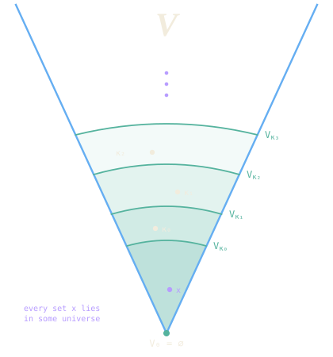
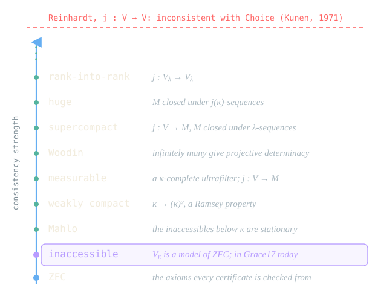
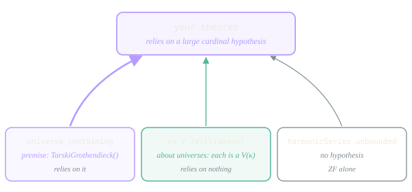

# Large cardinals

Set theory has a ceiling it cannot see past. Above every stage of the
cumulative hierarchy there is another, and ZFC proves that each one exists.
But some stages are so large that, standing on one, you would find a whole
universe of set theory below your feet, complete with its own hierarchy,
its own ordinals, and its own model of every axiom. ZFC cannot prove such a
stage exists. Large cardinals are the axioms that say it does, and they
form one of the most beautiful structures in mathematics: a single ladder
of ever stronger principles, ordered by consistency strength, rising toward
an inconsistency at the top.

Grace17 adds no large cardinal axiom. A theorem that needs one takes it as
a hypothesis, the certificate is a ZFC certificate of the implication, and
the axiom audit shows exactly which results rely on it. This page explains
what the hypotheses mean, how Cumulus states them, and how Grace17 keeps
track of them.

## A universe inside the universe


A cardinal κ is inaccessible when it is uncountable, cannot be reached from
below by a smaller number of smaller steps, and is closed under taking power
sets. At such a κ the stage V_κ is closed under everything ZFC can do. Its
members form a model of all the axioms, so the existence of κ proves that
ZFC is consistent. By Gödel's second incompleteness theorem, ZFC cannot
prove that, and so ZFC cannot prove that an inaccessible exists.

I find this one of the loveliest facts in logic. The universe of sets
contains, if it is large enough, perfect copies of itself.

## Grothendieck universes


Grothendieck needed universes to make category theory work: a category of
all groups, or all rings, is too large to be a set, but the category of all
groups inside a universe is a set, and nothing a working mathematician does
leaves it. Cumulus defines a Grothendieck universe directly, in
[`Grace.Cumulus.LargeCardinal.Universe`](../lib/Grace/Cumulus/LargeCardinal/Universe.g17):

```g17 fragment
predicate GrothendieckUniverse (U : Set) :=
  Transitive(U) ∧ ω ∈ U ∧ (∀ x ∈ U, ∀ y ∈ U, {x, y} ∈ U) ∧
  (∀ x ∈ U, 𝒫(x) ∈ U) ∧
  (∀ I ∈ U, ∀ f, FunctionBetween(f, I, U) → ⋃(functionImage(f, I, U)) ∈ U)
```

From these five clauses the module proves that U contains every natural
number, every ordered pair, product, function space, image, union,
intersection, and difference of its members. The two notions are one:
Williamson's theorem, `GrothendieckUniverse.eq_V`, says that every
Grothendieck universe is a stage V(κ), and
`GrothendieckUniverse.inaccessible` that the κ is inaccessible. Both are
proved under ZF, without Choice. Cumulus defines `Inaccessible(κ)` as an
ordinal κ above ω whose stage V(κ) is a universe; under ZFC this is
equivalent to the usual definition, which the module notes but does not
prove.

## Universes all the way up



The Tarski–Grothendieck axiom says that every set lies in some universe.
It is the foundation of Mizar, and it is what mathematicians reach for when
they want to talk about the category of all small categories, and then the
category of those. Mario Carneiro's thesis gives Lean's type theory a model
in ZFC together with, for each n, the existence of n inaccessible cardinals;
each type universe is read as a stage V_κ.

In Cumulus the axiom is a sentence, written applied to no arguments:

```g17 fragment
predicate TarskiGrothendieck := ∀ x, ∃ U, GrothendieckUniverse(U) ∧ x ∈ U
register largecardinal TarskiGrothendieck "every set lies in a Grothendieck universe"

predicate ExistsInaccessible := ∃ κ, Inaccessible(κ)
register largecardinal ExistsInaccessible "an inaccessible cardinal exists"
```

From it [`Grace.Cumulus.LargeCardinal.Axioms`](../lib/Grace/Cumulus/LargeCardinal/Axioms.g17)
proves that every set lies in V(κ) for some inaccessible κ, so the
inaccessibles are unbounded, and that `ExistsInaccessible()` is equivalent
in ZF to the existence of a single universe.

## The ladder



Inaccessibles are the first rung. Above them the hypotheses grow stranger
and stronger. A Mahlo cardinal has so many inaccessibles below it that they
form a stationary set. A weakly compact cardinal has a Ramsey property for
colorings of pairs. A measurable cardinal carries a two-valued measure,
equivalently an elementary embedding j of the universe V into an inner
model M, and Dana Scott showed that one already contradicts V = L. Woodin
cardinals give determinacy for projective sets of reals, and with it a
coherent theory of the real line that ZFC alone cannot settle.
Supercompact, huge, and rank-into-rank cardinals ask for embeddings with
ever more of V preserved, until at the top Kunen's theorem stops the
climb: with the axiom of Choice there is no nontrivial embedding of V into
itself.

What astonishes me is that these principles, invented for different
reasons by different people, line up in a single order. Each rung proves
the consistency of the ones below it, and the natural hypotheses found so
far have always turned out to compare.

Grace17 states the first rung today. The others can be stated the same way
when a development needs them.

## Hypotheses, never axioms

A large cardinal enters a Grace17 proof as a premise. The usual form is a
section hypothesis, so every theorem in the section takes it:

```g17 fragment
import Grace.Cumulus.LargeCardinal.Axioms

section WithUniverses
hypothesis TG : TarskiGrothendieck()

theorem powerset.in_universe (x : Set)
  shows ∃ U, GrothendieckUniverse(U) ∧ 𝒫(x) ∈ U
proof
  obtain ⟨U, universe, hx⟩ := TarskiGrothendieck.universe_containing at x with TG
  have power := GrothendieckUniverse.powerset with universe, hx
  exact ⟨U, universe, power⟩

end WithUniverses
```

The kernel checks this from the axioms of the chosen foundation, and the
certificate the independent checkers replay is a certificate of
`TarskiGrothendieck() → ∀ x, …`. Nothing in the kernel, the certificate
formats, or the checkers changes. The theorem holds in every model of the
foundation in which the hypothesis holds.

A module registers a predicate as a large cardinal hypothesis with
`register largecardinal`, as above. The registration changes no statement
and no proof. It tells the audit and the Workbench what to look for.

## What the audit says



The audit reports every registered hypothesis a result relies on, through
its statement or its proof:

- a premise that is a sentence such as `TarskiGrothendieck()`, or a property
  of something the conclusion does not mention: `Inaccessible(κ) → φ` with κ
  not in φ says that φ holds if some inaccessible exists;
- a lemma the proof uses that relies on one, through any number of steps;
- a lemma about inaccessibles or universes, used by a proof whose own
  statement never mentions them: the proof produced one from elsewhere.

A theorem whose premise is about something its conclusion mentions, such as
Williamson's theorem about every universe U, is a fact of ZF and relies on
nothing. On the command line:

```text
$ g17 axiom-audit lib/Grace/Cumulus/LargeCardinal/Axioms.g17 \
    --theorem Grace.Cumulus.LargeCardinal.Axioms.TarskiGrothendieck.inaccessible_containing
Axiom audit: Grace.Cumulus.LargeCardinal.Axioms.TarskiGrothendieck.inaccessible_containing (complete)
Hereditary named axioms: function.apply, set.empty, set.extensionality, set.foundation, set.infinity,
  set.infinity.minimal, set.pairing, set.powerset, set.union
Relies on a large cardinal hypothesis: every set lies in a Grothendieck universe
  (Grace.Cumulus.LargeCardinal.Axioms.TarskiGrothendieck), through
  Grace.Cumulus.LargeCardinal.Axioms.TarskiGrothendieck.inaccessible_containing
```

In the Workbench a completed proof that relies on a hypothesis carries a
violet badge naming it, and the audit panel lists each hypothesis with the
path to where the reliance starts. The JSON interface reports the same as
`largeCardinals`. The details are in [axiom audits](axiom-audit.md#large-cardinal-hypotheses).

## Large cardinals in the GRH port

The Lean proof of the Generalized Riemann Hypothesis that Grace17 is porting
uses Lean's universes in one region, its étale and Hodge cohomology, where
spaces are functors on the category of all rings. The rest of the proof
uses that region through theorems whose statements mention no universe.
The plan is to write the region over an admissible set of test rings, a
set closed under the constructions the region performs, obtained first from
`TarskiGrothendieck()` and then built in ZFC by closing a starting set of
rings under those constructions along ω. Until that second step the audit
shows the reliance on a universe all the way up to the final theorems.
After it, the certificate is a certificate from ZFC alone.
