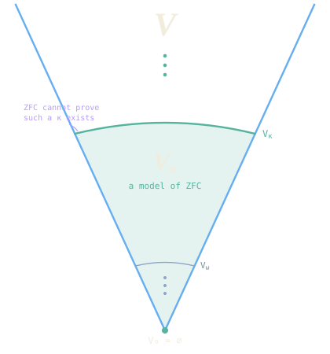
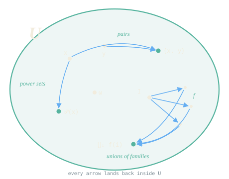

# Large cardinals

In set theory, a *large cardinal property* is a property of infinite
cardinals such that the existence of a cardinal with the property cannot be
proved in ZFC, assuming ZFC is consistent, and such that ZFC together with
its existence proves the consistency of ZFC. A *large cardinal axiom*
asserts that a cardinal with a given large cardinal property exists.

Large cardinal axioms are compared by *consistency strength*. A theory T is
at most as strong as a theory T′ when ZFC proves Con(T′) → Con(T). The large
cardinal axioms that arise in practice are, as far as is known, linearly
ordered by this relation, and each of them proves the consistency of the
ones below it. The hierarchy begins with the inaccessible cardinals and
ends, under the axiom of Choice, below the Reinhardt cardinals, which Kunen
showed to be inconsistent with ZFC.

Grace17 adds no large cardinal axiom to any of its foundations. A theorem
that needs one takes it as a hypothesis: its certificate is a certificate,
in the chosen foundation, of the implication from the hypothesis, and the
axiom audit records every result that relies on one. This page gives the
definitions, states what Cumulus proves about them, and describes how
Grace17 tracks them.

## Inaccessible cardinals



An infinite cardinal κ is *regular* if its cofinality is κ, that is, if κ is
not the supremum of fewer than κ smaller ordinals. It is a *strong limit*
if 2^λ < κ for every cardinal λ < κ. It is *(strongly) inaccessible* if it
is uncountable, regular, and a strong limit.

**Theorem.** If κ is inaccessible, then (V_κ, ∈) is a model of ZFC.

Since ZFC + "an inaccessible cardinal exists" therefore proves Con(ZFC), by
Gödel's second incompleteness theorem ZFC does not prove that an
inaccessible cardinal exists, unless ZFC is inconsistent. If κ is the least
inaccessible cardinal, then V_κ is a model of ZFC in which there is no
inaccessible cardinal, so ZFC + "there is no inaccessible cardinal" is
consistent relative to ZFC + "an inaccessible cardinal exists".

## Grothendieck universes



A *Grothendieck universe* is a set U such that

1. U is transitive: if x ∈ U and y ∈ x, then y ∈ U;
2. if x, y ∈ U, then {x, y} ∈ U;
3. if x ∈ U, then 𝒫(x) ∈ U;
4. if I ∈ U and f : I → U, then ⋃_{i ∈ I} f(i) ∈ U.

The sets ∅ and V_ω satisfy these conditions. Cumulus excludes them by also
requiring ω ∈ U. Universes were introduced by Grothendieck to give
category theory a set-theoretic foundation: for a universe U, the
U-small groups, rings, or schemes form a set, and the constructions of
ordinary mathematics applied to members of U yield members of U.

**Theorem.** A set U is a Grothendieck universe with ω ∈ U if and only if
U = V_κ for some strongly inaccessible cardinal κ. (ZFC)

Cumulus states the definition in
[`Grace.Cumulus.LargeCardinal.Universe`](../lib/Grace/Cumulus/LargeCardinal/Universe.g17):

```g17 fragment
predicate GrothendieckUniverse (U : Set) :=
  Transitive(U) ∧ ω ∈ U ∧ (∀ x ∈ U, ∀ y ∈ U, {x, y} ∈ U) ∧
  (∀ x ∈ U, 𝒫(x) ∈ U) ∧
  (∀ I ∈ U, ∀ f, FunctionBetween(f, I, U) → ⋃(functionImage(f, I, U)) ∈ U)
```

and proves, without Choice, that a universe is closed under ordered pairs,
products, function spaces, images, unions, intersections, and differences of
its members and contains every natural number. In
[`Grace.Cumulus.LargeCardinal.Inaccessible`](../lib/Grace/Cumulus/LargeCardinal/Inaccessible.g17)
it defines `Inaccessible(κ)` as: κ is an ordinal, ω ∈ κ, and V_κ is a
Grothendieck universe. It proves in ZF that every universe U equals V_κ for
κ the set of ordinals in U (`GrothendieckUniverse.eq_V`), and that this κ is
inaccessible in that sense (`GrothendieckUniverse.inaccessible`). Under ZFC,
`Inaccessible(κ)` is equivalent to κ being strongly inaccessible; that
equivalence is not proved in Cumulus.

## The Tarski–Grothendieck axiom


The *Tarski–Grothendieck axiom* states that every set is a member of some
Grothendieck universe. Over ZFC it is equivalent to the assertion that the
inaccessible cardinals form a proper class. Tarski–Grothendieck set theory,
ZFC together with this axiom (Tarski's axiom A, 1938), is the foundation of
the Mizar system. Type theories with a hierarchy of universes have
set-theoretic models of the same kind: Carneiro (2019) gives Lean's type
theory a model in ZFC together with, for each natural number n, the
existence of n inaccessible cardinals, interpreting each type universe as a
stage V_κ.

Cumulus states the axiom, and the existence of an inaccessible cardinal, as
sentences:

```g17 fragment
predicate TarskiGrothendieck := ∀ x, ∃ U, GrothendieckUniverse(U) ∧ x ∈ U
register largecardinal TarskiGrothendieck "every set lies in a Grothendieck universe"

predicate ExistsInaccessible := ∃ κ, Inaccessible(κ)
register largecardinal ExistsInaccessible "an inaccessible cardinal exists"
```

[`Grace.Cumulus.LargeCardinal.Axioms`](../lib/Grace/Cumulus/LargeCardinal/Axioms.g17)
proves that `ExistsInaccessible()` is equivalent in ZF to the existence of
a single universe, and that under `TarskiGrothendieck()` every set lies in
V_κ for some inaccessible κ, so that the inaccessible cardinals are
unbounded.

## Stronger large cardinals


The following properties are listed in increasing order of consistency
strength. Many of the stronger ones are defined by elementary embeddings
j : V → M of the universe into a transitive inner model M; the least
ordinal moved by j is its *critical point*.

- **Mahlo.** κ is inaccessible and the inaccessible cardinals below κ form
  a stationary subset of κ.
- **Weakly compact.** κ is uncountable and κ → (κ)²₂: every partition of the
  two-element subsets of κ into two classes has a homogeneous set of size κ.
- **Measurable.** There is a nonprincipal κ-complete ultrafilter on κ;
  equivalently, there is an elementary embedding j : V → M with critical
  point κ. Scott (1961) showed that if a measurable cardinal exists, then
  V ≠ L.
- **Woodin.** A property defined by elementary embeddings that reflect
  subsets of κ. If there are infinitely many Woodin cardinals, every
  projective set of reals is determined (Martin and Steel, 1989).
- **Supercompact.** For every λ ≥ κ there is j : V → M with critical point
  κ, j(κ) > λ, and M closed under sequences of length λ.
- **Huge.** There is j : V → M with critical point κ and M closed under
  sequences of length j(κ).
- **Rank-into-rank.** For some λ there is a nontrivial elementary embedding
  j : V_λ → V_λ.

A *Reinhardt cardinal* would be the critical point of a nontrivial
elementary embedding j : V → V. Kunen (1971) proved that no such embedding
exists in ZFC; the rank-into-rank axioms are among the strongest not known
to be inconsistent with ZFC.

Cumulus currently states the first rung, inaccessible cardinals and
universes. The others can be added as registered hypotheses in the same
way.

## Large cardinal hypotheses in Grace17

A large cardinal hypothesis enters a proof as a premise, usually as a
section hypothesis so that every theorem of the section takes it:

```g17 fragment
import Grace.Cumulus.LargeCardinal.Axioms

section WithUniverses
hypothesis TG : TarskiGrothendieck()

theorem powerset.in_universe (x : Set)
  shows ∃ U, GrothendieckUniverse(U) ∧ 𝒫(x) ∈ U
proof
  obtain ⟨U, universe, hx⟩ := TarskiGrothendieck.universe_containing at x with TG
  have power := GrothendieckUniverse.powerset with universe, hx
  exact ⟨U, universe, power⟩

end WithUniverses
```

The theorem the kernel records is `TarskiGrothendieck() → ∀ x, …`, a
theorem of the chosen foundation; the independent checkers replay its
certificate unchanged. It holds in every model of the foundation in which
the hypothesis holds. No kernel rule, axiom, certificate format, or checker
is involved.

A module declares that a predicate states a large cardinal hypothesis with
`register largecardinal`, as in the declarations above. The registration
changes no statement and no proof; it directs the axiom audit and the
Workbench.

## Reliance in the axiom audit


The audit reports a registered hypothesis H as relied on by a theorem when

- H occurs as a premise of the statement in a form that asserts existence:
  a sentence such as `TarskiGrothendieck()`, or a property H(κ) of a
  variable κ that the conclusion does not mention, since ∀κ (H(κ) → φ) with
  κ not free in φ is equivalent to (∃κ H(κ)) → φ;
- a theorem the proof uses relies on H; or
- the proof uses a theorem with a premise H(t) while its own statement does
  not mention H, so that it obtained an instance of H from elsewhere.

A theorem whose premise H(κ) concerns a variable its conclusion mentions,
such as `GrothendieckUniverse.eq_V`, is a theorem of ZF about objects with
property H and relies on no hypothesis; so is an equivalence between two
hypotheses. From the command line:

```text
$ g17 axiom-audit lib/Grace/Cumulus/LargeCardinal/Axioms.g17 \
    --theorem Grace.Cumulus.LargeCardinal.Axioms.TarskiGrothendieck.inaccessible_containing
Axiom audit: Grace.Cumulus.LargeCardinal.Axioms.TarskiGrothendieck.inaccessible_containing (complete)
Hereditary named axioms: function.apply, set.empty, set.extensionality, set.foundation, set.infinity,
  set.infinity.minimal, set.pairing, set.powerset, set.union
Relies on a large cardinal hypothesis: every set lies in a Grothendieck universe
  (Grace.Cumulus.LargeCardinal.Axioms.TarskiGrothendieck), through
  Grace.Cumulus.LargeCardinal.Axioms.TarskiGrothendieck.inaccessible_containing
```

The Workbench marks a completed proof that relies on a hypothesis with a
badge naming it and lists each hypothesis, with the path to where the
reliance begins, in the audit panel. The JSON interface reports the same
information as `largeCardinals`. See
[axiom audits](axiom-audit.md#large-cardinal-hypotheses).

## Universes in the GRH port

The Grace17 ZFC proof of the Generalized Riemann Hypothesis for Dirichlet
L-functions that <a class="profile" href="http://www.cl.cam.ac.uk/~gp351/" data-name="Grant Olney Passmore" data-photo="images/profiles/grant-passmore.jpg" data-line="www.cl.cam.ac.uk/~gp351" data-contact="Z3JhbnRAZ3JhY2UxNy5vcmc=">Grant Passmore</a>
is working on is porting the compressed Lean proof, which uses universe
levels in one region, its étale and Hodge cohomology. There a space is a
functor on the category of all commutative rings, and the Ext groups of
such functors are formed in a functor category one universe level higher.

In set theory the commutative rings form a proper class, not a set, and a
functor defined on a proper class is not a set either. Grothendieck's
answer was to work inside a universe U: the U-small rings form a set, the
functors on them are sets, and the category of those functors lies in a
larger universe. Read literally, the Lean argument therefore asks for one
Grothendieck universe, and so one inaccessible cardinal, for each universe
level it uses, as in Carneiro's model of Lean's type theory.

Passmore's port avoids them by bounding the rings instead of the
universe. The proof never evaluates its functors on arbitrary rings. Every
ring it uses is built from finitely many data by polynomial algebras,
quotients, localizations, finite products, tensor products, completions,
Witt vectors, tilts, perfect closures, and period thickenings, and applied
to rings of cardinality less than ℶ_ω each of these constructions yields a
ring of cardinality less than ℶ_ω. No product, colimit, or sheafification
in the region ranges over a proper class. The region is therefore
formulated over the rings whose carriers lie in V_{ω·2}:

- V_{ω·2} is a set, a stage of the cumulative hierarchy whose existence ZFC
  proves by the axiom of replacement. It is a model of Zermelo set theory.
- Every ring of cardinality less than ℶ_ω has an isomorphic copy with
  carrier in V_{ω·2}, since a set of cardinality ℶ_n embeds in V_{ω+n+1}.
- The class of these rings is closed under the constructions above, so the
  theorems the rest of the proof takes from this region hold for them
  exactly as stated.

The functors on these rings need room for their values. Ext is computed
from free covers and injective envelopes, which are sums and products
indexed by the whole category of test rings, and these leave V_{ω·2}. The
values therefore lie in a second stage V_θ, where θ is the Hartogs number
of V_{ω·2}, the least ordinal that does not inject into it. Under the axiom
of choice θ is the successor cardinal ℶ_ω⁺, which is regular, so V_θ is
closed under unions of families indexed by subsets of V_{ω·2}. V_θ plays
the part of the next universe level, but like V_{ω·2} it is a set that ZFC
proves exists: the category of test rings is small, the functors on it and
the Ext groups between them are sets in V_θ, and everything is formed in
ZFC.

Some notions in the region, such as a universally closed morphism of
schemes, quantify over all schemes. Such a definition is a formula about
the class of schemes, not a set built from it, and needs no universe.

This is an instance of a general phenomenon: a given argument uses only
boundedly many stages of the cumulative hierarchy, and McLarty (2020) shows
that the large structures of Grothendieck's cohomology can be founded this
way, without universes. Passmore's ZFC proof uses no large cardinal
hypothesis, and its certificate is to be a certificate from ZFC alone. Were
a large cardinal hypothesis to enter anywhere, the axiom audit would report
the reliance at every theorem above it, up to the main theorem.
