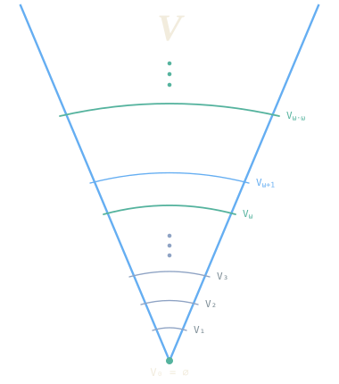

# Grace17 ordinals and the cumulative hierarchy

Ordinals are the backbone of a model of set theory. In Grace17, ordinals are
von Neumann ordinals: transitive sets of transitive sets, each one the set of
all smaller ordinals. The class is defined:

```text
predicate Transitive (A : Set) := ∀ x ∈ A, (x ⊆ A)
class Ordinal (α : Set) := { α | Transitive(α) ∧ (∀ β ∈ α, Transitive(β)) }
```

Foundation makes this standard “transitive set of transitive sets”
characterization equivalent to membership well-ordering. The core library
checks that the empty set is an ordinal, ordinal members are ordinals, the von
Neumann successor `α ∪ {α}` is an ordinal, and every computational
natural is an ordinal. `Ordinal` is this defined class.


## Finite hierarchy

Finite cumulative stages execute with the recursive evaluator:

```text
def finite (n : Nat) → Set
  | zero    => ∅
  | succ(n) => 𝒫(finite(n))
```


Thus evaluating `finite(3)` produces
`𝒫(𝒫(𝒫(∅)))`. Its successor membership theorem is
kernel checked:

```text
x ∈ finite(succ(n)) ↔ x ⊆ finite(n)
```

The library also proves that every `finite(n)` is transitive and that
`finite(n) ⊆ finite(succ(n))`. Both are checked theorems; the evaluator knows
nothing about them.

## Transfinite recursion

ZF Foundation and Replacement justify a conservative, noncomputable
class-recursion event. The surface form is:

```text
noncomputable transfinite def V (α : Ordinal) : Set
  | 0 => ∅
  | succ β => 𝒫(V β)
  | limit λ => ⋃ { V β | β < λ }
```



The limit comprehension is the range of a Replacement set containing the
earlier pairs `(β, V(β))`. The kernel installs no evaluator
body for `V`: finite executable work remains in `finite`, while proofs use the
checked `V.zero`, `V.next`, and `V.limit` laws.

Clause binders have lexical scope. A general limit clause may refer directly
to its index:

```text
| limit λ => limitStep(λ, history)
```

The elaborator alpha-renames `lambda` to the definition's kernel index before
the kernel checks its free variables. The history remains the only permitted
route to recursive values from earlier ordinals.

Before admitting the event, the kernel unfolds the supplied `Ordinal`, `Limit`,
and successor definitions and compares them with its canonical von Neumann
formulas. A locally redefined predicate that happens to be named `Ordinal` is
rejected, so the soft typing here adds nothing to the trusted foundation.

`Value`, `DomainThrough`, `StageClause`, `Approximation`, and `Stage` remain as
a first-order graph specification of bounded approximations to the recursion

```text
V(0)       = ∅
V(succ(β)) = 𝒫(V(β))
V(λ)       = ⋃ { V(β) | β ∈ λ }       when λ is a limit
```

Earlier approximation values are collected by a bounded Separation instance.
`CumulativeUniverse` collects membership across the set-valued stages.

`StageExists(α)`, `StageUnique(α)`, and
`HierarchyResolvedThrough(α)` name the exact transfinite-recursion proof
obligations. `Ranked` is the class of sets certified to occur at some ordinal
stage. The hierarchy library proves that every set belongs to it.

The Foundation library derives membership induction without a new kernel
rule. It builds `closure(x)` as the union of the Replacement image of the
finite iterates `singleton(x), union(singleton(x)), ...`, proves this set
transitive, and proves membership restricted to it well-founded. The tactic
`induction x using membership` expands to the existing well-founded-induction
proof rule. Using it, the hierarchy library checks `rank(x) ∈ Ordinal` for the
Foundation-recursive height

```text
rank(x) = next(union(range(rank.history(x))))
```

The remaining mathematics is also derived. Foundation gives membership
irreflexivity; nested membership induction gives ordinal trichotomy and the
zero/successor/limit cases. The transfinite recursion history then yields

```text
x ∈ V(λ) ↔ ∃ β ∈ λ, x ∈ V(β)
```

at limits. A single membership induction proves both `Transitive(V(β))` and
ordinal monotonicity of `V`, since those properties support one another at a
successor. Finally `rank.member_bound` places every member's rank below the
supremum used by `rank(x)`, and monotonicity proves the checked theorem
`rank.membership : x ∈ V(rank(x))`. So `CumulativeUniverse.eq_Universe` is
an unconditional theorem; no axiom or extra recursion principle is involved.

## Every set has a rank

The stages of the hierarchy exhaust the universe: every set lies in some
`V(α)`. In Cumulus this is the class equality
`CumulativeUniverse = Universe`, and the argument is a page of ordinary
mathematics over two transfinite definitions. This section walks through
it, with the proofs as they are checked in
[Hierarchy.g17](../lib/Grace/Cumulus/Set/Hierarchy.g17).

### Two recursions

The first definition is `V`, by recursion on the ordinals, as above. The
second is the rank function, by recursion on membership. Foundation makes
`∈` well-founded, so a definition may consult its own values at the members
of its argument; the keyword `foundation` asks for exactly that, and
`history` is the Replacement graph of those earlier values:

<!-- cumulus-source: lib/Grace/Cumulus/Set/Hierarchy.g17 -->
```g17
noncomputable foundation def rank (x : Set) : Set
  | x using history => next(⋃(Relation.range(history)))
```

So `rank(x)` is the successor of the supremum of the ranks of the members of
`x`. That it is an ordinal is the first theorem, by membership induction,
and that membership lowers rank is the second, which is the whole interface
a user of `rank` needs:

<!-- cumulus-source: lib/Grace/Cumulus/Set/Hierarchy.g17 -->
```g17
theorem rank.member (y x : Set)
  requires hy : y ∈ x
  shows rank(y) ∈ rank(x)
proof
  simp [rank.member_bound, rank.unfold]
```

`induction x using membership` is membership induction: the Foundation
library builds the transitive closure of `x` as the union of the finite
iterates of `⋃`, proves membership well-founded on it, and the tactic
expands to the kernel's well-founded induction rule.

### One induction for transitivity and monotonicity

The two facts about `V` that the rank argument needs are that each stage is
a transitive set and that the stages grow along the ordinals. Neither is
provable alone at a successor stage: `𝒫(V(β))` is transitive because `V(β)`
is transitive and contains the earlier stages, and `V(α) ⊆ 𝒫(V(β))` for
`α ≤ β` because the earlier stages are transitive. So they are proved
together, by one membership induction over the index:

<!-- cumulus-source: lib/Grace/Cumulus/Set/Hierarchy.g17 -->
```g17
theorem V.transitive_and_monotone (β : Set)
  shows β ∈ Ordinal → (Transitive(V(β)) ∧ (∀ α, α ∈ Ordinal → α ∈ next(β) → (V(α) ⊆ V(β))))
```

The proof is a case split on zero, successor, and limit, each case a few
lines of `simp` and `apply` over the three laws `V.zero`, `V.next`, and
`V.limit`; `V.transitive` and `V.monotone` read the two conjuncts off it.
At a limit, membership in the stage is membership in some earlier stage:

<!-- cumulus-source: lib/Grace/Cumulus/Set/Hierarchy.g17 -->
```g17
theorem V.limit_membership (x λ : Set)
  requires hLimit : Limit(λ)
  shows x ∈ V(λ) ↔ ∃ earlier ∈ λ, x ∈ V(earlier)
```

### The rank argument

Now we can prove that every set lies in the hierarchy, at the stage given
by its rank:

<!-- cumulus-source: lib/Grace/Cumulus/Set/Hierarchy.g17 -->
```g17
theorem rank.membership (x : Set)
  shows x ∈ V(rank(x))
proof
  induction x using membership
  intros current ih
  rw rank.unfold
  have hSupremumOrdinal := rank.supremum_ordinal at current
  have hSuccessorEquation := V.next with hSupremumOrdinal
  rw hSuccessorEquation
  apply set.powerset.backward
  intros member hMember
  have hMemberRanked := ih with hMember
  have hMemberBound := rank.member_bound with hMember
  have hMonotone := V.monotone at rank(member), ⋃(Relation.range(rank.history(current))) with rank.ordinal at member, hSupremumOrdinal, hMemberBound
  exact hMonotone with member, hMemberRanked
```

By membership induction, every member of `current` lies in the stage of
its own rank. `rank(current)` unfolds to the
successor of the supremum `s` of the members' ranks, and `V(next(s))` is
`𝒫(V(s))`, so it suffices that every member lies in `V(s)`. A member lies in
`V(rank(member))` by the induction hypothesis, its rank is at most `s` by
`rank.member_bound`, and `V` is monotone, which finishes. Nothing is hidden
in automation here: `simp` never runs, and each `have` names the fact it
uses.

### The universe is the hierarchy

`CumulativeUniverse` is the class of sets that occur at some stage, and
`Universe` the class of all sets. Classes are predicates on sets, so an
equality between them is an extensional statement that the kernel checks
pointwise:

<!-- cumulus-source: lib/Grace/Cumulus/Set/Hierarchy.g17 -->
```g17
class CumulativeUniverse (x : Set) := { x | ∃ α, α ∈ Ordinal ∧ x ∈ V(α) }
```

<!-- cumulus-source: lib/Grace/Cumulus/Set/Hierarchy.g17 -->
```g17
theorem rank.exists (x : Set)
  shows ∃ α, α ∈ Ordinal ∧ x ∈ V(α)
proof
  refine ⟨rank(x), rank.ordinal at x, rank.membership at x⟩
```

<!-- cumulus-source: lib/Grace/Cumulus/Set/Hierarchy.g17 -->
```g17
theorem CumulativeUniverse.eq_Universe
  shows CumulativeUniverse = Universe
proof
  apply CumulativeUniverse.eq_Universe_of_rank
  intro x
  exact rank.exists
```

The witness for the existential is the rank itself. The axiom audit of
`CumulativeUniverse.eq_Universe` lists the ZF axioms, Foundation among
them, and nothing else: no choice, no reflection, no extra recursion
principle. The two recursion keywords, `transfinite` and `foundation`, are
not axioms either. Each is justified once, by Replacement and
well-foundedness, and the kernel admits a recursive definition only after
unfolding the `Ordinal`, `Limit`, and successor predicates it was given and
comparing them with its own von Neumann formulas.

## Cantor's derived sets

The ordinals were discovered in 1872, in Cantor's study of the sets on which a
trigonometric series can fail to determine its coefficients. The derived
set of a set of reals is the set of its limit points; the derived set of
the derived set is a smaller set again; and Cantor saw that the iteration
need not stop at any finite stage, which is where the transfinite
indices come from. The theorem that grew out of this, the Cantor–Bendixson
theorem, says that every closed set of reals is a perfect set together with
a countable set. Cumulus proves it for every space with a countable base,
by the same two moves as the rank argument above: a transfinite recursion,
and an induction along it. The modules are
[Topology/CantorBendixson](../lib/Grace/Cumulus/Topology/CantorBendixson.g17)
and [Topology/Real/CantorBendixson](../lib/Grace/Cumulus/Topology/Real/CantorBendixson.g17).

### The iteration

`derivedSet(X, T, A)` is `limitPoints(X, T, A)`, the points of `X` every
open neighbourhood of which meets `A` elsewhere. The stages are a
transfinite recursion, with intersection at limits:

<!-- cumulus-source: lib/Grace/Cumulus/Topology/CantorBendixson/Iterate.g17 -->
```g17
noncomputable transfinite def derived (X T A : Set, α : Ordinal) : Set
  | 0 => A
  | succ β => derivedSet(X, T, derived(X, T, A, β))
  | limit λ => ⋂(Relation.range(history))
```

The three laws `derived.zero`, `derived.next`, and `derived.limit` state
the three clauses as equations, and at a limit a point survives exactly
when it survives every earlier stage:

<!-- cumulus-source: lib/Grace/Cumulus/Topology/CantorBendixson/Iterate.g17 -->
```g17
theorem derived.limit_membership (X T A x λ : Set)
  requires limit : Limit(λ)
  shows x ∈ derived(X, T, A, λ) ↔ ∀ β ∈ λ, x ∈ derived(X, T, A, β)
```

For a closed set the stages are closed and decrease along the ordinals
(`derived.closed`, `derived.decreasing`), each by one induction over the
index.

### Why the iteration stops

A point leaves at stage `γ` when it is isolated in `derived(γ)`: some basic
open set `W` meets that stage in the point alone. The same `W` cannot
witness two departures, at the same stage or at different ones, because the
stages decrease:

<!-- cumulus-source: lib/Grace/Cumulus/Topology/CantorBendixson/Stabilise.g17 -->
```g17
theorem derived.witness_injective (X T A B γ δ x y W : Set)
  requires topology : IsTopology(X, T)
  requires basis : Basis(X, T, B)
  requires closed : IsClosed(X, T, A)
  requires hGamma : γ ∈ Ordinal
  requires hDelta : δ ∈ Ordinal
  requires hW : W ∈ B
  requires first : W ∩ derived(X, T, A, γ) = {x}
  requires second : W ∩ derived(X, T, A, δ) = {y}
  shows γ = δ ∧ x = y
```

So if the base `B` is countable, the stages cannot keep dropping for
uncountably many steps. Hartogs' bound `hartogsBound(B)` is the least
ordinal that does not inject into `B`; if every stage below it dropped, the
witnesses would give such an injection. The proof picks each witness as the
one of least code under the injection of `B` into ℕ, so no choice is used:

<!-- cumulus-source: lib/Grace/Cumulus/Topology/CantorBendixson/Stabilise.g17 -->
```g17
theorem derived.stabilises (X T A B : Set)
  requires topology : IsTopology(X, T)
  requires basis : Basis(X, T, B)
  requires closed : IsClosed(X, T, A)
  requires countable : Countable(B)
  shows ∃ γ ∈ hartogsBound(B),
    derived(X, T, A, next(γ)) = derived(X, T, A, γ)
proof
  obtain ⟨g, code⟩ := countable
  by_contra none
  have hBound := hartogsBound.ordinal at B
  have ordinals : ∀ γ ∈ hartogsBound(B), γ ∈ Ordinal
    intros γ hγ
    exact Ordinal.member with hBound, hγ
  have offered : ∀ γ ∈ hartogsBound(B), ∃ W ∈ B,
      relates(stageDrops(X, T, A, B, hartogsBound(B)), γ, W)
    intros γ hγ
    have hGamma := ordinals with γ, hγ
    have strict : derived(X, T, A, next(γ)) ≠ derived(X, T, A, γ)
      intro equal
      apply none
      exact ⟨γ, hγ, equal⟩
    obtain ⟨W, hW, x, trace⟩ := stageDrops.offered with
      topology, basis, closed, hGamma, strict
    witness W
    constructor
    . exact hW
    . apply stageDrops.relates.backward
      exact ⟨hγ, hW, x, trace⟩
  have separated := stageDrops.separated with topology, basis, closed, ordinals
  have injective := leastCoded.injective with code, offered, separated
  exact hartogsBound.no_injection with injective
```

The Cantor–Bendixson rank is the least stable stage, and the kernel is the
stage there:

<!-- cumulus-source: lib/Grace/Cumulus/Topology/CantorBendixson/Stabilise.g17 -->
```g17
def stableStages (X T A : Set) : Set :=
  { γ ∈ hartogsBound(T) | derived(X, T, A, next(γ)) = derived(X, T, A, γ) }
```

<!-- cumulus-source: lib/Grace/Cumulus/Topology/CantorBendixson/Stabilise.g17 -->
```g17
def cantorBendixsonRank (X T A : Set) : Set := ⋂(stableStages(X, T, A))
```

<!-- cumulus-source: lib/Grace/Cumulus/Topology/CantorBendixson/Stabilise.g17 -->
```g17
def perfectKernel (X T A : Set) : Set :=
  derived(X, T, A, cantorBendixsonRank(X, T, A))
```

### The theorem

A perfect set is a closed set equal to its derived set, a closed set
without isolated points:

<!-- cumulus-source: lib/Grace/Cumulus/Topology/CantorBendixson/Theorem.g17 -->
```g17
predicate Perfect (X T P : Set) := IsClosed(X, T, P) ∧ derivedSet(X, T, P) = P
```

<!-- cumulus-source: lib/Grace/Cumulus/Topology/CantorBendixson/Theorem.g17 -->
```g17
theorem cantorBendixson (X T B A : Set)
  requires topology : IsTopology(X, T)
  requires basis : Basis(X, T, B)
  requires closed : IsClosed(X, T, A)
  requires countable : Countable(B)
  shows Perfect(X, T, perfectKernel(X, T, A)) ∧
    perfectKernel(X, T, A) ⊆ A ∧ Countable(A ∖ perfectKernel(X, T, A))
```

The kernel is perfect because it is a stable stage; it lies in `A` because
the stages decrease; and the points of `A` outside it each left at some
stage below the rank, with a witness in `B`, so they inject into `B` and
are countable. The rank itself is a countable ordinal
(`cantorBendixson.rank_countable`). The axiom audit of every one of these
theorems lists the ZF axioms and nothing else.

### On the real line

The open intervals with rational endpoints are a countable base of the
real topology (`rationalIntervals.basis`, with the density of ℚ in ℝ proved
from the cut structure of the reals), so the theorem specialises:

<!-- cumulus-source: lib/Grace/Cumulus/Topology/Real/CantorBendixson.g17 -->
```g17
theorem reals.cantorBendixson (A : Set)
  requires closed : IsClosed(ℝ, realTopology, A)
  shows Perfect(ℝ, realTopology, perfectKernel(ℝ, realTopology, A)) ∧
    perfectKernel(ℝ, realTopology, A) ⊆ A ∧
    Countable(A ∖ perfectKernel(ℝ, realTopology, A))
```

<!-- cumulus-source: lib/Grace/Cumulus/Topology/Real/CantorBendixson.g17 -->
```g17
theorem closed.countable_or_perfect_part (A : Set)
  requires closed : IsClosed(ℝ, realTopology, A)
  shows Countable(A) ∨
    (∃ P, Nonempty(P) ∧ Perfect(ℝ, realTopology, P) ∧ P ⊆ A)
```

This is Cantor's beautiful conclusion, obtained with the power of the
ordinals: a closed set of reals is countable or contains a nonempty perfect
set. You might find it as thrilling as I do to click "Open in Workbench" on
any of the snippets above to follow the argument yourself!
